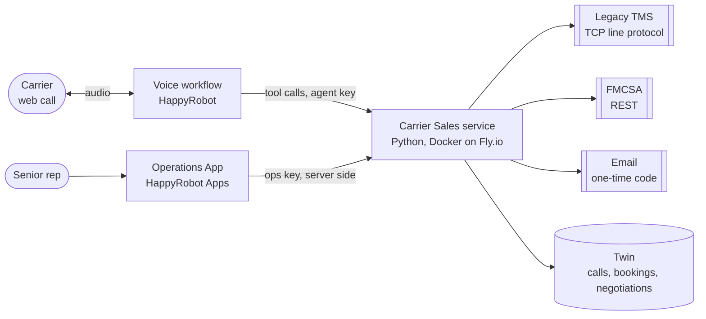

# Architecture

How the parts fit together and which rules the code enforces. The [full architecture](docs/reference/architecture.md) has the data shapes, sequence diagrams and every edge case; the [decision log](docs/reference/decision-log.md) records why each choice was made.

## Parts

| Part | Owns |
| --- | --- |
| Voice workflow | The conversation: web-call trigger, AI disclosure, prompt, six tools, end-of-call report |
| Carrier Sales service | Every decision: verification, pricing, negotiation, reservations, the TMS and FMCSA connections, rep actions |
| Twin | All saved state: one row per call, per booking and per carrier/load negotiation, each with its own event history |
| Operations App | What operations sees and does: KPIs, call history, the reservation queue, Confirm and Decline |

The TMS stays the source of truth for loads. Twin records what this system did. The App reads through the service, so every rule lives in one place.

## A call

1. **Verify.** `verify_carrier` checks FMCSA. `send_code` emails a code to the configured inbox (never to an address the caller gives). `verify_code` marks the call verified in the same write that uses up the code.
2. **Match.** `find_loads` searches the TMS only if the call is verified, reads each load's details, holds back loads whose text is not on the approved list, and prices the rest.
3. **Negotiate.** `negotiate` answers each counter. Money decisions are made in the service; the voice model only relays them.
4. **Reserve.** An agreement claims the load in one conditional write to its booking row, so only one call can hold a load.
5. **Close.** `close_call` saves the outcome and notes. The workflow reports when the call ended.
6. **Confirm.** A rep assigned in the App confirms the exact version of the reservation they reviewed. The service rechecks the shipment, the ceiling and the carrier's verification, then sends `LOAD_BOOK` once.

## Rules the code enforces

Tests check these whatever the model says.

| Rule | Meaning |
| --- | --- |
| INV-1 | No rate above `max_rate` is ever offered or accepted. Confirm rereads the ceiling. |
| INV-2 | `max_rate` never reaches the voice agent. Load fields pass through an allowlist. |
| INV-3 | No load details before FMCSA eligibility and a verified code on that call. |
| INV-4 | At most three counter rounds per call, across every load. |
| INV-5 | The expected code never reaches the workflow. |
| INV-6 | One active reservation per load, one agreement per call. |
| INV-7 | `LOAD_BOOK` only after a rep's Confirm, at most once, never resent. |
| INV-8 | Every endpoint requires authentication, including health. |
| INV-9 | Every call and booking state change and its audit event are saved in the same write. (A shared negotiation quote lowered to a new cap is updated without a new event.) |
| INV-10 | Each handled booking reply is kept as received, so the rep sees what the TMS actually said. A crash before it is saved can lose it. |

The service cannot control what the model says. A misheard amount inside the limits can become a reservation, which is why a rep reviews every reservation before anything is sent.

## Data

Twin is the only datastore, as the brief requires. The SQL interface used here is called one statement at a time, without a cross-table transaction. Each row therefore holds its own state and events, and every write checks the row's version.

| Table | One row per | Holds |
| --- | --- | --- |
| `calls` | Call (`run_id`) | MC, authority, code state, offers, rounds, agreement, outcome, notes, events |
| `bookings` | Load | Who holds it, at what rate and shipment terms, rep decision, TMS receipt, events |
| `negotiations` | Verified MC and load | Standing offer, best ask, rounds used, so redialing does not reset the negotiation |

## Failure handling

- **TMS.** Reads retry within the twelve-second voice deadline, then report "temporarily unavailable". A booking that times out is recorded as `UNKNOWN` and never resent, because a timeout does not say whether it landed. Malformed frames are refused, not guessed.
- **FMCSA.** An outage is "unavailable", never "inactive carrier".
- **Twin.** All statements share a conservative four-per-second pacer, chosen after rate-limit observations on this integration. This is our operating budget, not a universal Twin limit. A conflicting write rereads and decides again.
- **Repeats.** A repeated tool call is answered from stored state, so retries cannot buy an extra round or a second reservation.

## Security

- Separate agent and operations keys, compared in constant time, each opening only its own endpoints. No public API docs.
- Only reps listed by their HappyRobot identity can Confirm or Decline; a viewer can only look.
- The model never receives the ceiling, the expected code, contact details or raw TMS replies. It only passes on the code the caller speaks, and the service checks it.
- Secrets live in Fly and HappyRobot secret stores; `.env.example` lists names only.

## Code layout

| Path | Contents |
| --- | --- |
| `service/core/` | Pure business rules: pricing, negotiation, codes, carrier policy, load checks. No I/O. |
| `service/adapters/` | TMS (TCP), FMCSA, Twin and email clients |
| `service/*.py` | Orchestration: API, calls, selling, reservations, rep actions, dashboard snapshot |
| `ops-app/` | Next.js App on HappyRobot Apps |
| `happyrobot/` | Live voice prompt, tool bindings and evaluation results |
| `tools/` | Build gates and the local review launcher |

## Deployment

One Docker image. `make deploy APP=<fly-app> APP_URL=<app-url>` deploys to Fly.io after one-time resource and secret setup, then checks authenticated health and TMS reachability. `make review` runs the whole system locally. Details and rollback: [release guide](docs/reference/release.md).
