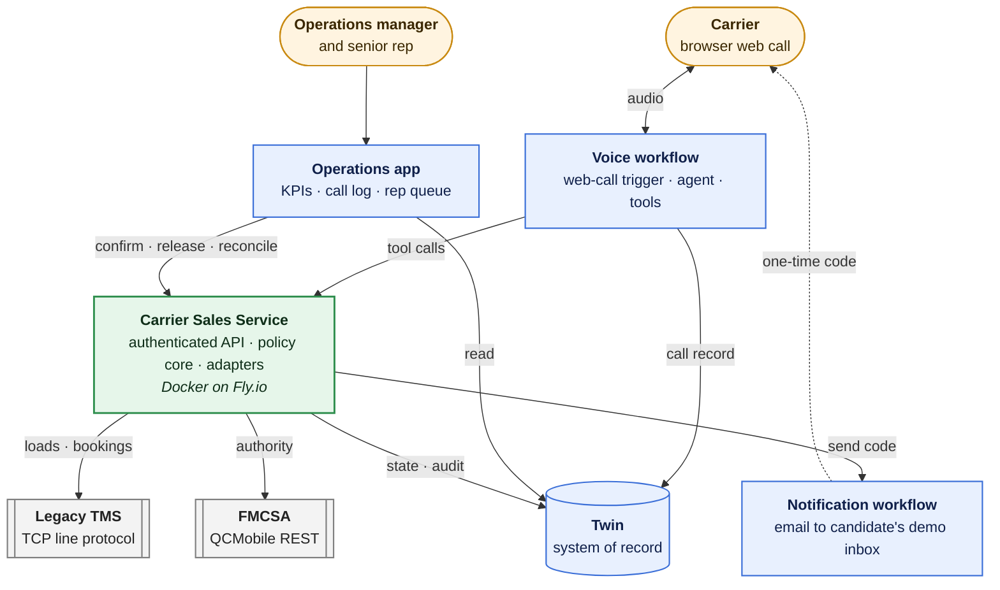
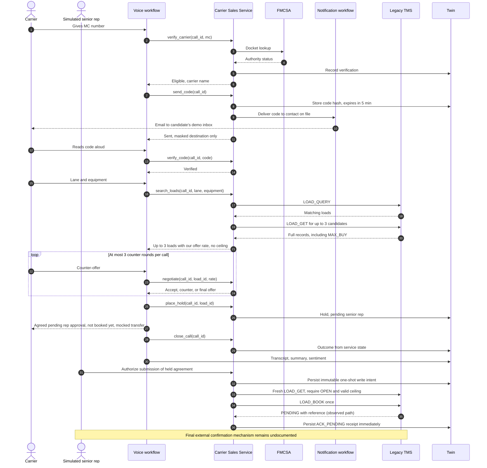
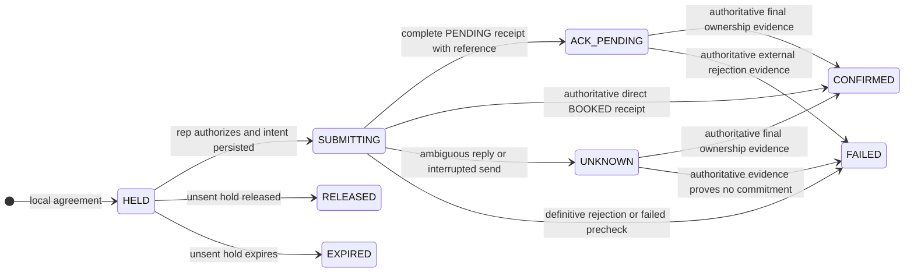

# Inbound Carrier Sales: Architecture

| | |
|---|---|
| **Version** | 2.2 · 2026-10-31 |
| **Status** | Build design, not an implementation report. Incorporates bounded live booking evidence and distinguishes acknowledged pending, confirmed and unknown. D-8 to D-10 remain candidate assumptions; T-1 to T-4 still need integration validation or their fallback. See [`docs/agent-onboarding.md`](docs/agent-onboarding.md) for current state. |
| **Scope** | Proof of concept for HappyRobot Logistics' inbound carrier desk (see [`FDE_Technical_Challenge_-_Inbound_Carrier_Sales.pdf`](FDE_Technical_Challenge_-_Inbound_Carrier_Sales.pdf), summarized in [`PROJECT_GUIDE.md`](PROJECT_GUIDE.md)). |
| **Supersedes** | [`Archive/Claude_ProposedArchitecture.md`](Archive/Claude_ProposedArchitecture.md), [`Archive/Codex_ProposedArchitecture.md`](Archive/Codex_ProposedArchitecture.md) |

**Clarification source:** Luke's reply on 2026-10-30 (Australia/Sydney), linked in `Questions.Md`. Fly.io and personal-email OTP are confirmed acceptable. The walkthrough is for the brokerage's business team; creative additions are optional and should provide client value. The archived proposals remain historical records.

**Design evidence:** [`Research.Md`](Research.Md) records industry input, Perplexity research, source checks and the decisions they informed. The four components remain unchanged; [sanitized TMS evidence](docs/tms-contract.md#booking-experiments-2026-10-31) updates booking recovery and amount handling below. Unless explicitly identified as observed evidence, the components, endpoints, guarantees and tests in this document are planned requirements, not verified deployed behavior.

---

## 1. Summary

A carrier opens a HappyRobot web call. A voice agent collects the MC number, the carrier is checked against FMCSA, completes the demo email-code check, hears matching loads from the legacy TMS, negotiates, and, once a rate is agreed, is handed to a (mocked) senior rep. Under candidate timing policy D-8, the rep authorizes one TMS submission from the planned operations app. An acknowledged `PENDING` request remains pending; local approval does not supply the undocumented external finalization step.

The design has one rule that everything else follows from:

> **The model talks; the service decides.** The voice agent can *ask* for any action. A small backend service, the **Carrier Sales Service**, decides whether that action is allowed, using state it stores itself. The service enforces verification and pricing regardless of what the model claims; the model never receives the rate ceiling or expected code.

Four parts, each with one job:

| Part | Runs on | Owns |
|---|---|---|
| **Voice workflow** | HappyRobot | The conversation: web-call trigger, inbound agent, prompt, tools. |
| **Carrier Sales Service** | Docker on Fly.io | Rules and integrations: verification, negotiation, holds, TMS and FMCSA access. |
| **Twin** | HappyRobot | The single system of record for what happened on every call. |
| **Operations app** | HappyRobot Apps | What the operations manager sees and does: KPIs, call history, the senior-rep queue. |

The TMS stays the source of truth for loads and bookings. Twin records what *our* solution did.

---

## 2. System overview



Read top to bottom: people → what they touch → the service that decides → what it depends on. **Blue** is HappyRobot, **green** is the service we build and run, **grey** is the customer's and government systems.

**Trust boundaries.** Every arrow into the service is authenticated, and each caller has its own key: the voice workflow (agent key) and the operations app (ops key). Agent requests must also bind to a trusted runtime call identity, not a model-supplied `call_id` alone (T-4). The service uses a third key to trigger the notification workflow. The web-call trigger and the app sit behind HappyRobot sign-in. Our TMS and FMCSA integrations run through the service.

---

## 3. A call, end to end

The happy path. Every step can end the call early; the possible endings are listed in §6.7.



`call_id` is supplied by the workflow runtime, never generated by the model (T-4).

---

## 4. Invariants

These are requirements for the implementation. The planned service must enforce them independently of the prompt, with the tests in §9. Current diagnostics and the offline lab do not establish these guarantees for a deployed system.

| ID | Invariant |
|---|---|
| **INV-1** | No rate above `max_rate` is ever offered or agreed, and `LOAD_BOOK` is only sent against a ceiling read from the TMS. |
| **INV-2** | `max_rate` (provisionally mapped from TMS `MAX_BUY`, D-10) never appears in anything the voice agent can see, and no spoken price is a fixed percentage of it. Every offer and acceptance target comes from the versioned pricing policy (§6.5) and is validated below the ceiling. |
| **INV-3** | No load details are returned until the service's own record shows FMCSA eligibility **and** a verified code for that call. A model-supplied "verified" is ignored. |
| **INV-4** | At most 3 counter rounds per call, counted across every load discussed on that call. |
| **INV-5** | The expected code never reaches the voice workflow. It is sent only to the destination on file for that carrier, or in the demo to the configured demo inbox (D-12), never to an address or number the caller provides. |
| **INV-6** | A load has at most one active hold. Its in-flight, acknowledged-pending or unknown booking attempt keeps it blocked. |
| **INV-7** | A booking request is never blindly resent. A complete reference-bearing `PENDING` receipt is **ACK_PENDING**; ambiguous transport/framing is **UNKNOWN**; only authoritative final evidence is **CONFIRMED**. |
| **INV-8** | Every endpoint requires authentication, including health checks. No public API docs. |
| **INV-9** | Retrying the same operation ID and inputs on the same call returns its recorded result or pending status instead of acting twice. Reusing an ID with different inputs is rejected. |

---

## 5. Requirements traceability

| Requirement (PDF) | Where it is met | How it is verified |
|---|---|---|
| FMCSA authority check (p.2) | §6.3 `verify_carrier` | Unit + live check with the recorded test MCs (§6.3) |
| OTP after authority, before matching; no bypass (p.4-5) | §6.3, INV-3, INV-5 | Adversarial suite: social engineering |
| Load match by lane and equipment (p.2) | §6.4 `search_loads` | Conversation tests |
| Never exceed or disclose `max_rate` (p.4) | §6.5, INV-1, INV-2 | Property tests + adversarial probing suite |
| ≤3 counter rounds, then close without transfer (p.5) | §6.5, INV-4 | Unit + conversation tests |
| Tentative reservation, mocked handoff (p.2-3) | §6.6 | End-to-end demo |
| Log MC, load, rate, outcome, notes (p.3) | §6.7 Twin (the TMS has no logging command) | Twin records after each test call |
| All call activity in Twin (p.4) | §6.7, including dropped calls and transcripts | Integration test: a call that drops mid-way still has a record |
| Operations UI in Apps (p.4) | §6.8 | Demo |
| Graceful TMS timeouts and malformed responses (p.3) | §6.2, §8 | Fault-injection tests against a fake TMS |
| Authentication on all endpoints (p.5) | §7, INV-8 | API tests: every route rejects missing keys |
| KPIs, scripted, edge and adversarial tests (p.4) | §9 | `docs/qa-results.md` |
| Docker, single-command cloud deploy (p.4) | §10 | `make deploy` |
| Web call only, no phone number (p.5) | §6.1 | Browser demo; no number provisioned |

---

## 6. Components

### 6.1 Voice workflow (HappyRobot)

- **Trigger:** web call with HappyRobot's enhanced security (sign-in) left on.
- **Agent:** short, direct turns for drivers on the road. The prompt walks a fixed order, identify → verify → code → match → negotiate → hold → handoff, and refuses to skip steps or discuss the ceiling. The prompt is the *first* line of defence; the service is the one that holds.
- **Tools:** one webhook tool per agent-facing endpoint. The workflow runtime, not the model, supplies `call_id` and operation IDs (T-4). The Tool Call Result node exposes only fields the agent may say out loud.
- **Handoff:** the agent confirms the agreed rate is subject to senior-rep approval and the load still being available, and says plainly it is **not booked yet**. Transfers don't work on web calls, so it then announces a mocked transfer and ends; the hold appears in the operations app's rep queue.
- **After the call:** the workflow closes the call with the service, which sets the outcome, then stores the transcript and an AI summary, notes and sentiment (§6.7).
- **Source control:** the workflow is built in the HappyRobot workspace through the HappyRobot MCP (installed locally, not part of the repo). Its export or sanitized snapshot, prompts and test definitions must be committed under the planned `happyrobot/` path when built. That path does not exist yet; the current external workflow snapshot and identifiers are in [onboarding](docs/agent-onboarding.md#current-state).

### 6.2 Carrier Sales Service

One Python 3.12 / FastAPI program, a modular monolith, with an async TCP client for the TMS and an HTTP client for everything else. It keeps no database of its own: all state lives in Twin.

| Endpoint | Caller | Requires | Does |
|---|---|---|---|
| `POST /carriers/verify` | Agent | Authenticated call | Normalizes the MC number, checks FMCSA, records the result. |
| `POST /otp/send` | Agent | FMCSA eligible | Issues a code to the contact on file (§6.3). Max 2 sends per call. |
| `POST /otp/verify` | Agent | Code issued | Checks the spoken code. Max 3 attempts, then locked for the call. |
| `POST /loads/search` | Agent | Code verified | `LOAD_QUERY` by lane and equipment, then `LOAD_GET` on up to 3 candidates in parallel for full details and the ceiling; accepts only explicitly `OPEN`, future-eligible loads and drops local blocked inventory; returns them with our opening offer. Records the request when nothing matches (§6.4). |
| `POST /negotiate` | Agent | Code verified | Applies the negotiation policy (§6.5) to the carrier's rate. |
| `POST /holds` | Agent | Agreed rate on this load | Places the hold (§6.6). |
| `POST /calls/{id}/close` | Workflow, after the call | Known call | Sets the outcome from service state (§6.7). |
| `GET /holds` | Ops app | Ops authentication | Rep queue. |
| `POST /holds/{id}/confirm` | Ops app | Unsent hold active | Local approval to submit: re-checks and sends once, then records `ACK_PENDING`, `CONFIRMED`, rejection or `UNKNOWN` (§6.6). The route name does not imply external finalization. |
| `POST /holds/{id}/release` | Ops app | Unsent hold active | Releases only the local unsent hold; never pending/unknown inventory. |
| `POST /holds/{id}/reconcile` | Ops app | Pending or unknown attempt | Read-only search for authoritative evidence; retains review/blocking if ownership or finality cannot be proven. |
| `GET /health` | Fly.io | Key | Liveness and TMS reachability (`DEBUG_ECHO`). |

**Agent-facing responses** always return HTTP 200 with a `status` field (`ok`, `otp_required`, `tms_unavailable`, …) so the agent can say something sensible. HTTP errors are reserved for authentication and malformed requests.

**The TMS adapter** turns the legacy line protocol into typed results:

| What the TMS does | What the adapter does |
|---|---|
| Responds normally, fields padded, in any order | Parses by key, trims padding, ignores unknown fields. |
| Times out, closes slowly, or sends a partial frame (no whole CRLF-terminated `END` line) | Reads (`LOAD_QUERY`, `LOAD_GET`): up to 2 retries with jittered backoff inside a ~6 s budget, then `tms_unavailable`. |
| Sends a malformed frame, a line over 4096 bytes, or a reply over a separate total size limit | Treated as a failed read; same retry rule. Never crashes, never guesses. |
| Returns `ERR\|CODE:…` | Mapped to a typed error the policy core understands. |
| Complete `LOAD_BOOK` receipt with matching load, reference and `STATUS:PENDING` | Persist the receipt immediately as `ACK_PENDING`, not confirmed and not a transport ambiguity. |
| Complete direct receipt with matching load, reference and `STATUS:BOOKED` | Recognize `CONFIRMED`; this handbook-shaped path has no observed live example yet. |
| `LOAD_BOOK` times out, is malformed, or returns `ALREADY_BOOKED` without an earlier identifying receipt | **No resend.** Retain `UNKNOWN` and operator review. A duplicate error must not overwrite an already recorded pending/confirmed receipt. |

When the TMS is down, the agent says so and offers a callback. It never pitches cached or invented loads.

**Field mapping.** The adapter owns the one mapping from TMS fields to the PDF's load fields, recorded with the T-2 evidence in `docs/tms-contract.md`; the rest of the service uses PDF names only. Known so far: `RATE` → `loadboard_rate` (posted price, per the handbook) and `MAX_BUY` → `max_rate` (D-10).

### 6.3 Verification and the one-time code

1. **Authority.** FMCSA QCMobile docket lookup. Eligible only if FMCSA shows the carrier allowed to operate, with active common or contract carrier authority (broker-only authority does not qualify), and not out of service. FMCSA errors return `fmcsa_unavailable`; the call cannot continue unverified. Luke supplied no test MC numbers. The [test-carrier ledger](docs/test-carriers.md) is currently unpopulated: select and verify an authorized carrier, an inactive/revoked carrier and a nonexistent MC before claiming live FMCSA coverage. The handbook-example MC used in TMS probes was not FMCSA-vetted.
2. **Code issue.** The service generates a 6-digit code, stores only a keyed hash with a 5-minute expiry in Twin, and triggers a separate, authenticated **Notification workflow** in HappyRobot that delivers it through an email integration (point 4 says where). The voice workflow receives only `sent`, the email channel, and a masked destination.
3. **Code check.** The code the carrier reads aloud *does* pass through the voice system, that is unavoidable, but it is compared against the stored hash in the service, in constant time, with an attempt limit.
4. **Where the code goes (D-12).** The service first looks for the carrier's trusted contact in Twin `carriers`. Luke allowed the candidate's personal email for the demo, so the service also has a **demo inbox setting**: when it is set, any FMCSA-eligible carrier with no contact on file gets its code there.
   - The setting is configuration, never caller input, and is left unset in production.
   - Any real, active MC therefore works in the demo, and the inbox can be pointed at a reviewer's address so they can complete a call themselves.
   - The email proves access to the demo inbox, not a real carrier's identity. Enrolling real carrier contacts is outside this POC. Records and the app therefore say *code passed*, never *carrier identity verified*, and the write-up does not describe MC number plus email code as multi-factor authentication.
   - With the setting unset and no contact on file, the call ends as `no_trusted_contact` and is flagged for human follow-up, with no live transfer.
5. **Returning carriers.** Require a fresh code on every call before matching. This is candidate assumption D-9, chosen under Luke's instruction to document assumptions; he did not confirm which OTP scope is intended.
6. **Challenge lifecycle.** Bind each challenge to the trusted call identity, MC, destination version and purpose. Consume it atomically on success. Resending invalidates the previous code without resetting the 3-attempt budget; retain the 2-send limit and throttle repeated requests across calls by MC and destination. Verification expires with the call or a configured authentication timeout.
7. **MC changes.** Invalidate previous authority, OTP and carrier-specific selections or agreements. Keep the call's counter-round and failed-code budgets. A carrier change cannot reset either limit.

### 6.4 Load search

Normalizes origin/destination and equipment type, using only established query fields. Live TMS city matching was case-insensitive/partial, while state/equipment inputs required uppercase. Returned matches must be checked locally. It matches equipment (with aliases such as *van* → *dry van*, *reefer* → *refrigerated*). `LOAD_QUERY` has returned `PENDING` records, so require explicit `OPEN`, valid future pickup and no blocked local attempt before ranking. Results are ranked by pickup time; at most three are offered, one at a time, by the agent. Each carries the carrier-facing load fields from the PDF and our **opening offer**, never `max_rate`, and never the posted rate where the posted rate is above what we can pay. The agent reads load notes, such as loading or waiting terms, as written and negotiates price only; anything unclear is flagged on the hold for the rep.

**Turned-away demand (D-13).** When nothing matches, the service records what the carrier asked for (lane, equipment, pickup date) in Twin `unmet_demand`. The operations app totals it by lane and week, so the team can see which capacity it turned away and source loads against it. It costs one table and one dashboard panel, and turns a lost call into a sales lead.

### 6.5 Negotiation policy

The broker pays the carrier, so the carrier pushes up and we concede toward a configured pricing target below the confidential ceiling.

**Rate assumption (D-10):** provisionally map `MAX_BUY` from `LOAD_GET` to the PDF's `max_rate`. Luke did not confirm this mapping, currency/scale or full rate bounds. The 2026-10-31 live sample supports exact positive whole native numeric values and canonical integer text; `.00` was accepted but a nonzero fractional value was rejected. See the bounded [evidence](docs/tms-contract.md#booking-experiments-2026-10-31). No further write probe is needed just to start the adapter/domain build. A TMS rejection cannot justify exceeding or disclosing the internal ceiling.

**Ceiling availability (D-11).** All 302 full records in the read-only 2026-10-30 study carry `MAX_BUY` for our token ([`docs/tms-contract.md`](docs/tms-contract.md)), so no stand-in ceiling is needed. A load whose `MAX_BUY` is missing or unusable goes to `pricing_review_required`: no offers, no booking. A percentage of posted `RATE` never substitutes for it.

- **Pricing policy (D-4).** A versioned policy file in the service, owned by the brokerage, turns each load's posted `RATE` and validated ceiling into three numbers, all rounded down to increments of 25 whole native units (a demo policy amount, not proof of dollar/cents scale):
  - **Working cap:** the ceiling minus a load-specific gap drawn from a configured band (initially 2-6 % of the ceiling). It is the highest number we say and the highest ask we accept.
  - **Opening offer:** the posted rate minus the configured opening discount, when that leaves room below the cap; otherwise a load-specific spread below the cap, drawn from a second band (initially 8-15 %).
  - **Round targets:** set fractions of the way from opening to cap, one per round (initially 35 %, 65 %, 100 %).

  Both draws use a keyed seed: an HMAC of the load ID and policy version under a server secret. The same load gives the same numbers on every call, so calling back gains nothing, and knowing the policy without the secret does not reveal the gap. Every number is validated below the ceiling before use. If the ceiling is missing or invalid, or the cap does not sit above the opening offer, the load goes to `pricing_review_required`; nothing is improvised during the call. The secret lives in Fly secrets, and the policy version is stored on every call.

  In the live records read so far, posted rates sit below `MAX_BUY`, so most openings come from the posted rate; the handbook samples show the opposite, which the second branch covers.
- **Rounds:** each carrier counter advances to the next round target. An ask at or below that target is accepted at the carrier's number. Our round-3 response is the final offer, at the cap; anything other than acceptance ends the call politely as `negotiation_failed`, with no transfer.
- **Counting:** rounds are per call, across loads (INV-4).
- **"It's posted at more."** Carriers may cite the posted rate. The agent states our offer without explaining internal pricing; the cited figure counts as a counter and stays bound by the cap.
- **Exact amounts:** use exact decimal/integer arithmetic, require finite positive whole native numeric values, then emit canonical integer text. Reject unsupported fractions without rounding the agreement. Do not introduce a dollars-to-cents conversion until currency/scale is established; whole-number acceptance does not prove final settlement or server ceiling enforcement.

**What this protects, and what it costs.** A fixed percentage is invertible: if the cap were always 97 % of the ceiling, the ceiling would be the cap ÷ 0.97. The keyed per-load gap removes that formula, and anchoring openings on the posted rate keeps them independent of the ceiling wherever the posted rate allows. Some leakage is unavoidable: wherever the cap binds, there is an accept/reject boundary below the ceiling, and repeated probing can narrow it. Confidentiality is therefore a tested property, not a guarantee: the adversarial suite probes it directly and across calls (§9), and the bands are tuned on the results.

The cap also has a cost. A carrier whose last ask falls between the cap and the ceiling is turned away, although the PDF (p.2) would accept that rate. We accept that loss to keep the ceiling hard to probe, and measure it as *deals lost to the cap* (§9) so the band can be narrowed if it costs too many loads.

### 6.6 Holds, handoff and booking

A **hold reserves the load inside our application only.** It suppresses our own offers without reserving external TMS inventory. The planned submission re-checks explicit `OPEN`, schedule and ceiling. `PENDING` was observed after real submissions, including in search results; it must stay excluded from fresh offers.



The reconciliation arrows describe future evidence-handling requirements, not a supplied TMS confirmation command. No live transition to `BOOKED` or carrier/rate ownership readback has been observed. Keep local rep approval, documentation readiness and raw TMS status as separate facts.

- **Before sending:** atomically claim one attempt and persist approved MC, load, exact whole rate and immutable agreement version. Re-read availability/ceiling and agreement expiry. Local operation IDs prevent duplicate application actions; the TMS documents no idempotency key.
- **Receipt handling:** persist the complete direct response/reference before downstream work. A valid `PENDING` receipt is `ACK_PENDING`; transport/framing ambiguity is `UNKNOWN`. A direct matching `BOOKED` receipt may establish `CONFIRMED`, but current real fixtures contain no such receipt. A status-only read or `ALREADY_BOOKED` alone proves neither finality nor carrier/rate ownership.
- **No resend:** pending/unknown, interrupted sends and stale subsequent `OPEN` reads never authorize another booking send. The historical exact replay was a separately authorized experiment, not a retry policy. Duplicate actions return recorded state. Late results cannot downgrade newer authoritative resolution.
- **Expiry/release:** only an unsent local hold may expire after 30 minutes (demo setting) or release normally. In-flight, `ACK_PENDING` and `UNKNOWN` attempts stay blocked across restarts and cleanup until authoritatively resolved. Preserve operator escalation during routine polling.
- **Resolution:** pending/unknown outcomes require read-only reconciliation and operator review if no authoritative evidence is available. Operators may annotate/escalate but cannot unblock a potentially sent attempt using a local audit flag alone. Unblocking requires recorded authoritative outcome/ownership evidence. Never-sent or definitively rejected attempts may use an audited local resolution/renegotiation path; neither the offline lab nor local approval supplies external finalization or cancellation.
- **Test inventory:** the [evidence ledger](docs/tms-contract.md#booking-test-inventory) records four acknowledged-pending disposable loads and three protected demo IDs. No cancel/reset mechanism was established; never assume an acknowledged load can be reused.
- **Candidate timing policy D-8:** retain local agreement/hold, simulated rep authorization, then one submission as the current default. This limits writes before approval; Luke did not require this timing, and the lab did not prove it superior. Submitting at agreement is an alternative policy requiring an explicit decision, not another TMS capability. A complete pending acknowledgement can represent the tentative first-layer milestone for the demo, with finalization left unresolved and honestly labelled. A mocked finalization, if shown separately, must be called simulated and excluded from real confirmed metrics.

### 6.7 Data model (Twin)

| Table | One row per | Key fields |
|---|---|---|
| `carriers` | Known carrier | MC, DOT, legal name, trusted contact, how the contact was verified |
| `calls` | Call | trusted call ID, started at, MC, eligibility, code verified until, failed-code/send budgets, first offer at, counter rounds used, selected load, agreed rate, pricing-policy version, **outcome**, closed at |
| `call_transcripts` | Call | call ID, transcript, AI summary, notes, sentiment |
| `call_events` | Tool operation | call ID, operation ID, action, request fingerprint, state, result, latency, error |
| `otp_challenges` | Code issued | call ID, MC, destination version, purpose, code hash, expiry, consumed at, delivery status |
| `negotiation_rounds` | Carrier counter | call ID, load ID, round, carrier ask, our response |
| `holds` | Hold | load ID, call ID, MC, exact whole rate, agreement version, expiry, state (§6.6), rep approval, documentation readiness, raw TMS status, reference, review flag and evidence |
| `booking_attempts` | Booking attempt | unique attempt ID, hold ID, approved immutable snapshot, send/receipt state, started at, acknowledgement/reference, raw TMS status and authoritative identifying evidence |
| `unmet_demand` | Search with no match | call ID, MC, origin, destination, equipment, pickup date, searched at |

**Who writes what.**

- **The service writes every authoritative fact as it happens:** MC, eligibility, code result, offers, rounds, agreed rate, holds and booking attempts. A call that drops halfway still has an accurate record.
- **At the end of the call** the workflow calls `close`, and the service sets the outcome from its own state. A call never closed (dropped, or a failed workflow run) is closed by the service as `caller_ended` after 30 minutes without activity.
- **The post-call step** stores the transcript and an AI summary, notes and sentiment in `call_transcripts`. These describe the call; they never overwrite service fields. A call with no transcript is flagged in the call log.

**Call outcomes** (set by the service): `agreed_pending_rep`, `negotiation_failed`, `no_match`, `carrier_ineligible`, `fmcsa_unavailable`, `code_failed`, `no_trusted_contact`, `pricing_review_required`, `tms_unavailable`, `caller_ended`. Booking status is not a call outcome; it lives on the hold (§6.6), because local approval/submission and external final status are separate from the conversation outcome.

Together, `call_events`, `negotiation_rounds` and `call_transcripts` are the audit trail: what was said, offered and agreed, in order, one of the customer's stated problems.

### 6.8 Operations app (HappyRobot Apps)

Built from the Apps Next.js template. It reads Twin through the server-side gateway behind the app's own sign-in, and calls the service with the ops key for actions, so rules are enforced in one place.

- **Overview:** the business KPIs first (§9), in the brokerage's terms: calls answered, time to first offer, ceiling compliance and headroom, dispatcher time saved. Then the northstar, guardrails and outcome funnel.
- **Rep queue:** unsent holds awaiting submission approval, plus distinct acknowledged-pending and unknown queues. Approve submission, release unsent holds, reconcile, or annotate/escalate pending/unknown outcomes. Require authoritative evidence before unblocking a potentially sent attempt; show flagged notes and actual TMS status.
- **Call log:** each call's summary, outcome, rounds and notes, linked to its events and transcript. This is the audit trail the brokerage said it lacks.
- **Carriers:** each carrier's calls, offers, bookings and reasons for no agreement, so the team can spot recurring mismatches (D-14).
- **Turned-away demand:** lanes and equipment carriers asked for when nothing matched, by week (D-13).
- **System health:** TMS and FMCSA error rates, pending/unknown attempts and operator-review flags.

---

## 7. Security

- **Authentication everywhere.** Three bearer keys, voice workflow, operations app, notification workflow, compared in constant time. A key only opens its own endpoints. `/health` needs a key too; Fly's health check sends it. FastAPI's `/docs`, `/redoc` and `/openapi.json` are switched off.
- **Least information to the model.** The agent never receives `max_rate`, the expected code, full contact details, or raw TMS frames.
- **Secrets** live in Fly secrets and HappyRobot's credential store, never in the repository. `.env.example` lists names only.
- **Social engineering.** No path skips verification: the gate is in the service, not the prompt. The code's destination comes from Twin or the demo inbox setting, never from the conversation. The adversarial suite (§9) covers urgency, claimed authority, "my dispatcher already verified me", alternative contact numbers, and prompt injection.
- **Call isolation.** A shared workflow key authenticates the workflow, not the carrier or call. Derive call identity from trusted runtime context or a server-issued scoped credential, then reject mismatched state access. Confirm the platform mechanism in T-4.
- **Logs.** Codes, contact details and the ceiling are kept out of service logs. Whether HappyRobot run logs of the notification workflow show the code must be checked (T-3).

---

## 8. Reliability and concurrency

- **Latency budget.** Each tool call aims for under 2 s typical and is cut off at about 8 s; the agent uses a short filler line while waiting. Twin round trips count against this budget (measured in T-1), and search runs its `LOAD_GET` calls in parallel.
- **Duplicates.** Assign a stable operation ID outside model-generated arguments (T-4), and store it with the trusted call identity, inputs and result. Reuse it for retries; use a new ID for a new action, even when the inputs match. Reject changed inputs under an existing ID (INV-9).
- **Simultaneous requests.** Run one service instance for simplicity, with per-call and per-load locks. Correctness also requires durable atomic claims and conditional updates in Twin for round budgets, OTP consumption, holds and booking attempts (T-1). In-memory locks alone do not cover restarts or deployment overlap. If Twin cannot support this, document the native limitation and resolve it before claiming these guarantees.
- **Recovery.** Persist state transitions before external side effects. Recover interrupted in-flight sends as unknown without resending; preserve known pending receipts. Never clear pending/unknown inventory or review flags merely because a timer, poll or process ended.

---

## 9. Quality: KPIs and tests

**Northstar KPI, booked loads per verified call.** Authoritatively confirmed bookings divided by calls that passed the code check. Keep acknowledged tentative submissions/handoffs as a separate first-layer KPI, never relabel `PENDING` or simulated finalization as confirmed. Real confirmed-booking count may remain zero while the external finalization contract is unresolved.

**Business KPIs.** The walkthrough is a business review, so each KPI answers one of the problems the brokerage described (PDF p.1), and they lead the dashboard:

| Customer problem | KPI | Definition |
|---|---|---|
| Missed calls and long hold times | Calls answered; after-hours share; time to first offer | Every web call answered by the agent; share of calls outside configured Chicago business hours; time from call start to the first load pitched. |
| Inconsistent negotiation, margin leakage | Ceiling compliance; headroom; deals lost to the cap | Share of agreements within the ceiling; ceiling minus agreed rate; failed negotiations whose last ask was between cap and ceiling. These measure pricing controls, not broker margin, which requires customer revenue. |
| Manual FMCSA verification | Automatic verification rate; ineligible carriers stopped | Share of calls whose authority the service checked; calls ended because the carrier was not authorized. |
| No audit trail | Complete-record rate | Share of calls with MC, offers, counters, outcome and notes all recorded in Twin. |
| Dispatcher burnout | Dispatcher time saved | Calls handled without a dispatcher × minutes per manual call. The brokerage supplies the minutes; the dashboard shows the assumed value. |
| Missed revenue | Turned-away demand | Lanes and equipment carriers asked for when nothing matched (D-13). |

**Guardrails, must stay at 0:** rate above ceiling, ceiling disclosed, verification bypassed, more than 3 counter rounds.

**Engineering health:** average handle time, rounds to agreement, FMCSA and code pass rates, TMS error rate, pending age and unknown bookings.

**HappyRobot Northstars (behavioural grading):** never discusses the ceiling; no load detail before verification; at most three counters, then a professional close; concise and carrier-friendly.

| Layer | What | Where |
|---|---|---|
| Unit and property | Every price stays at or below the cap and below the validated ceiling; the same load and policy version give the same numbers; without the secret, the policy does not reveal the gap; exact money parsing; missing pricing; round limits; code expiry, single use, resends, leading-zero codes and MC changes; TMS frame parsing, including a cut-off line that merely ends in `END` | `service/tests/` |
| Integration | Fake TMS faults; simultaneous confirms; restart after send; unknown-booking expiry; duplicate operation IDs; concurrent OTP replay and budget updates; a dropped call closed by timeout; a ceiling that falls before booking | `service/tests/` |
| Contract | Bounded read study and six historical booking sends recorded in `docs/tms-contract.md`; four pending acknowledgements, one explicit fractional rejection and one duplicate error. Preserve sanitized fixtures; no repeat write needed for the first build slice | Recorded evidence; finalization, money scale and full bounds unresolved |
| Conversation: standard | Happy path; no match (demand recorded); ineligible carrier; broker-only MC; lane change; carrier accepts first offer; carrier cites the posted rate | HappyRobot test suites |
| Conversation: edge | TMS down mid-call; code expired; wrong code three times; code read aloud with a leading zero; load taken during the call; pricing review required | HappyRobot test suites |
| Conversation: adversarial | Code bypass, call-ID substitution, cross-call replay, resends resetting limits; ceiling extraction by direct question, binary search, anchoring and repeated calls; prompt injection | HappyRobot adversarial tests |

Planned production/conversation results will be recorded in `docs/qa-results.md` and summarized in Apps; neither exists yet. Current tracked validation is the seven offline reader checks. The ignored lab records 37 historical SQLite/fake-TMS tests; its proof limits and sanitized receipts are in the contract evidence.

---

## 10. Deployment and repository

This is the target layout and deployment plan, not a list of existing artifacts. Current state and safe commands are in [onboarding](docs/agent-onboarding.md). `service/`, `happyrobot/`, `ops-app/`, Docker/Fly/Makefile artifacts and production QA results are not tracked yet. `.env.example` now supplies blank names only.

- **Image:** one Docker image for the service (Python 3.12 slim, non-root).
- **Deploy:** after one-time setup (`fly launch` and `fly secrets set`), `make deploy` runs `fly deploy`: one Fly.io machine, HTTPS by default. Luke confirmed Fly.io is acceptable and any cloud environment works. Another host would need its own deployment configuration; the service remains Dockerized.
- **Local:** `docker compose up` starts the service with the fake TMS.

```
service/          FastAPI app: api/, core/, adapters/ (tms, fmcsa, twin, notify), tests/
happyrobot/       workflow export, prompts, test-suite definitions
ops-app/          operations app source, mirrored from HappyRobot Apps
docs/             build description, TMS contract, test carriers, QA results, prospect email, demo script
scripts/          read-only TMS query tool
Dockerfile · docker-compose.yml · fly.toml · Makefile · .env.example
```

The operations app will be developed in HappyRobot Apps and mirrored under `ops-app/` for review. The repository is private; verify reviewer invitations before submission rather than assuming they have been sent.

**Walkthrough:** present to the brokerage's business team. Lead with the operational problem, a live call, the dashboard and measured QA results. Explain implementation only as needed for business confidence; retain technical details in the IT/business build description. Additional creative features are optional, follow the rubric, and should have a clear client benefit. An animated face is not a requested deliverable.

---

## 11. Delivery plan

| Phase | Outcome |
|---|---|
| **0. Day-one checks** | A browser web call; trusted call and operation IDs (T-4); TMS read checks for booked-load fields and units (T-2, `MAX_BUY` already observed); external Twin access, atomic coordination and latency (T-1); a demo email and notification-log check (T-3). |
| **1. TMS adapter** | Read-only adapter (`LOAD_QUERY`, `LOAD_GET`) plus fake TMS and fault-injection tests. Add receipt/state support from the sanitized fixtures; keep live writes disabled until the authorized integration boundary is ready. Unresolved finalization is isolated, not a reason to block read/domain work. |
| **2. Service** | Endpoints, policy core, Twin adapter, authentication; deployed to Fly.io. Build pure policy/adapters now; enable each real integration only after its corresponding T-1 to T-4 check or fallback is established. |
| **3. Conversation** | Voice workflow wired to the service; live end-to-end call. |
| **4. Operations** | Twin call records and the operations app with the rep queue. |
| **5. Quality and delivery** | Test suites, Northstars, QA results, build description, prospect email, walkthrough video. |

---

## 12. Decisions and open questions

**Decided**

| ID | Decision | Why |
|---|---|---|
| D-1 | One Python/FastAPI service (modular monolith) | Custom Code nodes have no network access and the TMS speaks raw TCP, so an external service is required; one is enough for a POC. |
| D-2 | Twin is the only datastore | Required by the brief; Twin is reachable from the service, the workflow and the app. |
| D-3 | Codes delivered by a separate HappyRobot notification workflow | Native delivery, and the voice workflow never holds the code. |
| D-4 | Versioned pricing policy: openings anchored on the posted rate where possible; cap a keyed, load-specific gap below the ceiling; everything validated below it | Fixed percentages can reveal the ceiling by inverse calculation. Keyed per-load gaps remove the formula, and repeat calls on a load gain nothing. The cost is deals lost between cap and ceiling, which is measured; probing tests decide the bands. |
| D-5 | No cached loads; a TMS outage is reported honestly | Cached availability may be wrong; honesty is simpler and safer. |
| D-6 | Separate `ACK_PENDING`, `CONFIRMED` and `UNKNOWN`; never blindly resend | Real pending receipts exist. Timeout, status-only read or duplicate error cannot prove final ownership. |
| D-7 | One service instance, backed by atomic Twin state transitions | Keeps deployment simple while durable coordination protects against concurrent requests, restarts and deployment overlap. T-1 must confirm support. |
| D-8 | Candidate default: local hold, rep authorizes one submission, preserve actual pending/final status | Luke left timing ambiguous. Local approval is not external finalization; the lab compares both timings without proving business superiority. |
| D-9 | Candidate assumption: OTP on every call, including returning carriers | Luke left scope intentionally ambiguous. Use the stricter p.4 interpretation and avoid a returning-carrier bypass. |
| D-10 | Candidate assumption: `LOAD_GET.MAX_BUY` supplies `max_rate`, subject to validation | Luke did not confirm rate semantics. Whole-value initial acceptance is observed; currency/scale and full bounds remain open. Enforce the local ceiling independently and block negotiation if unavailable. |
| D-11 | A load without a usable `MAX_BUY` goes to pricing review; no stand-in ceilings | Live reads show `MAX_BUY` is available to our token. A posted-rate percentage or invented figure cannot prove the ceiling, and must never authorize a real booking. |
| D-12 | Demo inbox setting: codes for carriers with no contact on file go to one configured inbox; unset in production | Luke allowed the candidate's personal email and supplied no test MCs, so any active MC must work in the demo, and a reviewer can be given the inbox. |
| D-13 | Record turned-away demand when no load matches | Luke asked for additions with client value. This turns lost calls into a sourcing signal for revenue, at the cost of one table and one panel. |
| D-14 | Carrier view in the operations app | Industry input ([`Research.Md`](Research.Md)): relationships matter as much as single prices. Built from existing tables, with no new data. |

**Open technical checks.** Pure adapter/policy work can proceed with explicit boundaries; unverified guarantees cannot be enabled or claimed until the check or fallback is established. Luke's answers are recorded separately in [`Questions.Md`](Questions.Md).

| ID | Question | Design impact | Fallback |
|---|---|---|---|
| T-1 | Can external Twin access enforce uniqueness and atomic conditional updates, fast enough for live calls? | Durable budgets, one-time codes, holds and booking claims, even with one instance. | A small Postgres used only for coordination, justified under PDF p.4; Twin stays the system of record. |
| T-2 | Whole-value acceptance and pending receipts observed. What are currency/scale, full bounds, pending lifecycle and authoritative ownership recovery? | Exact amounts (D-10), truthful tentative outcomes and final reconciliation. | Use canonical whole native values with explicit currency assumption; pending/unknown stay blocked for review. Do not invent finalization or resend. |
| T-3 | Do notification-workflow run logs expose the expected code? | Who can see live codes. | Restrict run-log access to operators and document it; if that isn't possible, the service sends the email itself. |
| T-4 | Can tools pass a trusted call identity and stable operation IDs outside model-generated arguments? | Call isolation and retry handling. | The first tool call returns an unguessable per-call token, required on every later call; retries are deduplicated by request fingerprint. |
