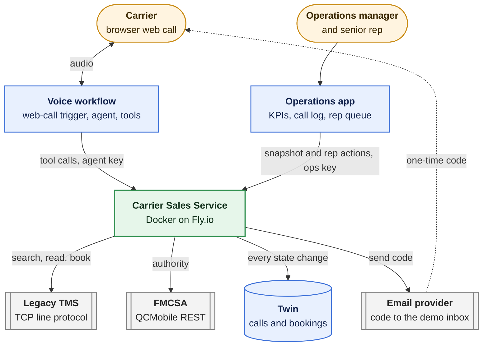
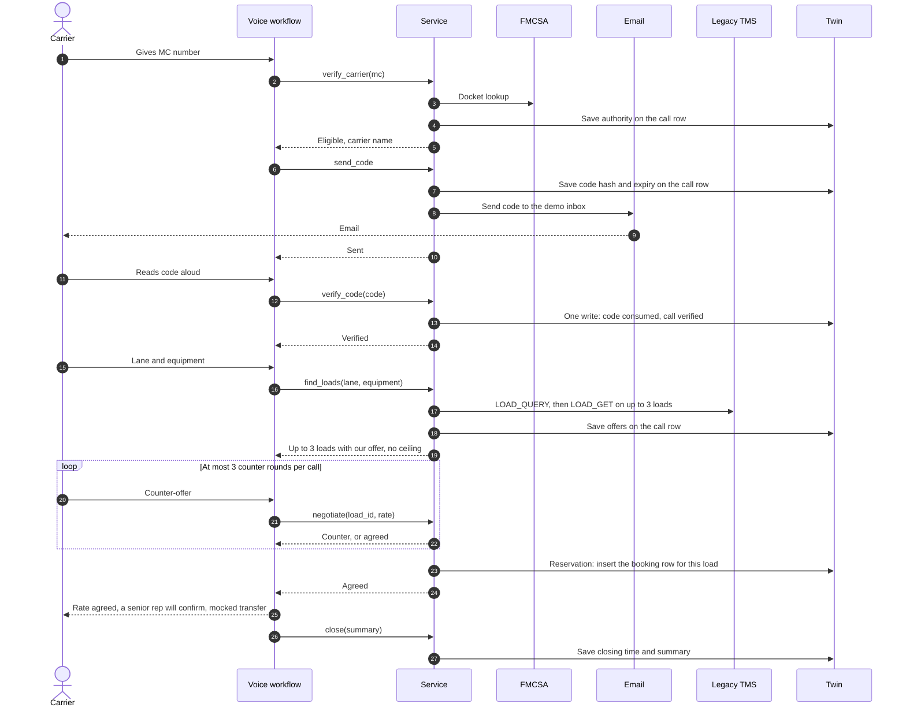
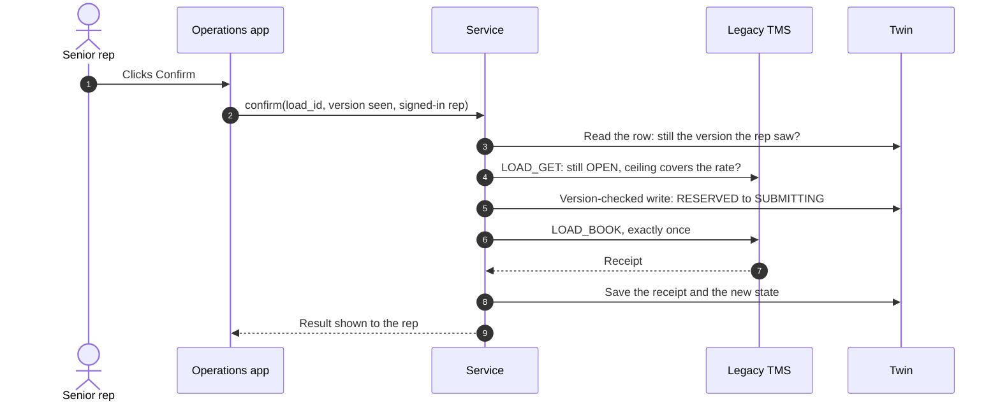
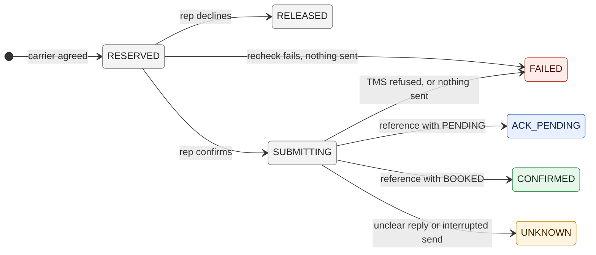

# Inbound Carrier Sales: Architecture

| | |
|---|---|
| **Version** | 3.0, 2026-11-02 |
| **Status** | Design for the real build. `main` holds no service code yet; it arrives through the [build plan](#15-build-plan). |
| **Evidence** | A prototype built from v2.5 passed a real end-to-end call. It stays on branch `prototype/e2e` as reference. See [what it proved](docs/lessons-from-prototype.md). |
| **Decisions** | Every decision, its reason and its cost are in [docs/decisions.md](docs/decisions.md). |
| **Requirements** | The [assignment PDF](docs/FDE_Technical_Challenge_-_Inbound_Carrier_Sales.pdf), summarized in [docs/assignment.md](docs/assignment.md). |

---

## 1. The system on one page

A carrier opens a HappyRobot web call. A voice agent takes their MC number, the service checks it against FMCSA, and the carrier reads back a code sent by email. The agent then finds matching loads in the legacy TMS, negotiates within a private ceiling and reserves the load. A senior rep, whose transfer is mocked on the call, reviews the reservation in the operations app and clicks Confirm. That click sends the booking to the TMS.

Two rules shape everything else:

> **1. The model talks; the service decides.** The model can only request actions. The service allows or refuses each one using its own records and the TMS, never the model's word. It never gives the model the rate ceiling or the expected code.
>
> **2. Only a rep can send a booking.** The TMS has no cancel, so the voice agent has no way to send `LOAD_BOOK`. A carrier's agreement only creates a reservation, so a mistake on the call reaches a person, not the TMS. A signed-in rep confirms that exact reservation at its recorded rate. It is sent at most once: if the result is unclear, the load stays blocked and the booking is never resent.

Four parts, each with one job:

| Part | Runs on | Owns |
|---|---|---|
| **Voice workflow** | HappyRobot | The conversation: web-call trigger, inbound agent, prompt, tools. |
| **Carrier Sales Service** | Docker on Fly.io | Rules and integrations: verification, negotiation, reservations, TMS and FMCSA access. |
| **Twin** | HappyRobot | The system of record for what happened on every call. |
| **Operations app** | HappyRobot Apps | What the operations manager sees and does: KPIs, call history, the rep queue. |

The TMS stays the source of truth for loads. Twin records what our solution did.

---

## 2. System overview



**Blue** is HappyRobot, **green** is the service we build and run, **grey** is outside systems.

**Trust boundaries.** Every arrow into the service is authenticated, and each caller has its own key. Tool requests carry the workflow's `run_id` in a hidden runtime field, so the model cannot choose or change the call. The service is the only writer to Twin, and the only thing that talks to the TMS, FMCSA and the email provider.

---

## 3. A call, end to end



Then, in the operations app:



`LOAD_BOOK` is reached only by winning that version-checked write, so a double click or two reps cannot send twice. The request carries the version the rep saw, so a rep can only confirm the reservation on their screen.

---

## 4. Rules that must always hold

Tests must prove these regardless of what the model does.

| ID | Invariant |
|---|---|
| **INV-1** | The service never returns or accepts a rate above `max_rate`. Confirm re-reads the ceiling before sending. |
| **INV-2** | `max_rate` never reaches anything the voice agent can see. Load fields reach the agent through an explicit allowlist, so a new field stays private by default. |
| **INV-3** | No load details until the service's own record shows FMCSA eligibility and a verified code for that call. |
| **INV-4** | At most 3 counter rounds per call, counted across every load discussed. |
| **INV-5** | The expected code never reaches the workflow. It goes only to the configured inbox, never to an address the caller gives. |
| **INV-6** | A load has at most one active reservation. A call has at most one agreement. |
| **INV-7** | `LOAD_BOOK` is sent only after a rep's Confirm of the reservation version they saw, at most once per reservation, and is never resent. A timeout is `UNKNOWN`, because a timeout does not say whether the request landed. |
| **INV-8** | Every endpoint requires authentication, including health. No public API docs. |
| **INV-9** | Every state change and its audit event commit in the same write. Neither can exist without the other. |
| **INV-10** | `LOAD_BOOK` evidence is never discarded: the step reached, the error type and every byte received. |

**What these cannot cover.** The service cannot control what the model says. A wrong number can be spoken, and a misheard rate inside the limits can reach a reservation. That is why a rep reviews every reservation before anything is sent. Conversation tests measure how often this happens.

---

## 5. Requirements traceability

| Requirement (PDF) | Where it is met | How it is verified |
|---|---|---|
| FMCSA authority check (p.2) | [§8](#8-verification-and-the-one-time-code) | Unit tests, live MC ledger |
| OTP after authority, before matching, no bypass (pp.4-5) | §8, INV-3, INV-5 | Unit tests, adversarial suite |
| Load match by lane and equipment (p.2) | [§9](#9-load-search-and-negotiation) | Conversation tests |
| Never exceed or disclose `max_rate` (p.4) | §9, INV-1, INV-2 | Property tests, adversarial probing, marked-value scan |
| At most 3 counters, then close without transfer (p.5) | §9, INV-4 | Unit and conversation tests |
| Tentative reservation, rep confirms, mocked handoff (pp.2-3) | [§10](#10-reservation-and-confirm) | End-to-end demo |
| Log MC, load, rate, outcome, notes (p.3) | [§7](#7-data-two-tables), events on each row | Row checks after each test call |
| All call activity in Twin (p.4) | §7 | A call that drops midway still has a record |
| Operations UI in Apps (p.4) | [§11](#11-operations-app) | Demo |
| Graceful TMS timeouts and malformed responses (p.3) | [§6](#6-the-service), [§10](#10-reservation-and-confirm) | Fault-injection tests over real TCP |
| Authentication on all endpoints (p.5) | INV-8 | API tests: every route rejects a missing or wrong key |
| KPIs, scripted, edge and adversarial tests (p.4) | [§14](#14-quality) | `docs/qa-results.md`, written during the build |
| Docker, single-command cloud deploy (p.4) | [§16](#16-deployment) | `make deploy` |
| Web call only, no phone number (p.5) | Voice workflow | Browser demo |

---

## 6. The service

One Python 3.12 FastAPI program. It keeps no database of its own and runs no background jobs. Its size is reported with every commit and kept small, but not capped ([D-28](docs/decisions.md)).

```text
service/                                                                   Status
  main.py            Builds the dependencies and the app                   built
  config.py          Typed settings; the only code that reads the env      built
  api.py             Routes, keys, request models; no business rules       built
  calls.py           The call row, and the verify and code flows           built
  selling.py         Voice flows: search, negotiate, close                 built
  bookings.py        Reservation and rep actions: confirm, decline         slices 3 and 4
  dashboard.py       The snapshot and KPIs for the operations app          built
  core/              Pure rules: no network, no files, no clock
    models.py  money.py  pricing.py  negotiation.py  loads.py              built
    carrier_policy.py  codes.py                                            built
  adapters/          Talks to the outside world, holds no business rules
    tms/  protocol.py  mapping.py  client.py                               built
    twin.py  fmcsa.py  email.py                                            built
  policy/            Versioned pricing policy, blocked-load list           built
  tests/             Tests, the fake TMS, a guard against outside network  built
tools/               The branch coverage check that make check runs        built
```

*Built* means on `main` now; the rest arrives in the slice shown. `tools/` sits outside `service/` because it checks the build and never runs in production. Where each prototype file went, and why, is in [lessons from the prototype](docs/lessons-from-prototype.md#where-the-prototypes-files-went).

The dependency direction is one way: `api` calls `calls`, `selling`, `bookings` and `dashboard`, which call `core` and `adapters`. `selling` writes call rows through `calls`. `core` imports nothing from the others.

| Endpoint | Key | Does |
|---|---|---|
| `POST /carriers/verify` | Agent | Normalizes the MC, checks FMCSA, saves the result. |
| `POST /otp/send` | Agent | Issues a code once the carrier is eligible. At most 2 per call. |
| `POST /otp/verify` | Agent | Checks the spoken code. At most 3 failures, then the call is locked. |
| `POST /loads/search` | Agent | `LOAD_QUERY`, then `LOAD_GET` on up to 3 candidates. Returns allowed fields and our opening offer. |
| `POST /negotiate` | Agent | Applies the negotiation policy. On agreement, reserves the load. |
| `POST /calls/close` | Agent | Records closing time and summary. Safe to repeat. |
| `GET /ops/snapshot` | Ops | Calls, bookings with their versions, and KPIs for the app. Cached for 5 seconds. |
| `POST /bookings/{load_id}/confirm` | Ops | Sends `LOAD_BOOK` for the version the rep saw ([§10](#10-reservation-and-confirm)). |
| `POST /bookings/{load_id}/decline` | Ops | Releases the version the rep saw. Nothing was sent, so the load is free. |
| `POST /bookings/{load_id}/reconcile` | Ops | Read-only TMS check on a stuck or sent booking. Never sends. |
| `GET /health` | Either | Liveness and TMS reachability. |

**Voice responses** are always HTTP 200 with a `status` field, so the agent can say something sensible. HTTP errors are kept for authentication and malformed requests. Each voice request has a 12 second deadline covering everything it does.

**The TMS adapter** turns the line protocol into typed results. Reads retry within a 6 second budget. `LOAD_BOOK` never retries.

| What the TMS does | What the adapter does |
|---|---|
| Responds normally, padded, in any order | Parses by key, trims padding, ignores unknown fields. |
| Times out, closes slowly or sends a partial frame | Reads: up to 2 retries with jitter, then `tms_unavailable`. |
| Sends a malformed frame or an oversized line or reply | Treated as a failed read. Never crashes, never guesses. |
| Returns `ERR\|CODE:...` | Mapped to a typed error. |

**Field mapping.** The adapter owns the one mapping from TMS fields to the PDF's load fields. Known so far: `RATE` is `loadboard_rate`, and `MAX_BUY` is `max_rate` (D-10). `DIMS` converts from feet to inches. See [the TMS reference](docs/tms/README.md) and [contract evidence](docs/tms-contract.md).

---

## 7. Data: two tables

Twin has no multi-table transactions, but one row can be updated atomically with a version check. So everything that must change together lives in one row ([D-23](docs/decisions.md)).

Both tables have the same shape, created once in the Twin UI because the API cannot create tables:

| Column | Type | Meaning |
|---|---|---|
| `id` | text, primary key | `run_id` for `calls`, load ID for `bookings` |
| `version` | int | Rises by one on every write |
| `data` | jsonb | The row's fields, shown below. Not `json`: the SQL casts values to `::jsonb`, as on the prototype |

**`calls`, one row per call.**

```json
{
  "cohort": "real",
  "started_at": "...", "last_activity": "...", "closed_at": null,
  "mc": "138328", "carrier_name": "...", "eligible": true,
  "authority": { "reason": "active_carrier_authority_verified", "checked_at": "..." },
  "otp": { "hash": "...", "expires_at": "...", "sends": 1, "failed": 0, "consumed_at": null },
  "verified_at": "...",
  "search": { "equipment": "DRY_VAN", "origin_state": "CA", "dest_state": "KY" },
  "offers": { "LD01234": 3400 },
  "rounds": 1,
  "last_counter": { "load_id": "LD01234", "ask": 4200, "response": 3600 },
  "agreement": { "load_id": "LD01234", "rate": 3625 },
  "outcome": null,
  "summary": "...",
  "policy_version": "pricing-v1",
  "events": [ { "seq": 1, "at": "...", "action": "verify_carrier", "mc": "138328", "status": "checking" } ]
}
```

**`bookings`, one row per load.** Creating this row is the reservation. The primary key means only one call can win a load.

```json
{
  "state": "RESERVED",
  "call_id": "...", "mc": "138328", "rate": 3625, "cohort": "real",
  "rep": null, "reference": null, "tms_status": null, "raw_reply": null,
  "send": { "step": null, "error": null, "bytes": 0, "sha256": null },
  "reason": null,
  "events": [ { "seq": 1, "at": "...", "action": "reserved", "status": "RESERVED" } ]
}
```

**Every write works the same way.** Read the row and its version, compute the new row in memory with its new event, then write it back only if the version has not changed. If it has, read again and retry, up to 5 times. There are no in-process locks. Two statements cover most actions, which matters on a database allowing about 4 per second.

**The audit trail is the `events` list.** Because an event is written with the change it describes, audit records cannot disagree with state (INV-9). There is no separate audit table to keep in step, no outbox and no replay. Each call event records the call's MC after the step and the step's result with its details, such as the carrier name, an ineligibility reason or tries left, and never a code. Some results are internal, such as `checking` before an FMCSA lookup and `code_issued` before the email, and a successful email adds no event, so events are not a record of what the agent heard.

**Outcome is computed, not stored twice.** A booking row is the only record of a booking. The dashboard derives each call's outcome when it reads:

| Condition | Outcome shown |
|---|---|
| A booking row exists for the call | `agreed_pending_rep`, with the booking's own state beside it |
| `outcome` is set | That value: `negotiation_failed`, `no_match`, `carrier_ineligible`, `fmcsa_unavailable`, `code_failed`, `pricing_review_required`, `tms_unavailable` |
| `closed_at` is set | `ended_without_agreement` |
| No activity for 30 minutes | `caller_ended` |

Turned-away demand (D-13) is also derived: calls with `no_match`, grouped by their `search` fields.

**Repeated requests are answered from stored state** ([D-26](docs/decisions.md)). A repeated `verify_code` on a consumed code returns verified. A repeated `negotiate` with the same ask returns the same response without using a round. A repeated close changes nothing. A repeated accept finds its own reservation.

---

## 8. Verification and the one-time code

1. **Authority.** FMCSA QCMobile docket lookup. Eligible only if `allowedToOperate` is `Y`, `commonAuthorityStatus` or `contractAuthorityStatus` is `A`, `statusCode` is `A`, `oosDate` is present and null, and any other out-of-service field says no. `allowedToOperate` alone is not enough, because inactive carriers still showed `Y`. Missing or unknown values fail closed, and an empty result means not found. FMCSA errors return `fmcsa_unavailable`, never inactive. The request works from Fly.io but returns HTTP 403 from the local machine. The ledger of checked carriers is in [docs/test-carriers.md](docs/test-carriers.md).
2. **Issue.** The service generates a 6-digit code, stores a keyed hash on the call row with a 5-minute expiry, then sends the email itself over Gmail SMTP. The code never enters a HappyRobot run, and an uncertain send counts against the limit and is not silently retried.
3. **Check.** The carrier reads the code aloud, which is unavoidable. The service compares it against the hash in constant time. Consuming the code and marking the call verified are one write, so a crash cannot leave a used code and an unverified call.
4. **Destination.** Codes go to one configured demo inbox (D-12), as Luke approved. This proves access to that inbox, not who owns an MC, so records say *code passed*, never *identity verified*.
5. **Every call.** A fresh code is required on every call before matching (D-9).
6. **MC changes.** Changing the MC clears authority, code and offers. It keeps the round, send and failure budgets, so a new MC cannot reset them. The new MC is saved before FMCSA is asked, so a failed or slow lookup cannot leave the earlier MC verified, and a late result for an MC the caller has since replaced is not applied.

---

## 9. Load search and negotiation

**Search** normalizes lane and equipment, then requires explicit `OPEN`, a future pickup and no active reservation. `LOAD_QUERY` also returns `PENDING` loads, so returned matches are checked locally. Loads on the [blocked list](service/policy/blocked-loads-v1.json) are never offered. Results are ranked by pickup time, and at most three are offered, one at a time. The agent reads notes as written. When nothing matches, the search is recorded on the call.

**Rate assumption (D-10).** `MAX_BUY` from `LOAD_GET` is provisionally `max_rate`. Luke did not confirm this mapping or its currency. A load without a usable `MAX_BUY` goes to `pricing_review_required`: no offers, no reservation (D-11).

**Pricing policy (D-4).** A versioned file, [`pricing-v1`](service/policy/pricing-v1.json), turns each load's posted rate and ceiling into three numbers, all rounded down to 25:

- **Working cap:** the ceiling minus a load-specific gap of 2 to 6%. It is the highest number we say and the highest ask we accept.
- **Opening offer:** the posted rate minus 5% when that leaves room below the cap, otherwise a load-specific spread of 8 to 15% below the cap.
- **Round targets:** 35%, 65% and 100% of the way from opening to cap.

Both draws use an HMAC of the policy version, load ID and purpose under a server secret. The same load gives the same numbers on every call, so calling back gains nothing, and knowing the policy without the secret does not reveal the gap. These percentages are demo choices the brokerage would own.

**Rounds.** Each counter advances to the next target. An ask at or below the target is accepted at the carrier's number. Round 3 is the final offer at the cap, and anything but acceptance ends the call as `negotiation_failed`, with no transfer. Rounds count across loads (INV-4).

**What this protects, and what it costs.** A fixed percentage could be inverted to find the ceiling; the keyed gap removes that formula. Some leakage is unavoidable, because the cap creates an accept/reject boundary that probing can narrow, so confidentiality is a tested property, not a guarantee. A carrier whose last ask falls between cap and ceiling is turned away, measured as *deals lost to the cap*.

---

## 10. Reservation and Confirm

**On the call.** When a carrier accepts, `negotiate` re-reads the load, then inserts the booking row. If that insert loses, the load has gone and the agent says so. Nothing has been sent, so a dropped call, a misheard yes or a failed write leaves at worst a reservation for the rep to review. A reservation does not expire, so it holds the load until a rep acts.

**In the app.** Confirm checks the row is still the version the rep saw, re-reads the load, wins a version-checked write to `SUBMITTING`, sends `LOAD_BOOK` once and saves the reply. Decline makes the same version check.



| State | Meaning | Load blocked | Rep can |
|---|---|---|---|
| `RESERVED` | Carrier agreed. Nothing sent. | Yes | Confirm, decline |
| `SUBMITTING` | Intent saved, `LOAD_BOOK` in flight. | Yes | Reconcile once older than 60 seconds |
| `ACK_PENDING` | Complete reply with matching load, reference and `PENDING`. | Yes | Reconcile |
| `CONFIRMED` | Complete reply with `BOOKED`. Never observed live. | Yes | None |
| `UNKNOWN` | The write may have landed and we cannot tell. | Yes | Reconcile |
| `FAILED` | The TMS refused, or we can prove nothing was sent. | No | None |
| `RELEASED` | The rep declined. Nothing was sent. | No | None |
| `UNCLAIMED` | A retry voided a claim before it reserved, so that claim can never reserve. Nothing held or sent. | No | None |

A later reservation on a freed load carries the earlier attempt's events forward, so no evidence is lost.

**What can go wrong at Confirm:**

| Event | Result |
|---|---|
| The rep's screen is out of date | The row is no longer the version the rep saw. Nothing is sent or changed, and the rep is told to refresh. |
| TMS read fails before sending | Stays `RESERVED`. The rep is told to retry. |
| Load no longer `OPEN`, pickup passed or ceiling fell | `FAILED`, nothing sent. The rep calls the carrier back. |
| Two clicks or two reps | The version check lets one win. The other is told it is already handled. |
| `INVALID_RATE` or an unknown-load error | `FAILED`. Nothing was created. |
| The connection never opens, so no byte left the service | `FAILED`, with `send.step` recording why. The load is free. |
| Timeout after connecting, malformed reply, `ALREADY_BOOKED` or any other error | `UNKNOWN`, with bytes kept. Never resent. |
| Process dies after `SUBMITTING` | The row stays `SUBMITTING`. After 60 seconds the app offers Reconcile, which moves it to `UNKNOWN`. |
| Twin fails while saving the receipt | The save retries for about 10 seconds with the rep waiting. If it still fails, the receipt is logged and shown on the rep's screen. |

**`PENDING`.** The handbook shows `BOOKED`, but all nine complete live receipts returned `PENDING`, including one sent deliberately above the ceiling, and none has moved on. No documented action moves them on, and reads return no reference or owner ([evidence](docs/tms-contract.md)). So the app shows the actual TMS status, and `PENDING` is never called confirmed. Luke's reply on this is still open (Q8).

**Live sends are off by default.** `LIVE_BOOKING` must be set for Confirm to reach the TMS, because each send spends a load permanently.

---

## 11. Operations app

Built from the HappyRobot Apps Next.js template and mirrored under `ops-app/`. It verifies the signed-in user, then calls the service from its server with the ops key. The Twin gateway for Apps has been failing (T-7), so the app reads through the service, which also keeps every rule in one place. The ops key never reaches the browser, and the rep's identity comes from the verified session.

- **Overview:** business KPIs first, then the northstar and funnel. Real calls only, with test data shown separately.
- **Rep queue:** reservations awaiting a decision, then sent bookings with their actual TMS status and reference.
- **Call log:** each call's outcome, rounds, summary and events. This is the audit trail the brokerage said it lacks.
- **Turned-away demand:** lanes carriers asked for when nothing matched.

---

## 12. Security

- **Authentication everywhere.** Two bearer keys, compared in constant time. Each opens only its own endpoints. FastAPI's docs routes are off.
- **Least information to the model.** The agent never receives `max_rate`, the expected code, contact details or raw TMS frames. The Tool Call Result node exposes only listed fields as a second layer.
- **Secrets** live in Fly secrets and HappyRobot's credential store, never in the repository. `.env.example` lists names only.
- **Social engineering.** No path skips verification, because the gate is in the service, not the prompt. The code's destination comes from configuration, never the conversation.
- **Call isolation.** Identity comes from `run_id` in a hidden runtime field (D-16), so the model has no call ID to substitute.
- **SQL.** Twin's API takes SQL text, so every value goes through one quoting function and table names come from constants.
- **Logs.** Codes and the ceiling stay out of logs. Platform transcripts contain spoken codes, so they stay restricted to operators. Twin stores a summary, not the transcript.

---

## 13. Reliability and capacity

- **Timeouts.** A timeout does not tell us whether a request landed. For reads we retry. For `LOAD_BOOK` we record `UNKNOWN` and stop.
- **Voice deadline.** Every voice request stops at 12 seconds and returns `temporarily_unavailable`. That is safe because no voice request can send a booking. An interrupted code email counts against the send limit and is not retried.
- **Confirm runs to completion.** It has no voice deadline, and a dashboard disconnecting does not cancel it.
- **Twin rate limit.** All statements pass through one pacer at 4 per second, retrying only on HTTP 429. A timed-out write may still have landed, so the next read decides. Conditional writes make that safe.
- **One instance.** One service instance for simplicity. The version check protects against restarts and deployment overlap, without in-process locks.
- **No background jobs.** Stale calls and stuck bookings are detected when read, and resolved by a rep. A process restart loses nothing but in-flight requests.
- **Capacity.** A call is estimated at about 20 Twin statements, against 70 measured on the prototype, so the 4 per second limit allows about 12 full calls a minute. This estimate must be measured ([§14](#14-quality)).

---

## 14. Quality

**Northstar KPI: reserved handoffs per code-passed call** (D-15). Real calls that reached the rep with a reservation, divided by real calls that passed the code check. It measures the leg the AI owns. Rep-confirmed, TMS-acknowledged and TMS-confirmed are reported separately, and `PENDING` is never counted as confirmed.

**Cohorts (D-21).** Each call is real or synthetic, set by `CALL_COHORT` when the call begins. KPIs count real calls only.

| Customer problem (PDF p.1) | KPI |
|---|---|
| Missed calls, long holds | Calls answered, time to first offer |
| Inconsistent negotiation | Ceiling compliance, headroom, deals lost to the cap |
| Manual FMCSA checks | Automatic verification rate, ineligible carriers stopped |
| No audit trail | Share of calls with a complete record |
| Dispatcher burnout | Calls handled without a dispatcher |
| Missed revenue | Turned-away demand |

**Guardrails, must stay at 0:** rate above ceiling, ceiling disclosed, verification bypassed, more than 3 counters, a booking sent twice.

| Test layer | Covers | Where |
|---|---|---|
| Unit and property | Pricing bounds, money parsing, rounds, code expiry and limits, TMS parsing, booking transitions, FMCSA rule table | `service/tests/` |
| Integration | Fake TMS faults over real TCP, every route over HTTP, the real SQL running against a fake Twin, a crash at each write, a marked ceiling scanned through every response and row | `service/tests/` |
| Contract | Recorded TMS replies in [fixtures](docs/tms/fixtures/README.md) | `service/tests/` |
| Conversation | Standard, edge and adversarial suites | HappyRobot test suites, `happyrobot/` |

**Engineering gates, enforced in CI where possible:**

| Gate | Target |
|---|---|
| Size | Functions at most 50 lines, modules at most 300 |
| Complexity | Radon rank B or better, with no exceptions |
| Lint and format | `ruff check` and `ruff format --check` clean |
| Types | `mypy --strict` clean |
| Coverage | At least 90% branch coverage on `core/`, `calls.py`, `selling.py`, `bookings.py` and `dashboard.py` |
| Layering | `core/` imports only the standard library and `core/` |
| Environment | Only `config.py` reads it |
| Capacity | 12 calls of about 4 minutes within 4 minutes, plus one rep action a minute, all reach a reservation with no response over 12 seconds |
| Dependencies | `pip-audit` and `npm audit --omit=dev` show no high or critical issue |

---

## 15. Build plan

Each slice is a small set of commits on `main`, read by the owner. Each ends in something the owner can run or call. No booking is sent before slice 4.

| Slice | Delivers | Ends with |
|---|---|---|
| **0. Skeleton** | Docs, decisions, tooling, folders. No logic. | This commit |
| **1. Foundations** | Money, models, pricing, negotiation, loads; TMS protocol, mapping and read-only client. Rewritten in six small pieces, with the prototype's tests and recorded TMS replies as the check. | `make check` passes offline |
| **2. Verify** | Service, config, Twin adapter, FMCSA, email, Docker, deployment. Real workflow wired for verify, send and check. | A real call passes MC and code |
| **3. Sell** | Search, negotiation, reservation, close, mocked handoff. | A real call ends in a reservation |
| **4. Operate** | Dashboard, rep queue, `LOAD_BOOK` in the TMS client, Confirm with `LIVE_BOOKING` on. | A rep click returns a TMS reference, spending one load |
| **5. Deliver** | QA suites, KPIs, build description, email, video. | Submission |

**Definition of done** is one real run showing: an active MC, an emailed code, at least one counter, a spoken mocked transfer, the agent ending the session, complete Twin rows, and a rep Confirm that returns a TMS reference.

**Target.** Working software by 16:00 on 2026-11-03, with the demo video recorded that evening. There is no fallback to `prototype/e2e` ([D-33](docs/decisions.md)); it stays as reference only.

---

## 16. Deployment

- **Image:** one Docker image, Python 3.12 slim, non-root, runtime packages only.
- **Deploy:** after one-time setup, `make deploy` runs `fly deploy`. Luke confirmed any cloud environment works, and any host that runs a container can run this image.
- **Hosting:** a machine that stays up during the demo. Fly's trial stopped machines after about 5 minutes.
- **Setup steps** are in [docs/onboarding.md](docs/onboarding.md).

---

## 17. Open questions

Unresolved checks are tracked in [docs/decisions.md](docs/decisions.md#open-checks). The ones that could change this design: Luke's answer on `PENDING` (Q8), and whether a native post-call summary works in this workspace (T-8).
