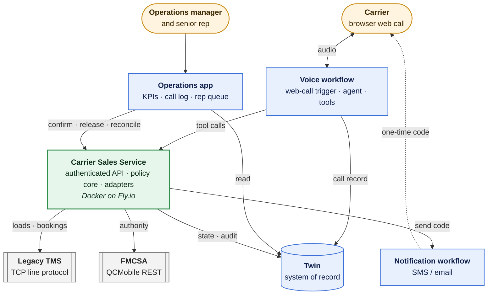
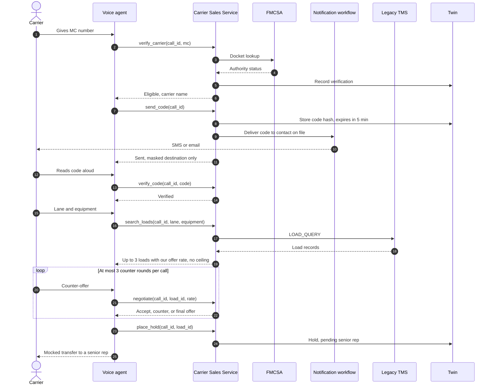
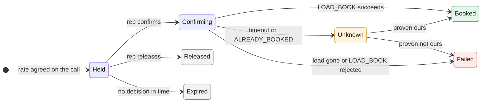

# Inbound Carrier Sales — Architecture Proposal

| | |
|---|---|
| **Version** | 1.0 · 2026-10-29 |
| **Status** | Proposed. Decisions marked *pending* wait on answers tracked in [`Questions.Md`](Questions.Md). |
| **Scope** | Proof of concept for HappyRobot Logistics' inbound carrier desk (see [`FDE_Technical_Challenge_-_Inbound_Carrier_Sales.pdf`](FDE_Technical_Challenge_-_Inbound_Carrier_Sales.pdf), summarized in [`PROJECT_GUIDE.md`](PROJECT_GUIDE.md)). |
| **Supersedes** | [`Archive/Claude_ProposedArchitecture.md`](Archive/Claude_ProposedArchitecture.md), [`Archive/Codex_ProposedArchitecture.md`](Archive/Codex_ProposedArchitecture.md) |

---

## 1. Summary

A carrier opens a HappyRobot web call. A voice agent collects the MC number, the carrier is checked against FMCSA, proves identity with a one-time code, hears matching loads from the legacy TMS, negotiates, and — once a rate is agreed — is handed to a (mocked) senior rep who confirms the booking from an operations app.

The design has one rule that everything else follows from:

> **The model talks; the service decides.** The voice agent can *ask* for any action. A small backend service, the **Carrier Sales Service**, decides whether that action is allowed, using state it stores itself. No persuasion of the model can change an outcome, because the model never holds the deciding information: not the rate ceiling, not the expected code, not the verification flag.

Four parts, each with one job:

| Part | Runs on | Owns |
|---|---|---|
| **Voice workflow** | HappyRobot | The conversation: web-call trigger, inbound agent, prompt, tools. |
| **Carrier Sales Service** | Docker on Fly.io | Rules and integrations: verification, negotiation, holds, TMS and FMCSA access. |
| **Twin** | HappyRobot | The single system of record for what happened on every call. |
| **Operations app** | HappyRobot Apps | What the operations manager sees and does: KPIs, call history, the senior-rep queue. |

The TMS stays the source of truth for loads and bookings. Twin records what *our* solution did.

---

## 2. System overview



Read top to bottom: people → what they touch → the service that decides → what it depends on. **Blue** is HappyRobot, **green** is the service we build and run, **grey** is the customer's and government systems.

**Trust boundaries.** Every arrow into the service is authenticated, and each caller has its own key: the voice workflow (agent key) and the operations app (ops key). The service uses a third key to trigger the notification workflow. The web-call trigger and the app sit behind HappyRobot sign-in. The legacy TMS and FMCSA are reachable only from the service.

---

## 3. A call, end to end

The happy path. Every step can end the call early; the possible endings are listed in §6.7.



---

## 4. Invariants

These are the rules the system guarantees. Each is enforced in the service (not the prompt) and each has tests (§9). Agents changing the code must keep every one of them true.

| ID | Invariant |
|---|---|
| **INV-1** | No rate above `max_rate` is ever offered or agreed. |
| **INV-2** | `max_rate` (TMS `MAX_BUY`) never appears in anything the voice agent can see, and is never the boundary of an accept/reject decision (§6.5). |
| **INV-3** | No load details are returned until the service's own record shows FMCSA eligibility **and** a verified code for that call. A model-supplied "verified" is ignored. |
| **INV-4** | At most 3 counter rounds per call, counted across every load discussed on that call. |
| **INV-5** | The expected code never reaches the voice workflow. It is sent only to a contact from the trusted carrier registry, never to a number or address the caller dictates. |
| **INV-6** | A load has at most one active hold. |
| **INV-7** | A booking request is never blindly resent. An ambiguous result is recorded as **unknown** until an authoritative response proves the outcome. |
| **INV-8** | Every endpoint requires authentication, including health checks. No public API docs. |
| **INV-9** | Repeating a tool call with the same inputs on the same call returns the stored result instead of acting twice. |

---

## 5. Requirements traceability

| Requirement (PDF) | Where it is met | How it is verified |
|---|---|---|
| FMCSA authority check (p.2) | §6.3 `verify_carrier` | Unit + live check with known MCs |
| OTP after authority, before matching; no bypass (p.4–5) | §6.3, INV-3, INV-5 | Adversarial suite: social engineering |
| Load match by lane and equipment (p.2) | §6.4 `search_loads` | Conversation tests |
| Never exceed or disclose `max_rate` (p.4) | §6.5, INV-1, INV-2 | Property tests + adversarial probing suite |
| ≤3 counter rounds, then close without transfer (p.5) | §6.5, INV-4 | Unit + conversation tests |
| Tentative reservation, mocked handoff (p.2–3) | §6.6 | End-to-end demo |
| Log MC, load, rate, outcome, notes (p.3) | §6.7 Twin | Twin records after each test call |
| All call activity in Twin (p.4) | §6.7 | No other datastore exists |
| Operations UI in Apps (p.4) | §6.8 | Demo |
| Graceful TMS timeouts and malformed responses (p.3) | §6.2, §8 | Fault-injection tests against a fake TMS |
| Authentication on all endpoints (p.5) | §7, INV-8 | API tests: every route rejects missing keys |
| KPIs, scripted, edge and adversarial tests (p.4) | §9 | `docs/qa-results.md` |
| Docker, single-command cloud deploy (p.4) | §10 | `make deploy` |
| Web call only, no phone number (p.5) | §6.1 | — |

---

## 6. Components

### 6.1 Voice workflow (HappyRobot)

- **Trigger:** web call with HappyRobot's enhanced security (sign-in) left on.
- **Agent:** short, direct turns for drivers on the road. The prompt walks a fixed order — identify → verify → code → match → negotiate → hold → handoff — and refuses to skip steps or discuss the ceiling. The prompt is the *first* line of defence; the service is the one that holds.
- **Tools:** one webhook tool per service endpoint. The Tool Call Result node exposes only fields the agent may say out loud.
- **Handoff:** transfers don't work on web calls, so the agent announces the transfer and ends; the hold appears in the operations app's rep queue.
- **After the call:** an extraction step writes the call record to Twin (outcome, notes, sentiment).
- **Source control:** the workflow is built in the HappyRobot workspace (via the HappyRobot MCP in [`REFERENCES/`](REFERENCES/)) and its export, prompts and test definitions are committed under `happyrobot/`.

### 6.2 Carrier Sales Service

One Python 3.12 / FastAPI program — a modular monolith — with an async TCP client for the TMS and an HTTP client for everything else. It keeps no database of its own: all state lives in Twin.

| Endpoint | Caller | Requires | Does |
|---|---|---|---|
| `POST /carriers/verify` | Agent | — | Normalizes the MC number, checks FMCSA, records the result. |
| `POST /otp/send` | Agent | FMCSA eligible | Issues a code to the contact on file (§6.3). Max 2 sends per call. |
| `POST /otp/verify` | Agent | Code issued | Checks the spoken code. Max 3 attempts, then locked for the call. |
| `POST /loads/search` | Agent | Code verified | `LOAD_QUERY` by lane and equipment; drops held, booked and past-pickup loads; returns up to 3 with our opening offer. |
| `POST /negotiate` | Agent | Code verified | Applies the negotiation policy (§6.5) to the carrier's rate. |
| `POST /holds` | Agent | Agreed rate on this load | Places the hold (§6.6). |
| `GET /holds` | Ops app | — | Rep queue. |
| `POST /holds/{id}/confirm` | Ops app | Hold active | Re-checks the load, then books it (§6.6). |
| `POST /holds/{id}/release` | Ops app | Hold active | Releases the hold. |
| `POST /holds/{id}/reconcile` | Ops app | Booking unknown | Looks for authoritative proof of the outcome. |
| `GET /health` | Fly.io | Key | Liveness and TMS reachability (`DEBUG_ECHO`). |

**Agent-facing responses** always return HTTP 200 with a `status` field (`ok`, `otp_required`, `tms_unavailable`, …) so the agent can say something sensible. HTTP errors are reserved for authentication and malformed requests.

**The TMS adapter** turns the legacy line protocol into typed results:

| What the TMS does | What the adapter does |
|---|---|
| Responds normally, fields padded, in any order | Parses by key, trims padding, ignores unknown fields. |
| Times out, closes slowly, or sends a partial frame (no `END`) | Reads (`LOAD_QUERY`, `LOAD_GET`): up to 2 retries with jittered backoff inside a ~6 s budget, then `tms_unavailable`. |
| Sends a malformed or oversized (>4096 bytes) frame | Treated as a failed read; same retry rule. Never crashes, never guesses. |
| Returns `ERR\|CODE:…` | Mapped to a typed error the policy core understands. |
| `LOAD_BOOK` times out or returns `ALREADY_BOOKED` | **No resend.** Booking marked *unknown* (INV-7, §6.6). |

When the TMS is down, the agent says so and offers a callback. It never pitches cached or invented loads.

### 6.3 Verification and the one-time code

1. **Authority.** FMCSA QCMobile docket lookup. Eligible only if FMCSA reports the carrier as allowed to operate. FMCSA errors return `fmcsa_unavailable`; the call cannot continue unverified.
2. **Code issue.** The service generates a 6-digit code, stores only a keyed hash with a 5-minute expiry in Twin, and triggers a separate, authenticated **Notification workflow** in HappyRobot that delivers it by SMS or email. The voice workflow receives only `sent`, the channel, and a masked destination ("ending in 4567").
3. **Code check.** The code the carrier reads aloud *does* pass through the voice system — that is unavoidable — but it is compared against the stored hash in the service, in constant time, with an attempt limit.
4. **Where the code goes.** Only to a contact in the trusted carrier registry (Twin `carriers`). A carrier with no trusted contact gets no code, hears no loads, and is routed to a human. *How* contacts become trusted for previously unknown carriers is an open business question (Q-7); for the demo, one carrier is seeded with our own contact details and this is disclosed.

### 6.4 Load search

Matches origin and destination (city or state, case-insensitive) and equipment type (with aliases such as *van* → *dry van*, *reefer* → *refrigerated*). Results are ranked by pickup time; at most three are offered, one at a time, by the agent. Each carries the carrier-facing load fields from the PDF and our **opening offer** — never `max_rate`, and never the posted rate where the posted rate is above what we can pay.

### 6.5 Negotiation policy

The broker pays the carrier, so the carrier pushes up and we concede toward a ceiling we never reveal.

- **Opening offer:** the lower of the posted rate and a fixed share of `max_rate` (initially 90 %).
- **Working cap:** a fixed share of `max_rate` (initially 97 %), rounded down to $25. It is the highest number we will ever say **and** the highest carrier ask we accept. `max_rate` itself never decides anything on the call, so probing for it finds the cap, not the ceiling.
- **Rounds:** each carrier counter moves our offer a set part of the way from opening to cap (initially 35 %, 65 %, 100 %). An ask at or below our current offer or the round's target is accepted at the carrier's number. After round 3 we make a final offer; anything else ends the call politely as `negotiation_failed`, with no transfer.
- **Counting:** rounds are per call, across loads (INV-4).

All shares are configuration. They are a starting point, not a claim: predictable counters can still leak information, so the adversarial suite (§9) probes for it — repeated asks, binary search, "what's your best number" — and the parameters are tuned on the results before we say the requirement is met.

### 6.6 Holds, handoff and booking

A **hold reserves the load inside our application only.** It stops our agent offering the load to anyone else; it does not reserve anything in the TMS, and the load can still be booked elsewhere before the senior rep acts. This is why confirmation re-checks the load first.



"Load gone" means a `LOAD_GET` just before booking shows the load is no longer available.

- **Unknown is a first-class outcome.** A timed-out `LOAD_BOOK` may have committed. `ALREADY_BOOKED` only proves *someone with our token* booked the load — possibly an earlier test run — not that this carrier got it at this rate. The app shows unknown bookings for review; reconcile resolves them only with identifying evidence (for example, a `LOAD_GET` showing this booking's details, if the TMS exposes them — Q-5).
- **Booking timing is pending (Q-1).** If the answer is "book as soon as the rate is agreed", `place_hold` books directly, the agent tells the carrier a rep will confirm rather than "you're booked", and the rep queue becomes a review list. Nothing else in this design changes.

### 6.7 Data model (Twin)

| Table | One row per | Key fields |
|---|---|---|
| `carriers` | Known carrier | MC, DOT, legal name, trusted contact, how the contact was verified |
| `calls` | Call | call ID, MC, eligibility, code verified, counter rounds used, selected load, agreed rate, **outcome**, notes, sentiment, duration |
| `call_events` | Tool call | call ID, action, request fingerprint, result, latency, error |
| `otp_challenges` | Code issued | call ID, code hash, expiry, attempts, delivery status |
| `negotiation_rounds` | Carrier counter | call ID, load ID, round, carrier ask, our response |
| `holds` | Hold | load ID, call ID, MC, rate, state (§6.6), rep, booking reference, evidence |

**Call outcomes:** `booked`, `pending_rep`, `negotiation_failed`, `no_match`, `carrier_ineligible`, `code_failed`, `no_trusted_contact`, `tms_unavailable`, `caller_ended`.

`call_events` is the audit trail: what was said, offered and agreed, in order — one of the customer's stated problems.

### 6.8 Operations app (HappyRobot Apps)

Built from the Apps Next.js template. It reads Twin through the server-side gateway behind the app's own sign-in, and calls the service with the ops key for actions, so rules are enforced in one place.

- **Overview:** northstar and guardrail KPIs (§9), outcome funnel, agreed rate versus posted rate.
- **Rep queue:** holds awaiting confirmation; confirm, release, or reconcile.
- **Call log:** each call's summary, outcome, rounds and notes, linked to its events.
- **Health:** TMS and FMCSA error rates, unknown bookings needing review.

---

## 7. Security

- **Authentication everywhere.** Three bearer keys — voice workflow, operations app, notification workflow — compared in constant time. A key only opens its own endpoints. `/health` needs a key too; Fly's health check sends it. FastAPI's `/docs`, `/redoc` and `/openapi.json` are switched off.
- **Least information to the model.** The agent never receives `max_rate`, the expected code, full contact details, or raw TMS frames.
- **Secrets** live in Fly secrets and HappyRobot's credential store, never in the repository. `.env.example` lists names only.
- **Social engineering.** No path skips verification: the gate is in the service, not the prompt. The adversarial suite (§9) covers urgency, claimed authority, "my dispatcher already verified me", alternative contact numbers, and prompt injection.
- **Logs.** Codes, contact details and the ceiling are kept out of service logs. Whether HappyRobot run logs of the notification workflow show the code must be checked (Q-6).

---

## 8. Reliability and concurrency

- **Latency budget.** Each tool call aims for under 2 s typical and is cut off at about 8 s; the agent uses a short filler line while waiting.
- **Duplicates.** HappyRobot may retry a webhook. Each call records `call_id + action + request fingerprint`; a repeat returns the stored result (INV-9).
- **Simultaneous requests.** For the proof of concept the service runs as **one instance** and serializes work per call and per load, which is enough to guarantee INV-4, INV-6 and INV-9. Before running more than one instance, Twin must enforce them itself (for example, a unique active hold per load, or conditional updates). Whether Twin supports this is a day-one check (Q-4). Storing state in a database does not by itself prevent two requests acting at once.

---

## 9. Quality: KPIs and tests

**Northstar KPI — booked loads per verified call.** Confirmed bookings divided by calls that passed the code check. It captures what the brokerage wants: more loads moved without a dispatcher.

**Guardrails — must stay at 0:** rate above ceiling, ceiling disclosed, verification bypassed, more than 3 counter rounds.

**Supporting:** margin kept below the ceiling, average handle time, rounds to agreement, FMCSA and code pass rates, TMS error rate, unknown bookings.

**HappyRobot Northstars (behavioural grading):** never discusses the ceiling; no load detail before verification; at most three counters, then a professional close; concise and carrier-friendly.

| Layer | What | Where |
|---|---|---|
| Unit and property | Negotiation never exceeds the cap or ceiling across random inputs; round limits; code expiry, attempts and locking; MC normalization; TMS frame parsing | `service/tests/` |
| Integration | Service against a **fake TMS** that injects every documented fault: timeouts, missing `END`, malformed and oversized frames, slow close, `ALREADY_BOOKED` | `service/tests/` |
| Contract | `DEBUG_ECHO`, `LOAD_QUERY`, `LOAD_GET` against the real TMS | Manual, recorded |
| Conversation: standard | Happy path; no match; ineligible carrier; lane change; carrier accepts first offer | HappyRobot test suites |
| Conversation: edge | TMS down mid-call; code expired; wrong code three times; load taken during the call | HappyRobot test suites |
| Conversation: adversarial | Code bypass by urgency, authority or "already verified"; "send it to this number instead"; ceiling extraction by direct question, binary search and anchoring; prompt injection | HappyRobot adversarial tests |

Results, including failures and what was changed, are recorded in `docs/qa-results.md` and summarized in the app.

---

## 10. Deployment and repository

- **Image:** one Docker image for the service (Python 3.12 slim, non-root).
- **Deploy:** `make deploy` runs `fly deploy`, one Fly.io machine, HTTPS by default. The image runs unchanged on Cloud Run, ECS or Azure Container Apps if the customer prefers (Q-3).
- **Local:** `docker compose up` starts the service with the fake TMS.

```
service/          FastAPI app: api/, core/, adapters/ (tms, fmcsa, twin, notify), tests/
happyrobot/       workflow export, prompts, test-suite definitions
docs/             build description, KPIs, QA results, prospect email, demo script
Dockerfile · docker-compose.yml · fly.toml · Makefile · .env.example
```

The operations app lives in HappyRobot's managed Apps repository and is linked from the README. The repository is private, with reviewers invited.

---

## 11. Delivery plan

| Phase | Outcome |
|---|---|
| **0. Day-one checks** | A browser web call that talks; `DEBUG_ECHO` and one `LOAD_QUERY` through our token (does it return `MAX_BUY`? what does `LOAD_GET` show for a booked load?); one write and read to Twin from outside HappyRobot; a test send through a notification workflow. |
| **1. TMS adapter** | Adapter plus fake TMS and fault-injection tests. |
| **2. Service** | Endpoints, policy core, Twin adapter, authentication; deployed to Fly.io. |
| **3. Conversation** | Voice workflow wired to the service; live end-to-end call. |
| **4. Operations** | Twin call records and the operations app with the rep queue. |
| **5. Quality and delivery** | Test suites, Northstars, QA results, build description, prospect email, walkthrough video. |

---

## 12. Decisions and open questions

**Decided**

| ID | Decision | Why |
|---|---|---|
| D-1 | One Python/FastAPI service (modular monolith) | Custom Code nodes have no network access and the TMS speaks raw TCP, so an external service is required; one is enough for a POC. |
| D-2 | Twin is the only datastore | Required by the brief; Twin is reachable from the service, the workflow and the app. |
| D-3 | Codes delivered by a separate HappyRobot notification workflow | Native delivery, and the voice workflow never holds the code. |
| D-4 | Accept/counter boundary is a cap below `max_rate` | The true ceiling is never the decision boundary, so it cannot be probed directly. |
| D-5 | No cached loads; a TMS outage is reported honestly | Cached availability may be wrong; honesty is simpler and safer. |
| D-6 | Ambiguous bookings recorded as unknown | A timeout or `ALREADY_BOOKED` does not prove this booking succeeded. |
| D-7 | One service instance for the POC | Simplest way to guarantee the concurrency invariants until Twin's capabilities are confirmed. |

**Open** (questions to Luke are in [`Questions.Md`](Questions.Md))

| ID | Question | Owner | Design impact |
|---|---|---|---|
| Q-1 | Hold then book, or book as soon as the rate is agreed? | Luke | §6.6 only. Design assumes hold-then-book. |
| Q-2 | Code check on every call, or only for new carriers? | Luke | One check in `search_loads`. Design assumes every call (the strictest reading of p.4). |
| Q-3 | Fly.io acceptable as the cloud target? | Luke | §10 only; the image is portable. |
| Q-4 | Can Twin enforce uniqueness or conditional updates from outside? | Day-one check | Whether more than one instance is possible. |
| Q-5 | Does our token return `MAX_BUY`, and does `LOAD_GET` identify who booked a load? | Day-one check | Ceiling source (§6.5); how unknown bookings are reconciled (§6.6). |
| Q-6 | Do notification-workflow run logs expose the code? | Day-one check | Whether delivery needs masking or a different path. |
| Q-7 | How does a previously unknown carrier's contact become trusted? | Business | §6.3; the demo uses a disclosed, seeded contact. |
