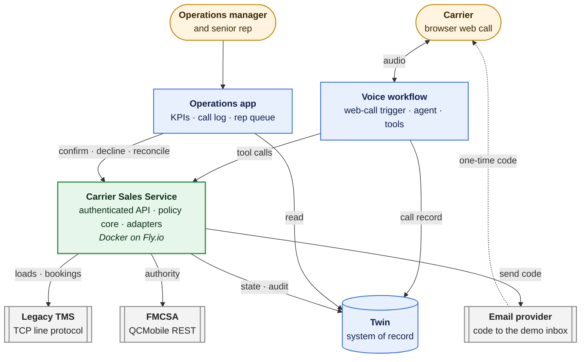
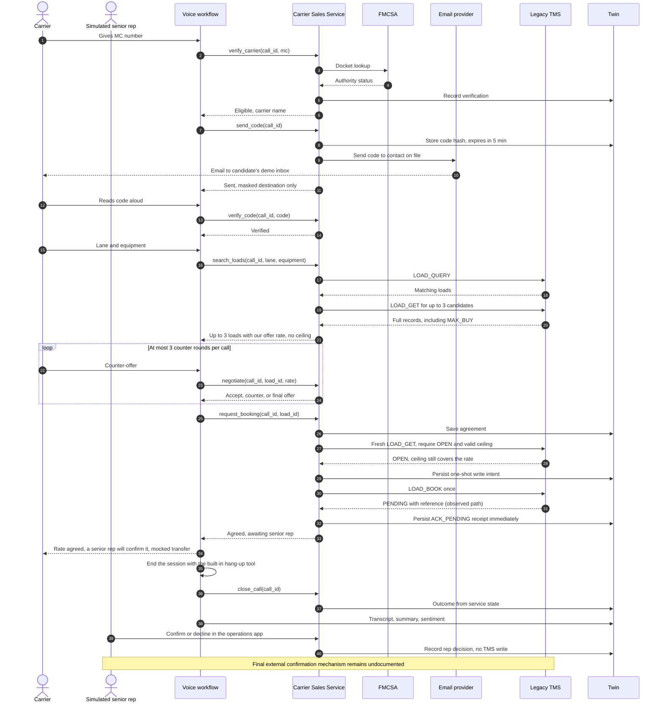
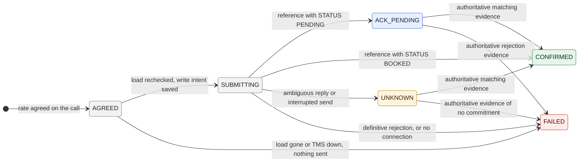

# Inbound Carrier Sales: Architecture

| | |
|---|---|
| **Version** | 2.5 · 2026-10-31 |
| **Status** | Build design, not an implementation report. Folds in Codex's controlled experiment against v2.4 (isolated harness commit `0e0451d`), which ran one real browser call and ended in a live `UNKNOWN` booking, so no acknowledged booking has been proven on a real call. T-1, T-4, T-5 and T-6 now have live answers with stated limits; T-2, T-3 and the new T-7 stay open ([platform checks](docs/platform-checks.md)). D-8 to D-10 remain candidate assumptions, and three owner decisions are listed in §12. The `PENDING` question to Luke (Q8) does not block the build. See [`docs/agent-onboarding.md`](docs/agent-onboarding.md) for current state. |
| **Scope** | Proof of concept for HappyRobot Logistics' inbound carrier desk (see [`FDE_Technical_Challenge_-_Inbound_Carrier_Sales.pdf`](FDE_Technical_Challenge_-_Inbound_Carrier_Sales.pdf), summarized in [`PROJECT_GUIDE.md`](PROJECT_GUIDE.md)). |
| **Supersedes** | [`Archive/Claude_ProposedArchitecture.md`](Archive/Claude_ProposedArchitecture.md), [`Archive/Codex_ProposedArchitecture.md`](Archive/Codex_ProposedArchitecture.md) |

**Clarification source:** Luke's reply on 2026-10-30 (Australia/Sydney), linked in `Questions.Md`. Fly.io and personal-email OTP are confirmed acceptable. The walkthrough is for the brokerage's business team; creative additions are optional and should provide client value. The archived proposals remain historical records.

**Design evidence:** [`Research.Md`](Research.Md) records industry input, Perplexity research, source checks and the decisions they informed. The four components remain unchanged; [sanitized TMS evidence](docs/tms-contract.md#booking-experiments-2026-10-31) updates booking recovery and amount handling below, and [platform checks](docs/platform-checks.md) record what the isolated end-to-end harness found. Unless explicitly identified as observed evidence, the components, endpoints, guarantees and tests in this document are planned requirements, not verified deployed behavior.

---

## 1. Summary

A carrier opens a HappyRobot web call. A voice agent collects the MC number, the carrier is checked against FMCSA, completes the demo email-code check, hears matching loads from the legacy TMS and negotiates. Once a rate is agreed, the service submits one tentative booking to the TMS (candidate policy D-8), and the carrier is handed to a (mocked) senior rep, who confirms from the planned operations app. An acknowledged `PENDING` request remains pending; the rep's confirmation is recorded locally and does not supply the undocumented external finalization step.

The design has one rule that everything else follows from:

> **The model talks; the service decides.** The voice agent can *ask* for any action. A small backend service, the **Carrier Sales Service**, decides whether that action is allowed, using state it stores itself. The service enforces verification and pricing regardless of what the model claims; the model never receives the rate ceiling or expected code.

Four parts, each with one job:

| Part | Runs on | Owns |
|---|---|---|
| **Voice workflow** | HappyRobot | The conversation: web-call trigger, inbound agent, prompt, tools. |
| **Carrier Sales Service** | Docker on Fly.io | Rules and integrations: verification, negotiation, bookings, TMS and FMCSA access. |
| **Twin** | HappyRobot | The single system of record for what happened on every call. |
| **Operations app** | HappyRobot Apps | What the operations manager sees and does: KPIs, call history, the senior-rep queue. |

The TMS stays the source of truth for loads and bookings. Twin records what *our* solution did.

---

## 2. System overview



Read top to bottom: people → what they touch → the service that decides → what it depends on. **Blue** is HappyRobot, **green** is the service we build and run, **grey** is outside systems: the customer's TMS, FMCSA and the email provider.

**Trust boundaries.** Every arrow into the service is authenticated, and each caller has its own key: the voice workflow (agent key) and the operations app (ops key). Agent requests carry the workflow's `run_id` in a hidden runtime field, so the model cannot choose or change the call (D-16). The service holds its own credential for the email provider. The web-call trigger and the app sit behind HappyRobot sign-in. All TMS, FMCSA and email traffic runs through the service.

---

## 3. A call, end to end

The happy path. Every step can end the call early; the possible endings are listed in §6.7.



`call_id` is the workflow's `run_id`, supplied by the runtime and never generated by the model (D-16). `request_booking` takes no rate: the service uses the one it recorded during negotiation.

---

## 4. Invariants

These are requirements for the implementation. The planned service must enforce them independently of the prompt, with the tests in §9. Current diagnostics and the offline lab do not establish these guarantees for a deployed system.

| ID | Invariant |
|---|---|
| **INV-1** | No rate above `max_rate` is ever offered or agreed, and `LOAD_BOOK` is only sent against a ceiling freshly read from the TMS. |
| **INV-2** | `max_rate` (provisionally mapped from TMS `MAX_BUY`, D-10) never appears in anything the voice agent can see, and no spoken price is a fixed percentage of it. Every offer and acceptance target comes from the versioned pricing policy (§6.5) and is validated below the ceiling. |
| **INV-3** | No load details are returned until the service's own record shows FMCSA eligibility **and** a verified code for that call. A model-supplied "verified" is ignored. |
| **INV-4** | At most 3 counter rounds per call, counted across every load discussed on that call. |
| **INV-5** | The expected code never reaches the voice workflow. It is sent only to the destination on file for that carrier, or in the demo to the configured demo inbox (D-12), never to an address or number the caller provides. |
| **INV-6** | A load has at most one active booking, and so does a call. `AGREED`, `SUBMITTING`, `ACK_PENDING`, `CONFIRMED` and `UNKNOWN` bookings keep the load blocked from new offers. |
| **INV-7** | A booking request is never blindly resent, including after a restart, a stale `OPEN` read or a new request. A complete reference-bearing `PENDING` receipt is **ACK_PENDING**; ambiguous transport/framing is **UNKNOWN**; only authoritative final evidence is **CONFIRMED**. A rep's confirmation never substitutes for that evidence, and the actual TMS status is always shown. |
| **INV-8** | Every endpoint requires authentication, including health checks, on the service and on the operations app. No public API docs. |
| **INV-9** | A repeat of the same request on the same call, while it is running or within the retry window, returns the recorded result or in-progress status instead of acting twice. After the window it is a new action (D-17). A booking stays protected regardless: a retry finds the call's existing booking (INV-6). |
| **INV-10** | `LOAD_BOOK` evidence is never discarded. Whatever the outcome, the service keeps the step the send reached, the error type and every byte received. A failure before any request byte leaves the service is `FAILED`, because nothing was sent. A receipt that cannot be saved to Twin is retried, then written to the service log (§6.6). |

---

## 5. Requirements traceability

| Requirement (PDF) | Where it is met | How it is verified |
|---|---|---|
| FMCSA authority check (p.2) | §6.3 `verify_carrier` | Unit + live check with the recorded test MCs (§6.3) |
| OTP after authority, before matching; no bypass (p.4-5) | §6.3, INV-3, INV-5 | Adversarial suite: social engineering |
| Load match by lane and equipment (p.2) | §6.4 `search_loads` | Conversation tests |
| Never exceed or disclose `max_rate` (p.4) | §6.5, INV-1, INV-2 | Property tests + adversarial probing suite |
| ≤3 counter rounds, then close without transfer (p.5) | §6.5, INV-4 | Unit + conversation tests |
| Tentative reservation, mocked handoff (p.2-3) | §6.6 | End-to-end demo |
| Log MC, load, rate, outcome, notes (p.3) | §6.7 Twin (the TMS has no logging command) | Twin records after each test call |
| All call activity in Twin (p.4) | §6.7, including dropped calls and transcripts | Integration test: a call that drops mid-way still has a record |
| Operations UI in Apps (p.4) | §6.8 | Demo, once T-7 is resolved |
| Graceful TMS timeouts and malformed responses (p.3) | §6.2, §8 | Fault-injection tests against a fake TMS |
| Authentication on all endpoints (p.5) | §7, INV-8 | API tests: every route rejects missing keys |
| KPIs, scripted, edge and adversarial tests (p.4) | §9 | `docs/qa-results.md` |
| Docker, single-command cloud deploy (p.4) | §10 | `make deploy` |
| Web call only, no phone number (p.5) | §6.1 | Browser demo; no number provisioned |

---

## 6. Components

### 6.1 Voice workflow (HappyRobot)

- **Trigger:** web call with HappyRobot's enhanced security (sign-in) left on.
- **Agent:** short, direct turns for drivers on the road. The prompt walks a fixed order, identify → verify → code → match → negotiate → reserve → handoff, and refuses to skip steps or discuss the ceiling. The prompt is the *first* line of defence; the service is the one that holds.
- **Tools:** one webhook tool per agent-facing endpoint. The runtime fills `call_id` from `current.run_id` in a hidden field, outside model-generated arguments (D-16). The platform has no stable operation ID, so the service recognizes retries itself (D-17). The Tool Call Result node exposes only fields the agent may say out loud, and each must be exposed explicitly: a successful HTTP reply with no exposed fields leaves the model with nothing.
- **Handoff:** once the service has taken the booking request, the agent repeats the agreed rate and says a senior rep will confirm it. `ACK_PENDING` and `UNKNOWN` get the same neutral line (D-18): the agent never says the load is booked and never says it is not booked, because on `UNKNOWN` either could be false. Transfers don't work on web calls, so it then says out loud that it is transferring the carrier to a senior rep (mocked), and ends the session with the built-in `hr_builtin_tool__end_conversation` tool (T-6). The booking appears in the operations app's rep queue.
- **After the call:** the workflow closes the call with the service, which sets the outcome, then stores the transcript and an AI summary, notes and sentiment (§6.7). This also runs when the carrier hangs up, as it did on the live test call.
- **Source control:** the workflow is built in the HappyRobot workspace through the HappyRobot MCP (installed locally, not part of the repo). Its export or sanitized snapshot, prompts and test definitions must be committed under the planned `happyrobot/` path when built. That path does not exist yet; the current external workflow snapshot and identifiers are in [onboarding](docs/agent-onboarding.md#current-state).

### 6.2 Carrier Sales Service

One Python 3.12 / FastAPI program, a modular monolith, with an async TCP client for the TMS and an HTTP client for everything else. It keeps no database of its own: all state lives in Twin.

| Endpoint | Caller | Requires | Does |
|---|---|---|---|
| `POST /carriers/verify` | Agent | Authenticated call | Normalizes the MC number, checks FMCSA, records the result. |
| `POST /otp/send` | Agent | FMCSA eligible | Issues a code to the contact on file (§6.3). Max 2 sends per call. |
| `POST /otp/verify` | Agent | Code issued | Checks the spoken code. Max 3 attempts, then locked for the call. |
| `POST /loads/search` | Agent | Code verified | `LOAD_QUERY` by lane and equipment, then `LOAD_GET` on up to 3 candidates in parallel for full details and the ceiling; accepts only explicitly `OPEN`, future-eligible loads with no active booking of ours; returns them with our opening offer. Records the request when nothing matches (§6.4). |
| `POST /negotiate` | Agent | Code verified | Applies the negotiation policy (§6.5) to the carrier's rate. |
| `POST /bookings` | Agent | Agreed rate on this load, none active on this call | Re-checks the load, then sends `LOAD_BOOK` once, using the rate recorded during negotiation (§6.6). |
| `POST /calls/{id}/close` | Workflow, after the call | Any call | Sets the outcome from service state (§6.7). Creates the record if the carrier hung up before any other tool ran. |
| `GET /bookings` | Ops app | Ops authentication | Rep queue. |
| `POST /bookings/{id}/confirm` | Ops app | `ACK_PENDING` or `CONFIRMED`, awaiting the rep | Records the rep's confirmation. Never writes to the TMS, and does not imply external finalization. Not available on `UNKNOWN` (D-18). |
| `POST /bookings/{id}/decline` | Ops app | Awaiting the rep | Records the decline. The load stays blocked and flagged for release (§6.6). |
| `POST /bookings/{id}/reconcile` | Ops app | `ACK_PENDING` or `UNKNOWN` | Read-only search for authoritative evidence; retains review and blocking if ownership or finality cannot be proven. Never resends. |
| `GET /health` | Fly.io | Key | Liveness and TMS reachability (`DEBUG_ECHO`). |

**Agent-facing responses** always return HTTP 200 with a `status` field (`ok`, `otp_required`, `tms_unavailable`, …) so the agent can say something sensible. HTTP errors are reserved for authentication and malformed requests.

**The TMS adapter** turns the legacy line protocol into typed results:

| What the TMS does | What the adapter does |
|---|---|
| Responds normally, fields padded, in any order | Parses by key, trims padding, ignores unknown fields. |
| Times out, closes slowly, or sends a partial frame (no whole CRLF-terminated `END` line) | Reads (`LOAD_QUERY`, `LOAD_GET`): up to 2 retries with jittered backoff inside a ~6 s budget, about 2 s per attempt, then `tms_unavailable`. |
| Sends a malformed frame, a line over 4096 bytes, or a reply over a separate total size limit | Treated as a failed read; same retry rule. Never crashes, never guesses. |
| Returns `ERR\|CODE:…` | Mapped to a typed error the policy core understands. |
| Complete `LOAD_BOOK` receipt with matching load, reference and `STATUS:PENDING` | Persist the receipt immediately as `ACK_PENDING`, not confirmed and not a transport ambiguity. |
| Complete direct receipt with matching load, reference and `STATUS:BOOKED` | Recognize `CONFIRMED`; this handbook-shaped path has no observed live example yet. |
| `LOAD_BOOK` returns `INVALID_RATE` or an unknown-load error | `FAILED`. Nothing was created, so the local claim is freed. |
| `LOAD_BOOK` cannot open a connection, so no request byte left the service | `FAILED` with `tms_unavailable`. Nothing was sent, so the local claim is freed. |
| `LOAD_BOOK` times out after connecting, is malformed, or returns `ALREADY_BOOKED` without an earlier identifying receipt, or any other error | **No resend.** Retain `UNKNOWN`, the INV-10 evidence and operator review. A duplicate error must not overwrite an already recorded pending/confirmed receipt. |

When the TMS is down, the agent says so and offers a callback. It never pitches cached or invented loads.

**Field mapping.** The adapter owns the one mapping from TMS fields to the PDF's load fields, recorded with the T-2 evidence in `docs/tms-contract.md`; the rest of the service uses PDF names only. Known so far: `RATE` → `loadboard_rate` (posted price, per the handbook) and `MAX_BUY` → `max_rate` (D-10).

### 6.3 Verification and the one-time code

1. **Authority.** FMCSA QCMobile docket lookup. Eligible only if FMCSA shows the carrier allowed to operate, with active common or contract carrier authority (broker-only authority does not qualify), and not out of service. In observed responses that means `allowedToOperate` is `Y`, `commonAuthorityStatus` or `contractAuthorityStatus` is `A`, `statusCode` is `A` and `oosDate` is null. `allowedToOperate` alone is not enough, because inactive carriers still showed `Y`. Missing or unknown values fail closed, and an empty result means not found. FMCSA errors, including HTTP 403, return `fmcsa_unavailable` and never mean inactive authority; the call cannot continue unverified. The service makes this request directly: it worked from a Fly.io machine in about 3.6 s, while the same request from the local machine still returns HTTP 403 (T-5). Luke supplied no test MC numbers, so the [test-carrier ledger](docs/test-carriers.md) records the public records checked so far. Authority does not prove who owns an MC or whether the carrier suits the freight.
2. **Code issue.** The service generates a 6-digit code, stores only a keyed hash with a 5-minute expiry in Twin, and sends it itself through an email provider (D-3; point 4 says where). Delivery sits behind one notifier interface, so a working HappyRobot trigger could replace the provider without touching these rules. The expected code therefore never enters a HappyRobot run. The voice workflow receives only `sent`, the email channel, and a masked destination. The provider's message ID is stored with the challenge. An uncertain send still counts against the limit and is never retried silently. A delayed or duplicate email is harmless: a resend invalidates the earlier code, so a late copy of it fails as a wrong code.
3. **Code check.** The code the carrier reads aloud *does* pass through the voice system, that is unavoidable, but it is compared against the stored hash in the service, in constant time, with an attempt limit.
4. **Where the code goes (D-12).** The service first looks for the carrier's trusted contact in Twin `carriers`. Luke allowed the candidate's personal email for the demo, so the service also has a **demo inbox setting**: when it is set, any FMCSA-eligible carrier with no contact on file gets its code there.
   - The setting is configuration, never caller input, and is left unset in production.
   - Any real, active MC therefore works in the demo, and the inbox can be pointed at a reviewer's address so they can complete a call themselves.
   - The email proves access to the demo inbox, not a real carrier's identity. Enrolling real carrier contacts is outside this POC. Records and the app therefore say *code passed*, never *carrier identity verified*, and the write-up does not describe MC number plus email code as multi-factor authentication.
   - With the setting unset and no contact on file, the call ends as `no_trusted_contact` and is flagged for human follow-up, with no live transfer.
5. **Returning carriers.** Require a fresh code on every call before matching. This is candidate assumption D-9, chosen under Luke's instruction to document assumptions; he did not confirm which OTP scope is intended.
6. **Challenge lifecycle.** Bind each challenge to the trusted call identity, MC, destination version and purpose. Consume it atomically on success. Resending invalidates the previous code without resetting the 3-attempt budget; retain the 2-send limit and throttle repeated requests across calls by MC and destination. Verification expires with the call or a configured authentication timeout.
7. **MC changes.** Invalidate previous authority, OTP and carrier-specific selections or agreements. Keep the call's counter-round and failed-code budgets. A carrier change cannot reset either limit. A booking already submitted cannot be withdrawn, so it stays in the rep queue, flagged. Because the call is identified by `run_id`, not by a token from the first reply, a retried `verify_carrier` or a corrected MC still works (D-16).

### 6.4 Load search

Normalizes origin/destination and equipment type, using only established query fields. Live TMS city matching was case-insensitive/partial, while state/equipment inputs required uppercase. Returned matches must be checked locally. It matches equipment (with aliases such as *van* → *dry van*, *reefer* → *refrigerated*). `LOAD_QUERY` has returned `PENDING` records, so require explicit `OPEN`, valid future pickup and no active booking of ours before ranking. Results are ranked by pickup time; at most three are offered, one at a time, by the agent. Each carries the carrier-facing load fields from the PDF and our **opening offer**, never `max_rate`, and never the posted rate where the posted rate is above what we can pay. The agent reads load notes, such as loading or waiting terms, as written and negotiates price only; anything unclear is flagged on the booking for the rep. A candidate that disappears between search and detail read is skipped, not treated as an outage.

**Turned-away demand (D-13).** When nothing matches, the service records what the carrier asked for (lane, equipment, pickup date) in Twin `unmet_demand`. The operations app totals it by lane and week, so the team can see which capacity it turned away and source loads against it. It costs one table and one dashboard panel, and turns a lost call into a sales lead.

### 6.5 Negotiation policy

The broker pays the carrier, so the carrier pushes up and we concede toward a configured pricing target below the confidential ceiling.

**Rate assumption (D-10):** provisionally map `MAX_BUY` from `LOAD_GET` to the PDF's `max_rate`. Luke did not confirm this mapping, currency/scale or full rate bounds. The 2026-10-31 live sample supports exact positive whole native numeric values and canonical integer text; `.00` was accepted but a nonzero fractional value was rejected. See the bounded [evidence](docs/tms-contract.md#booking-experiments-2026-10-31). `1` and the exact `MAX_BUY` both passed initial validation, so the server offers no useful floor, and whether it enforces the ceiling is unknown because we never probe above it. The service owns every rate limit. No further write probe is needed just to start the adapter/domain build. A TMS rejection cannot justify exceeding or disclosing the internal ceiling.

**Ceiling availability (D-11).** All 302 full records in the read-only 2026-10-30 study carry `MAX_BUY` for our token ([`docs/tms-contract.md`](docs/tms-contract.md)), so no stand-in ceiling is needed. A load whose `MAX_BUY` is missing or unusable goes to `pricing_review_required`: no offers, no booking. A percentage of posted `RATE` never substitutes for it.

- **Pricing policy (D-4).** A versioned policy file in the service, owned by the brokerage, turns each load's posted `RATE` and validated ceiling into three numbers, all rounded down to increments of 25 whole native units (a demo policy amount, not proof of dollar/cents scale):
  - **Working cap:** the ceiling minus a load-specific gap drawn from a configured band (initially 2-6 % of the ceiling). It is the highest number we say and the highest ask we accept.
  - **Opening offer:** the posted rate minus the configured opening discount (initially 5 %), when that leaves room below the cap; otherwise a load-specific spread below the cap, drawn from a second band (initially 8-15 %).
  - **Round targets:** set fractions of the way from opening to cap, one per round (initially 35 %, 65 %, 100 %).

  Both draws use a keyed seed: an HMAC-SHA256 of the policy version, load ID and purpose under a server secret, mapped onto the band in basis points. The same load gives the same numbers on every call, so calling back gains nothing, and knowing the policy without the secret does not reveal the gap. The order is fixed: calculate in integer basis points, floor, then round down to 25. The first version is [`pricing-v1`](service/policy/pricing-v1.json). Its numbers, including the 5 % opening discount, are our demo choices, not facts from the brokerage, which would own them in production. Every number is validated below the ceiling before use. If the ceiling is missing or invalid, or the cap does not sit above the opening offer, the load goes to `pricing_review_required`; nothing is improvised during the call. The secret lives in Fly secrets, and the policy version is stored on every call.

  In the live records read so far, posted rates sit below `MAX_BUY`, so most openings come from the posted rate; the handbook samples show the opposite, which the second branch covers.
- **Rounds:** each carrier counter advances to the next round target. An ask at or below that target is accepted at the carrier's number. Our round-3 response is the final offer, at the cap; anything other than acceptance ends the call politely as `negotiation_failed`, with no transfer.
- **Counting:** rounds are per call, across loads (INV-4). A repeated ask counts as a new round unless it is a retry inside the window (D-17), so a carrier cannot stall by repeating a number.
- **"It's posted at more."** Carriers may cite the posted rate. The agent states our offer without explaining internal pricing; the cited figure counts as a counter and stays bound by the cap.
- **Exact amounts:** use exact decimal/integer arithmetic, require finite positive whole native numeric values, then emit canonical integer text. Reject unsupported fractions without rounding the agreement. Do not introduce a dollars-to-cents conversion until currency/scale is established; whole-number acceptance does not prove final settlement or server ceiling enforcement.

**What this protects, and what it costs.** A fixed percentage is invertible: if the cap were always 97 % of the ceiling, the ceiling would be the cap ÷ 0.97. The keyed per-load gap removes that formula, and anchoring openings on the posted rate keeps them independent of the ceiling wherever the posted rate allows. Some leakage is unavoidable: wherever the cap binds, there is an accept/reject boundary below the ceiling, and repeated probing can narrow it. Confidentiality is therefore a tested property, not a guarantee: the adversarial suite probes it directly and across calls (§9), and the bands are tuned on the results.

The cap also has a cost. A carrier whose last ask falls between the cap and the ceiling is turned away, although the PDF (p.2) would accept that rate. We accept that loss to keep the ceiling hard to probe, and measure it as *deals lost to the cap* (§9) so the band can be narrowed if it costs too many loads.

### 6.6 Booking and handoff

**The AI's work ends at a tentative booking; the senior rep owns final confirmation** (PDF pp.1-3). Once a rate is agreed, the service sends `LOAD_BOOK` once, while the carrier is still on the call, persists the actual reply, and hands off. A failure therefore surfaces while the agent can still offer something else. This timing is candidate policy D-8: record it as ours in the write-up, not as something Luke mandated.

**What the TMS actually does.** The handbook shows `STATUS:BOOKED`, but live requests returned a reference with `STATUS:PENDING` and stayed there, and no documented action moves them on ([evidence](docs/tms-contract.md#booking-experiments-2026-10-31)). We treat that reply as the tentative stage. This is our interpretation, not confirmed behaviour: we do not know whether `PENDING` reserves the load against other tokens, whether it expires, or what completes it (T-2, [Q8](Questions.Md)). The four acknowledged sends all used MC 872144, which FMCSA shows as inactive. A later send on a real call with active MC 138328 lost its reply and ended `UNKNOWN`, while LD01077, `OPEN` just before, read `PENDING` at every check for about 23 minutes. That makes a carrier-specific cause less likely, but it is an observation, not proof: no receipt survived, and reads do not show ownership. Seven sends have produced no `BOOKED`.

**How this fits the PDF.** The PDF asks for a tentative reservation at agreement and a mocked rep who then confirms (pp.2-3). It names no TMS status and no confirmation operation, and it lists only search, detail and booking (p.3). As we read it, `PENDING` with a reference plus a mocked rep's confirmation meets those steps. That reading is disclosed in the build description, not presented as confirmed. If an active MC ever returns `BOOKED` directly, the booking reaches `CONFIRMED` before the rep acts: the state model handles that, but D-8's reasoning would need revisiting.



| State | Meaning | Load blocked | Operations app shows |
|---|---|---|---|
| `AGREED` | Rate recorded and load claimed by us. Nothing sent. | Yes | Saving agreement |
| `SUBMITTING` | Write intent saved, `LOAD_BOOK` in flight. | Yes | Sending to TMS |
| `ACK_PENDING` | Complete reply with a matching load, a reference and `STATUS:PENDING`. | Yes | Booking request accepted, awaiting senior confirmation |
| `CONFIRMED` | Authoritative TMS evidence of a final booking. None observed live. | Yes | Confirmed booking |
| `UNKNOWN` | The write may have committed, and we cannot tell. | Yes | Outcome unknown, needs review |
| `FAILED` | A definitive no, or nothing was sent. | No | Not booked |

Once the rep has confirmed an `ACK_PENDING` booking, the app shows "Rep confirmed, awaiting TMS confirmation" next to the actual TMS status, so it never implies which unknown step remains. The reconciliation arrows describe future evidence handling, not a supplied TMS command.

- **Before sending.** Atomically create the booking, which claims the load, with the approved MC, load, exact whole rate and immutable agreement version. The rate comes from the service's negotiation record, never from a tool argument. Read a fresh `LOAD_GET`: the status must be `OPEN` and the current ceiling must cover the rate. Persist the write intent, then send `LOAD_BOOK` once. Local operation keys prevent duplicate application actions; the TMS documents no idempotency key.
- **Once sent, finish.** The request deadline stops applying when the send starts. The send and the save run to completion even if the caller has gone (§8).
- **Receipt handling.** Persist the complete reply and reference before anything else, because reads never return them. On any failure, keep the step the send reached (connect, write or read), the error type, and the bytes received with their count and hash, so a partial reply is never thrown away (INV-10). The live test lost exactly this: its `UNKNOWN` kept neither the error nor the reply. If Twin fails during the save, retry it within the request, then write the sanitized receipt to the service log so an operator can restore it; the booking recovers as `UNKNOWN`. A status-only read or `ALREADY_BOOKED` alone proves neither finality nor carrier and rate ownership. `INVALID_RATE` or an unknown-load error means `FAILED`; anything else unclear means `UNKNOWN`.
- **`FAILED` frees the load.** Nothing exists at the TMS, so the agent may offer another candidate within the round budget. With none left, the call ends as `booking_failed`, with no transfer.
- **No resend.** `ACK_PENDING`, `UNKNOWN`, interrupted sends and a later stale `OPEN` read never authorize another send. The historical exact replay was a separately authorized experiment, not a retry policy. Duplicate actions return the recorded state. Late results cannot downgrade newer authoritative evidence.
- **What counts as confirmed.** A complete `LOAD_BOOK` reply with a matching load, a reference and `STATUS:BOOKED`, or a TMS record whose reference, carrier and rate all match ours. A bare `BOOKED` status is flagged for review. No read exposes those fields today, so reconcile cannot reach `CONFIRMED` until T-2 is answered.
- **The rep's decision is a separate fact.** Confirm and decline are recorded on the booking, next to its state and the raw TMS status. Neither writes to the TMS. Confirm is offered only when the TMS acknowledged the request: on `UNKNOWN` the rep can reconcile, decline or escalate, because we cannot prove there is a booking to confirm (D-18). With no cancel operation, a declined booking stays blocked and flagged for release. This is the main cost of D-8.
- **Resolution.** Reconcile is read-only and never sends `LOAD_BOOK`. Operators may annotate or escalate, but a local flag cannot unblock a potentially sent booking; that needs recorded authoritative evidence. Routine polling never clears an escalation.
- **Restart.** An `AGREED` booking becomes `FAILED`, because nothing was sent. A `SUBMITTING` booking becomes `UNKNOWN`, because something may have been. Known `ACK_PENDING` receipts are preserved.
- **Live writes are off by default.** Development and tests use the fake TMS. Every live booking permanently spends a load, and no reset is documented, so the [evidence ledger](docs/tms-contract.md#booking-test-inventory) lists each one and protects demo loads. There are no more standalone test bookings: the next live send goes through the finished service (D-20).
- **Simulated final confirmation.** If the demo shows one, it is called simulated, stored apart from the TMS status and excluded from real confirmed metrics.

### 6.7 Data model (Twin)

| Table | One row per | Key fields |
|---|---|---|
| `carriers` | Known carrier | MC, DOT, legal name, trusted contact, how the contact was verified |
| `calls` | Call | trusted call ID (`run_id`), cohort, started at, MC, eligibility, code verified until, failed-code/send budgets, first offer at, counter rounds used, selected load, agreed rate, pricing-policy version, **outcome**, closed at |
| `call_transcripts` | Call | call ID, transcript, AI summary, notes, sentiment |
| `call_events` | Tool operation | call ID, action, request fingerprint, started and finished at, state, result, latency, error |
| `otp_challenges` | Code issued | call ID, MC, destination version, purpose, code hash, expiry, consumed at, delivery status, provider message ID |
| `negotiation_rounds` | Carrier counter | call ID, load ID, round, carrier ask, our response |
| `bookings` | Tentative booking, with at most one send | load ID, call ID, MC, cohort, exact whole rate, immutable agreement version, state (§6.6), write-intent ID, started at, send step, error type, bytes received and hash, raw reply, reference, raw TMS status, rep decision, rep, review flag and authoritative identifying evidence |
| `unmet_demand` | Search with no match | call ID, MC, origin, destination, equipment, pickup date, searched at |

**Schema and access.** Eight real tables, not the lab's single JSON row. A setup role creates them once, and the running service uses its own key, separate from any setup or lab key (§7). Uniqueness is physical: `calls` is keyed by `run_id`, and nullable active-load and active-call columns on `bookings`, cleared when a booking fails, carry unique constraints (INV-6). Rows that change carry a version column for conditional updates. T-1 proved these two primitives on probe rows, so this schema must be proven too.

**Who writes what.**

- **The service writes every authoritative fact as it happens:** MC, eligibility, code result, offers, rounds, agreed rate and bookings. A call that drops halfway still has an accurate record.
- **At the end of the call** the workflow calls `close`, and the service sets the outcome from its own state. A call never closed (dropped, or a failed workflow run) is closed by the service as `caller_ended` after 30 minutes without activity. A carrier who hangs up before any tool ran still gets a record, because `close` creates it.
- **The post-call step** collects the full transcript, paging through it and reading both the text-test and voice formats, and stores it with an AI summary, notes and sentiment in `call_transcripts`. Spoken codes are redacted from our copy first, including failed attempts, without hiding nearby lane details. These fields describe the call; they never overwrite service fields. A call with no transcript is flagged in the call log. Originals stay on the platform, limited to operators.

**Call outcomes** (set by the service): `agreed_pending_rep`, `negotiation_failed`, `no_match`, `carrier_ineligible`, `fmcsa_unavailable`, `code_failed`, `no_trusted_contact`, `pricing_review_required`, `tms_unavailable`, `booking_failed`, `caller_ended`. `agreed_pending_rep` covers both `ACK_PENDING` and `UNKNOWN` bookings. Booking state is not a call outcome; it lives on the booking (§6.6), because the rep's decision and external final status are separate from the conversation outcome.

Together, `call_events`, `negotiation_rounds` and `call_transcripts` are the audit trail: what was said, offered and agreed, in order, one of the customer's stated problems.

### 6.8 Operations app (HappyRobot Apps)

Built from the Apps Next.js template. It reads Twin through the server-side gateway behind the app's own sign-in, and calls the service with the ops key for every action, so rules are enforced in one place. The app never writes to Twin directly, and the service records the signed-in rep on each action. The gateway is failing for this workspace, so app reads are blocked until T-7 is resolved. Protect or remove the template's public `/api/health` route (INV-8).

- **Overview:** the business KPIs first (§9), in the brokerage's terms: calls answered, time to first offer, ceiling compliance and headroom, dispatcher time saved. Then the northstar, guardrails and outcome funnel. Figures count real calls only, with test data shown separately (§9).
- **Rep queue:** tentative bookings awaiting confirmation, with separate acknowledged-pending and unknown views. Each shows the carrier's MC, a link to the call, the actual TMS status, reference and flagged load notes. Confirm (acknowledged bookings only), decline, reconcile, or annotate and escalate. Require authoritative evidence before unblocking a potentially sent booking.
- **Call log:** each call's summary, outcome, rounds and notes, linked to its events and transcript. This is the audit trail the brokerage said it lacks.
- **Carriers:** each carrier's calls, offers, bookings and reasons for no agreement, so the team can spot recurring mismatches (D-14).
- **Turned-away demand:** lanes and equipment carriers asked for when nothing matched, by week (D-13).
- **System health:** TMS and FMCSA error rates, pending/unknown attempts and operator-review flags.

---

## 7. Security

- **Authentication everywhere.** Two bearer keys, voice workflow and operations app, compared in constant time. A key only opens its own endpoints. `/health` needs a key too; Fly's health check sends it. FastAPI's `/docs`, `/redoc` and `/openapi.json` are switched off.
- **Least information to the model.** The agent never receives `max_rate`, the expected code, full contact details, or raw TMS frames.
- **Secrets** live in Fly secrets and HappyRobot's credential store, never in the repository. `.env.example` lists names only.
- **Twin access.** A Viewer key could not write. An Editor key can, but it applies to the whole workspace while tag scopes are off, so the service gets its own key and that breadth is documented rather than described as scoped. Lab keys are never reused.
- **Social engineering.** No path skips verification: the gate is in the service, not the prompt. The code's destination comes from Twin or the demo inbox setting, never from the conversation. The adversarial suite (§9) covers urgency, claimed authority, "my dispatcher already verified me", alternative contact numbers, and prompt injection.
- **Call isolation.** A shared workflow key authenticates the workflow, not the carrier or call. Call identity comes from `run_id` in a hidden runtime field (D-16), and all state access is scoped to it. The model cannot set that field, so it has no call ID to substitute. The live test saw `run_id` reach the service this way; repeat that on the final workflow (T-4).
- **Logs.** Codes, contact details and the ceiling are kept out of service logs. The expected code never enters a HappyRobot run, because the service sends it (D-3). The carrier does read it aloud, so platform transcripts hold it: restrict them to operators and redact our copy (§6.7).

---

## 8. Reliability and concurrency

- **Latency budget.** Each tool call has one whole-request deadline covering Twin, FMCSA and the TMS together, set just under the platform's tool limit (the lab allowed 15 s; start at 12 s). The earlier 2 s and 8 s targets cannot hold: a Twin write took about 0.4 to 0.7 s from the local machine, an FMCSA lookup about 3.6 s from Fly.io, and a booking needs three Twin writes and two TMS calls. The agent uses a short filler line while waiting, and search runs its `LOAD_GET` calls in parallel inside the deadline. Measure all of this from the deployed host before relying on it.
- **Booking deadline.** The deadline applies only before the send. If too little time remains to send and save, the booking is `FAILED` with nothing sent. Once the send starts it is shielded from cancellation and finishes even if the caller has gone; a late caller gets `in_progress`, and a retry returns the recorded state (INV-9), never a second send.
- **Duplicates.** The platform has no stable operation ID, so the service keeps a fingerprint of each request (tool and canonical inputs) per `run_id`. An identical request while the first is running, or within a short window after it finishes (start at 5 s, tuned from live calls), is a retry and gets the recorded result. A later identical request is a new action, so a repeated counter uses a round and a repeated resend uses a send (D-17, INV-9). Bookings derive their operation key from `run_id`, load and agreement version.
- **Simultaneous requests.** Run one service instance for simplicity, with per-call and per-load locks. Correctness also requires durable atomic claims and conditional updates in Twin for round budgets, OTP consumption and booking claims (T-1 proved both on probe rows, not yet on this schema). In-memory locks alone do not cover restarts or deployment overlap. If Twin cannot support this, document the native limitation and resolve it before claiming these guarantees.
- **Recovery.** Persist state transitions before external side effects. Recover interrupted in-flight sends as unknown without resending; preserve known pending receipts. Never clear pending/unknown inventory or review flags merely because a timer, poll or process ended.
- **Hosting.** The service needs a machine that stays running. Fly's trial stopped the lab machine after about 5 minutes (§10).

---

## 9. Quality: KPIs and tests

**Northstar KPI, acknowledged tentative bookings handed off per verified call (D-15).** Real calls that reached the rep with a TMS reference, divided by real calls that passed the code check. It measures the first leg the AI owns: a qualified carrier, an agreed rate and a booking request ready for a senior rep, with no dispatcher involved.

**Confirmed bookings are reported separately** and count only authoritative TMS evidence (INV-7), so that figure may stay at zero while the external finalization contract is unresolved. Never relabel `PENDING` or simulated finalization as confirmed. The funnel reads: agreements, requests submitted, requests acknowledged, rep confirmed, TMS confirmed.

**Cohorts (D-21).** Every call and booking is marked real or synthetic. KPIs count real records only and synthetic ones are shown separately, so test data cannot distort conversion.

**Business KPIs.** The walkthrough is a business review, so each KPI answers one of the problems the brokerage described (PDF p.1), and they lead the dashboard:

| Customer problem | KPI | Definition |
|---|---|---|
| Missed calls and long hold times | Calls answered; after-hours share; time to first offer | Every web call answered by the agent; share of calls outside configured Chicago business hours; time from call start to the first load pitched. |
| Inconsistent negotiation, margin leakage | Ceiling compliance; headroom; deals lost to the cap | Share of agreements within the ceiling; ceiling minus agreed rate; failed negotiations whose last ask was between cap and ceiling. These measure pricing controls, not broker margin, which requires customer revenue. |
| Manual FMCSA verification | Automatic verification rate; ineligible carriers stopped | Share of calls whose authority the service checked; calls ended because the carrier was not authorized. |
| No audit trail | Complete-record rate | Share of calls with MC, offers, counters, outcome and notes all recorded in Twin. |
| Dispatcher burnout | Dispatcher time saved | Calls handled without a dispatcher × minutes per manual call. The brokerage supplies the minutes; the dashboard shows the assumed value. |
| Missed revenue | Turned-away demand | Lanes and equipment carriers asked for when nothing matched (D-13). |

**Guardrails, must stay at 0:** rate above ceiling, ceiling disclosed, verification bypassed, more than 3 counter rounds, a booking sent twice.

**Engineering health:** average handle time, rounds to agreement, FMCSA and code pass rates, TMS error rate, pending age and unknown bookings.

**HappyRobot Northstars (behavioural grading):** never discusses the ceiling; no load detail before verification; at most three counters, then a professional close; concise and carrier-friendly.

| Layer | What | Where |
|---|---|---|
| Unit and property | Every price stays at or below the cap and below the validated ceiling; the same load and policy version give the same numbers; without the secret, the policy does not reveal the gap; exact money parsing; missing pricing; round limits; code expiry, single use, resends, leading-zero codes and MC changes; TMS frame parsing, including a cut-off line that merely ends in `END`; booking reply classification from the sanitized fixtures | `service/tests/` |
| Integration | Fake TMS faults; simultaneous booking requests; restart after send; a stale `OPEN` read after an unknown attempt; `PENDING` loads filtered from search; a rep decline keeping the load blocked; duplicate requests; concurrent OTP replay and budget updates; a dropped call closed by timeout; a ceiling that falls before booking; a connection that never opens (`FAILED`, nothing sent); a reply followed by a timeout (evidence kept); Twin failing after a reply; a carrier hanging up before any tool; a repeated counter inside and outside the retry window; no Confirm on `UNKNOWN` | `service/tests/` |
| Contract | Bounded read study and six historical booking sends recorded in `docs/tms-contract.md`; four pending acknowledgements, one explicit fractional rejection and one duplicate error. Preserve sanitized fixtures; no repeat write needed. One active-MC attempt ended `UNKNOWN`, and the next live send goes through the finished service (D-20) | Recorded evidence; finalization, money scale and full bounds unresolved |
| Conversation: standard | Happy path; no match (demand recorded); ineligible carrier; broker-only MC; lane change; carrier accepts first offer; carrier cites the posted rate; spoken mocked transfer and agent hang-up, in voice | HappyRobot test suites |
| Conversation: edge | TMS down mid-call; code expired; wrong code three times; code read aloud with a leading zero; load taken during the call; booking outcome unknown, with neutral wording and no false denial; pricing review required | HappyRobot test suites |
| Conversation: adversarial | Code bypass, booking requested before agreement, call-ID substitution, cross-call replay, resends resetting limits; ceiling extraction by direct question, binary search, anchoring and repeated calls; prompt injection | HappyRobot adversarial tests |

Planned production/conversation results will be recorded in `docs/qa-results.md` and summarized in Apps; neither exists yet. Current tracked validation is the seven offline reader checks and the offline phase 1 tests in [`service/`](service/README.md). The ignored lab records 37 historical SQLite/fake-TMS tests; its proof limits and sanitized receipts are in the contract evidence. The isolated harness is summarized in [platform checks](docs/platform-checks.md). A passing tool-selection grade does not prove an integration works, so confirm each call reached the service. Backend close, terminal speech, session closure and scenario grading are four separate facts, and one passing does not prove another (T-6). HappyRobot cancels a full-workflow scenario at 1m30s, so a complete call is tested by hand or in segments.

---

## 10. Deployment and repository

This is the target layout and deployment plan, not a list of existing artifacts. Current state and safe commands are in [onboarding](docs/agent-onboarding.md). `service/` holds phase 1 only. `happyrobot/`, `ops-app/`, Docker/Fly/Makefile artifacts and production QA results are not tracked yet. `.env.example` now supplies blank names only.

- **Image:** one Docker image for the service (Python 3.12 slim, non-root).
- **Deploy:** after one-time setup (`fly launch` and `fly secrets set`), `make deploy` runs `fly deploy`: one Fly.io machine, HTTPS by default. Luke confirmed Fly.io is acceptable and any cloud environment works. Another host would need its own deployment configuration; the service remains Dockerized. The lab built a Python 3.12 amd64 image and deployed it this way, but Fly's trial stopped the machine after about 5 minutes, so the demo needs a paid plan or another always-on host (§12).
- **Local:** `docker compose up` starts the service with the fake TMS.

```
service/          FastAPI app: api/, core/, adapters/ (tms, fmcsa, twin, notify), tests/
happyrobot/       workflow export, prompts, test-suite definitions
ops-app/          operations app source, mirrored from HappyRobot Apps
docs/             onboarding, build description, TMS reference and contract, platform checks, test carriers, QA results, prospect email, demo script
scripts/          read-only TMS query tool
Dockerfile · docker-compose.yml · fly.toml · Makefile · .env.example
```

**One codebase (D-19).** `service/` on `main` is the only production code. Codex's isolated harness is a test bench: it deploys an exact `main` commit to its lab app and lab workflow, runs the demo script and reports. Its own lab service is reference material, reused only by porting proven pieces into `service/`.

The operations app will be developed in HappyRobot Apps and mirrored under `ops-app/` for review. The repository is private; verify reviewer invitations before submission rather than assuming they have been sent.

**Walkthrough:** present to the brokerage's business team. Lead with the operational problem, a live call, the dashboard and measured QA results. Explain implementation only as needed for business confidence; retain technical details in the IT/business build description. Say *tentative booking*, not *booked*: the call ends with an agreed rate, a real TMS reference and a mocked handoff, and the app shows the actual TMS status. If a take ends in `UNKNOWN`, the safe path has worked: never resend, and record again on a different load. Additional creative features are optional, follow the rubric, and should have a clear client benefit. An animated face is not a requested deliverable.

---

## 11. Delivery plan

| Phase | Outcome |
|---|---|
| **0. Platform checks** | Done by Codex's experiment, with limits: T-1, T-4, T-5 and T-6 have live answers, T-2 and T-3 stay open, and T-7 is new ([platform checks](docs/platform-checks.md)). |
| **1. TMS adapter and core** | Strict parser, read adapter, `LOAD_BOOK` path with reply classification from the sanitized fixtures, fake TMS and fault-injection tests, booking and pricing core. Live writes stay disabled. Unresolved finalization is isolated, not a reason to block this work. Built in `service/`. Before phase 2, close the gaps the live test exposed: keep evidence after a timeout, fail cleanly when no connection opened, survive a failed receipt save, and use neutral wording on `UNKNOWN`. |
| **2. Service** | Endpoints, Twin schema and adapter, FMCSA and email adapters, authentication, Docker. Port what the lab proved instead of starting from nothing. T-2 does not block this phase. |
| **3. Conversation** | Voice workflow wired to the service; live end-to-end call on Codex's test bench. |
| **4. Operations** | Twin call records and the operations app with the rep queue. Needs T-7. |
| **5. Quality and delivery** | Test suites, Northstars, QA results, build description, prospect email, walkthrough video. |

**Clean-run gate (D-19).** Codex deploys each candidate commit to its test bench and runs the demo script. Fixes go into `service/`, and the loop repeats. Nothing moves to the real workflow or gets pushed until one run shows all of: a real voice call with an active MC, an emailed code, at least one counter, a TMS reference with `PENDING`, neutral wording to the carrier, a spoken mocked transfer, the agent ending the session, a complete Twin record and a rep confirmation in Apps. The last step depends on T-7. Each live send spends a load, so it needs owner approval and a ledger entry.

---

## 12. Decisions and open questions

**Decided**

| ID | Decision | Why |
|---|---|---|
| D-1 | One Python/FastAPI service (modular monolith) | Custom Code nodes have no network access and the TMS speaks raw TCP, so an external service is required; one is enough for a POC. |
| D-2 | Twin is the only datastore | Required by the brief; Twin is reachable from the service, the workflow and the app. |
| D-3 | The service sends codes through an email provider, behind one notifier interface | T-3's fallback, replacing the notification workflow. The normal trigger failed (HTTP 502, and 401 on the native hook), and the working action-test route is deprecated and exposes expected codes in privileged run details. Sending from the service keeps the code out of HappyRobot runs. A working trigger could return behind the same interface. |
| D-4 | Versioned pricing policy: openings anchored on the posted rate where possible; cap a keyed, load-specific gap below the ceiling; everything validated below it | Fixed percentages can reveal the ceiling by inverse calculation. Keyed per-load gaps remove the formula, and repeat calls on a load gain nothing. The cost is deals lost between cap and ceiling, which is measured; probing tests decide the bands. |
| D-5 | No cached loads; a TMS outage is reported honestly | Cached availability may be wrong; honesty is simpler and safer. |
| D-6 | Separate `ACK_PENDING`, `CONFIRMED` and `UNKNOWN`; never blindly resend | Real pending receipts exist. Timeout, status-only read or duplicate error cannot prove final ownership. |
| D-7 | One service instance, backed by atomic Twin state transitions | Keeps deployment simple while durable coordination protects against concurrent requests, restarts and deployment overlap. T-1 proved the primitives on probe rows. |
| D-8 | Candidate policy: send `LOAD_BOOK` once at rate agreement, then hand off; the rep confirms afterwards | Luke left timing ambiguous. The PDF reserves tentatively at agreement (p.2) and has the rep confirm afterwards (p.3), and reading `PENDING` as that tentative stage only works if it comes before the rep. Failures surface while the carrier is on the line. The cost: with no cancel, a load the rep declines stays blocked and flagged. The lab exercised both timings without proving either better. Replaces the earlier local hold until rep approval. |
| D-9 | Candidate assumption: OTP on every call, including returning carriers | Luke left scope intentionally ambiguous. Use the stricter p.4 interpretation and avoid a returning-carrier bypass. |
| D-10 | Candidate assumption: `LOAD_GET.MAX_BUY` supplies `max_rate`, subject to validation | Luke did not confirm rate semantics. Whole-value initial acceptance is observed; currency/scale and full bounds remain open. Enforce the local ceiling independently and block negotiation if unavailable. |
| D-11 | A load without a usable `MAX_BUY` goes to pricing review; no stand-in ceilings | Live reads show `MAX_BUY` is available to our token. A posted-rate percentage or invented figure cannot prove the ceiling, and must never authorize a real booking. |
| D-12 | Demo inbox setting: codes for carriers with no contact on file go to one configured inbox; unset in production | Luke allowed the candidate's personal email and supplied no test MCs, so any active MC must work in the demo, and a reviewer can be given the inbox. |
| D-13 | Record turned-away demand when no load matches | Luke asked for additions with client value. This turns lost calls into a sourcing signal for revenue, at the cost of one table and one panel. |
| D-14 | Carrier view in the operations app | Industry input ([`Research.Md`](Research.Md)): relationships matter as much as single prices. Built from existing tables, with no new data. |
| D-15 | Northstar is acknowledged tentative bookings handed off per verified call; confirmed bookings are reported separately | The AI owns the first leg, and no live booking has reached `BOOKED`. A confirmed-only northstar could stay at zero, and counting `PENDING` as booked would be false. |
| D-16 | `current.run_id` is the only call identity, carried in a hidden runtime field, with no per-call token | The live test showed it reaches the service outside model arguments. The lab's extra token added nothing against the model and caused the failures on a retried first tool and an MC correction, because no token exists yet at that point. This differs from Codex's suggestion to create the call before asking for the MC: `close` covers an early hang-up with less machinery. |
| D-17 | Retries are recognized by request fingerprint inside a short window, not by an operation ID | The platform offers no stable operation ID, and a fingerprint alone froze repeated counters in the lab. The window separates a retry from a carrier really repeating themselves. Bookings are safe regardless (INV-6). Must be proven in a native call. |
| D-18 | Candidate: `ACK_PENDING` and `UNKNOWN` share one neutral carrier line, and Confirm is off on `UNKNOWN` | On the live call the agent said the load was not booked after an unknown outcome, which could be false. A rep cannot confirm a booking we cannot prove exists. The Confirm rule awaits the owner. |
| D-19 | One codebase and a clean-run gate: `service/` on `main` is the only production code, and Codex's lab tests it | The lab keeps everything in one Twin row, writes to Twin from its app and uses a deprecated email route, so a clean lab demo would not prove the product, and porting afterwards would leave the submitted version the least tested. Nothing is pushed until a clean run passes (§11). |
| D-20 | No more standalone test bookings | Reads cannot prove ownership, so more sends would not settle `PENDING`, and each one spends a load. The next live send goes through the finished service, with INV-10 evidence. |
| D-21 | Real and synthetic records are marked apart, and KPIs count real ones only | Mixed cohorts distort conversion. The lab's final snapshot held one real code-passed call and two synthetic ones. |

**Awaiting the owner.** Work proceeds on the recommendation unless the owner changes it.

| Decision | Recommendation | Why it matters |
|---|---|---|
| Can a rep Confirm an `UNKNOWN` booking? | No (D-18) | A rep would be confirming something we cannot prove exists. Decline and escalate stay available. |
| Which email provider sends codes? | Gmail with an app password, held in the host's secrets | It uses the approved demo inbox and can reach a reviewer's address. The owner creates the credential. |
| Where does the service run? | A paid Fly.io plan, keeping the tested deployment | The trial stops machines after about 5 minutes. Luke accepts any cloud environment. |

**Open technical checks.** Pure adapter/policy work can proceed with explicit boundaries; unverified guarantees cannot be enabled or claimed until the check or fallback is established. Luke's answers are recorded separately in [`Questions.Md`](Questions.Md).

| ID | Question | Design impact | Fallback |
|---|---|---|---|
| T-1 | Can external access enforce uniqueness and atomic conditional updates, fast enough for live calls? **Answered on probe rows:** 20 contenders produced exactly 1 winner, for both inserts and conditional updates, measured from the local machine (insert median 688 ms, update median 376 ms, both p95 about 740 ms). **Still to prove:** the real schema and constraints (§6.7), and latency from the deployed host. | Durable budgets, one-time codes and booking claims, even with one instance. | A small Postgres used only for coordination, justified under PDF p.4; Twin stays the system of record. This covers missing atomicity only; the PDF still requires Twin. |
| T-2 | Whole-value acceptance and pending receipts observed. What are currency/scale, full bounds, pending lifecycle and authoritative ownership recovery? Asked in Q8. The one active-MC attempt ended `UNKNOWN` with no receipt, so it added an observation, not an answer. | Exact amounts (D-10), truthful tentative outcomes and final reconciliation. | Use canonical whole native values with explicit currency assumption; pending/unknown stay blocked for review. Do not invent finalization or resend. |
| T-3 | Can the service trigger a notification workflow automatically, and do run logs expose the expected code? **No, for now:** the normal trigger returned HTTP 502 and the native hook 401. The working action-test route is deprecated, delivered two emails a minute apart with the cause unproven, and exposes expected codes in privileged run details. | Code delivery and who can see live codes. | **Adopted:** the service sends the email itself (D-3). **Still to prove:** delivery through the chosen provider from the deployed host. |
| T-4 | Can tools pass a trusted call identity and stable operation IDs outside model-generated arguments? **Identity, yes:** `current.run_id` reached the service outside model arguments. **Stable operation ID, none found.** | Call isolation and retry handling. | **Adopted:** D-16 for identity and D-17 for retries. **Still to prove:** both in a native call, including a retried first tool and an MC correction. |
| T-5 | Can the service reach FMCSA directly from Fly.io? **Yes:** a direct lookup from a Fly `iad` machine returned MC 138328 as eligible in about 3.6 s. Local direct requests still return HTTP 403, which is an egress difference, not a failed integration. | Where the authority lookup runs. | Needed only if the final host is blocked: a native HTTP node does the lookup and passes the raw result to the service through runtime-mapped fields, never model-generated arguments. The service still applies the eligibility rule. |
| T-6 | How does a workflow end a session cleanly, and can a full call be tested within HappyRobot's 1m30s scenario limit? **Answered in text:** the built-in `hr_builtin_tool__end_conversation` ended a session in 9 s and its grader passed. **Still to prove in voice:** the human call ended by user disconnection, so the agent hanging up and a spoken mocked transfer are unproven. | Call closing and how conversation tests are built. | Test full calls by hand or in segments, and let the post-call step and the 30-minute timeout close calls (§6.7). |
| T-7 | Why does the Twin API gateway show Failed, and can HappyRobot restore it? The database is healthy and external access works, but Apps reads return HTTP 503. One Retry deploy failed too, and a deployment key did not help. | Apps cannot read Twin, so the dashboard and rep queue cannot run natively (PDF p.4). | The app reads through ops endpoints on the service, which reaches Twin by its working route. Apps stays the UI, but the data path changes, so use this only if support cannot restore the gateway. |
