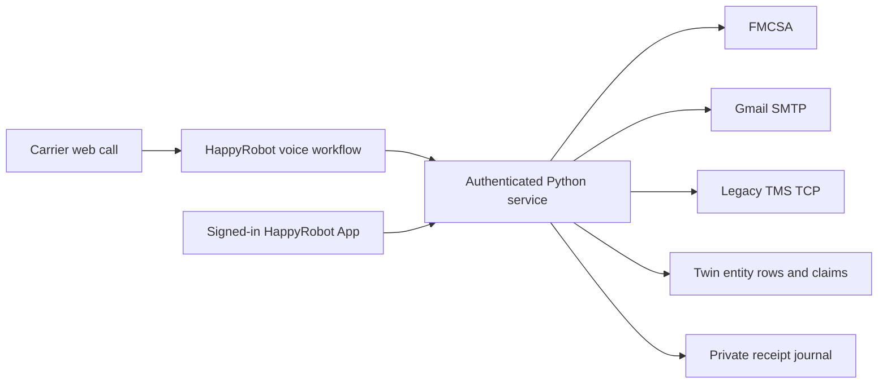

# Inbound Carrier Sales: business and IT build description

This candidate handles the first part of an inbound carrier call and hands the
result to a senior representative. The measured outcome and exact run are in
[PROTOTYPE_REPORT.md](../PROTOTYPE_REPORT.md). The original workflow and main
branch remain unchanged. One final owner call passed all nine required steps:
LD01062 at 3625 returned a PENDING reference, the full handoff was spoken, and
the owner saved rep approval in Apps. This is one controlled result, not a
production conversion measure.

## Business flow

1. Verify the caller's MC against active FMCSA carrier authority.
2. Email a fresh six-digit code to the approved demo inbox and verify it during
   the call before showing any load or rate.
3. Match equipment and lane to explicitly OPEN loads with future pickup,
   excluding spent, protected and void inventory.
4. Offer a service-calculated rate. Negotiate within the unchanged private
   pricing policy and a three-round counter limit. Internal ceilings stay private.
5. Clearly accept the agreed price, then ask the exact load-and-total booking
   question. Check fresh natural permission from actual native speech.
6. Persist call and load claims, the booking row and write intent before one
   LOAD_BOOK send. Save the actual reply and reference.
7. Speak the fixed senior-review and simulated-transfer disclosure, then hang up.
8. Let a signed-in rep review the redacted call and actual receipt in Apps and
   record Confirm or Decline. UNKNOWN is reconciled by read only.

Rep approval is a local business decision. TMS PENDING remains PENDING. No
supported external confirmation, cancellation or expiry operation was established.
The pending interpretation and Luke's unanswered question need review before
submission, as recorded in Questions.Md.

## Components

HappyRobot supplies the hidden runtime call identity and conversation. Python
owns authority, OTP, pricing, round counts, consent, booking transitions and audit
records. The voice model requests actions and receives only carrier-safe results.
It cannot supply a verification boolean, expected code, pricing ceiling, stored
agreement or rep identity.

Twin stores one authoritative row per call, booking and OTP challenge with version
checks. Primary-key call/load claims prevent duplicate submissions. There are no
multi-table transactions, so every write is ordered to fail closed after a crash.
Auxiliary inserts and upserts run independently. The old aggregate remains frozen
and unread. [Storage results](storage-cutover.md) show real-table contention and
latency, including the earlier failures and the limits of the measurements.

The App keeps HappyRobot sign-in and uses authenticated server-side service reads
and rep actions. This is the T-7 fallback for the failed native Twin gateway.
Neither credentials nor raw upstream errors reach the browser. App candidate UI
source is mirrored locally; the separate native Production publish would merge
its App repository into main and was canceled under the owner's hard limit.
The existing functional dashboard, new name and saved alias remain available.

The service runs in a non-root Python 3.12 Docker container. make deploy updates
one existing 256 MB Fly Machine. make warm prevents idle shutdown during a call;
make idle restores automatic stopping afterwards. The total hosting budget is USD3.

## Failure handling and evidence

Codes are call/MC-bound, expire, are consumed once and have resend/failure budgets.
Missing authority, failed verification, missing pricing and TMS outages are intended
to close politely. QA retains one ineligible-call hangup failure, described in
qa-results.md. Information questions do not grant booking permission. Every past send
intent continues to block the load, including an ambiguous or failed result.

Complete pending acknowledgements, uncertain transport and authoritative final
confirmation stay distinct. Receipt capture and storage recovery never trigger a
retry. UNKNOWN and the disputed LD01094 booking cannot be confirmed. Declining a
pending request retains its claim and release warning.

The App separates real and synthetic cohorts. The northstar measures consented,
acknowledged tentative handoffs per code-passed real call. TMS confirmations and
rep approvals are separate. Spoken disclosure is assessed from actual messages,
not inferred from a handoff flag.
These figures describe controlled owner calls and test records, not measured
customer conversion.

Transcripts redact codes and preserve contextual MC identity. Summaries are
explicitly deterministic; sentiment is not assessed. The personal-inbox OTP route
is Luke-approved demo scope and does not prove real carrier contact ownership.
The private receipt journal is ephemeral and must be exported before replacement.
Auxiliary write loss, gateway throttling and slow-storage deadline exhaustion
remain production concerns. QA keeps live, hybrid and simulated results distinct.

## Review links

- [Voice workflow](https://platform.happyrobot.ai/deployments/yhcdrf4kne4j)
- [Operations dashboard](https://carrier-sales-santiago.happyrobot.dev)
- [QA results](qa-results.md)
- [Submission checklist](submission-checklist.md)
