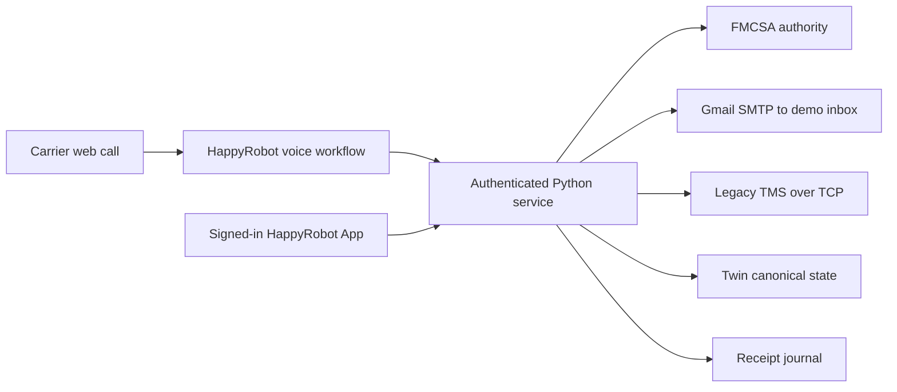

# Inbound Carrier Sales: business and IT build description

Status: controlled prototype on branch prototype/e2e. The first real call
proved the integrations but failed caller consent. Its receipt is retained
for review. The corrected clean-call assessment is pending. This document
must be updated with that result before submission.

## Business scope

The prototype answers inbound web calls, checks carrier authority, verifies
an emailed code, finds suitable loads, negotiates within service-owned pricing
rules, requests a tentative booking and announces a simulated senior-rep
handoff. An operator can review the call and receipt in HappyRobot Apps.

The brokerage keeps the final business decision. Rep approval is recorded
locally and is separate from the TMS's actual status. PENDING is displayed as
PENDING. No supported external finalization or cancellation operation has
been established, and no BOOKED result is invented.

## Carrier journey

1. The caller gives an MC number. The service checks active FMCSA authority.
2. A fresh code goes to the configured demo inbox. The caller must read it
   during the call before seeing loads or rates. The demo destination was
   approved for this challenge; it does not prove a real carrier's identity.
3. The caller provides equipment and a lane. The service filters explicitly
   OPEN loads with future pickup and excludes protected or spent inventory.
4. The service returns carrier-safe offers and accepts at most three counter
   rounds across the call. Internal ceiling and policy values stay backend-only.
5. Price agreement is followed by an explicit permission question naming the
   exact load and total. The service checks fresh affirmative speech from
   the same native session. A clarification or interrupted answer blocks it.
6. One permitted LOAD_BOOK send is made. A complete pending receipt becomes
   ACK_PENDING; uncertain transport becomes UNKNOWN. Neither is described as
   externally confirmed.
7. The agent speaks the neutral senior-review and mocked-transfer line, then
   closes the record and uses the platform hangup tool.
8. The operator reviews the receipt, notes and redacted transcript. Confirm,
   Decline and read-only Reconcile go through the authenticated service.

## Components

HappyRobot supplies the conversation and hidden runtime run ID. The model
requests actions; it cannot set verification facts, the call identity, a
pricing ceiling, an agreed booking rate or a consent boolean.

The Python 3.12 service owns verification, matching, pricing, counter budgets,
consent, booking transitions and audit records. It is Dockerized and deployed
with make deploy to the isolated Fly app. Every service endpoint requires
the appropriate agent or operations bearer credential.

Twin is the business datastore. The external SQL gateway rejected the attempted
data-modifying CTE form, and the runtime role could not create tables.
The approved fallback uses a version-checked canonical JSONB row with atomic
claims and transitions. Separate proto_ business tables are monotonic read
models, not a claim of normalized atomic transactions. Real contention testing
produced one winner from eight claims and one from eight conditional changes.

The native Apps Twin gateway remained Failed after its allowed retry. The
approved fallback keeps verified HappyRobot sign-in and routes App reads and
actions through the service. The operations key stays server-side. Rep identity
comes from the verified session, not from browser input.

## Controls and failure behavior

- Codes are call/MC-bound, expire in five minutes, are consumed once, and have
  resend and failure budgets. Changing MC clears verification and selections.
- The versioned pricing policy is deterministic for a load and policy secret.
  It validates every offered/agreed rate against usable internal pricing.
  Missing or ambiguous pricing goes to review.
- Booking uses the stored agreement. Durable write intent, atomic claims and
  one-shot sending prevent a repeated tool request from sending again.
- A follow-up experiment requires appended authorization for a fresh load.
  Prior intents and receipts are never relabelled or reset to regain budget.
- Receipt bytes, digest, phase and error type are retained independently of
  normal socket cleanup. Receipt-save recovery does not resend a booking.
- A connection that never opens is FAILED. Ambiguous post-send transport is
  UNKNOWN. Only authoritative final evidence can produce CONFIRMED.
- UNKNOWN has no Confirm action. Caller-consent review also blocks Confirm.
  Declining a pending/unknown booking retains the claim and release warning.
- Transcript collection follows native pagination, joins ASR fragments and
  redacts spoken codes, including failed attempts. Native privileged logs and
  ignored raw evidence remain private.

## Operations and measurement

The App separates real and synthetic cohorts. The northstar counts consented,
acknowledged tentative handoffs per code-passed real call. Confirmed TMS
bookings and rep approvals are separate measures. The disputed first call
does not count as a successful handoff.

Current evidence, scenario coverage and limits are in qa-results.md. Native
conversation simulations, fake TCP tests and actual owner voice calls have
different labels. A passing conversational grade does not prove integration
or real booking success.

## Documented assumptions and production work

The candidate interpretation maps TMS PENDING to an initial tentative stage,
not a proven reservation guarantee. Currency/scale, finalization, cancellation,
expiry and lost-receipt ownership remain unresolved. MAX_BUY is treated as the
internal ceiling under the documented candidate assumption.

The owner configured Gmail SMTP for service-owned code delivery. It replaces
the temporary native action-test route on the deployed prototype. Sender
acceptance and the next actual inbox/code proof are recorded separately.

The canonical Twin aggregate, demo inbox identity policy, strict consent
matcher and deterministic post-call summary are prototype choices. Stronger
storage transactions, durable cross-machine receipt retention, a real carrier
contact source, tested AI analysis, operator permissions and full conversation
QA need review before production. No unsupported ROI figures are claimed.

The existing main checkout, real workflow and architecture were not changed.
This branch and its external prototype resources remain isolated for review.
