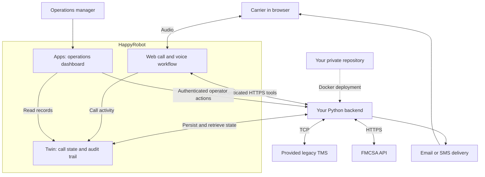

# Codex Proposed Architecture

**I recommend one HappyRobot voice workflow, one Python backend, Twin for storage, and a HappyRobot App for operations.**

Your backend would be a **modular monolith**: one deployed program with separate modules for verification, negotiation and integrations. That keeps the POC manageable.

**1. HappyRobot owns the conversation**

Configure the web-call trigger, inbound voice agent, prompt and tools.

The agent can request operations such as:

- Check carrier authority.
- Send and verify an OTP.
- Search and inspect loads.
- Request an offer or counteroffer.
- Request booking and mocked handoff.

**The agent asks for actions; the backend decides whether they are permitted.** A caller persuading the model cannot override the backend's rules.

**2. Your backend owns the rules and integrations**

Use **Python with FastAPI**, Pydantic for request validation, an HTTP client for external APIs, and Python's TCP networking support for the TMS. FastAPI supports asynchronous requests, which suits waiting on these external systems. [FastAPI documentation](https://fastapi.tiangolo.com/async/)

Keep four modules inside that service:

| Module | Responsibility |
|---|---|
| **Verification** | FMCSA lookup, OTP generation/checking, expiry and attempt limits. |
| **Load integration** | Translate structured requests into TMS commands and parse responses. |
| **Negotiation and booking** | Enforce verification gates, permitted prices, counter limits and booking prerequisites. |
| **Persistence** | Read call state and record actions, results and failures in Twin. |

HappyRobot supplies the agent infrastructure. This design does not require a separate LiveKit or LangGraph agent.

**3. Twin owns your solution's durable records**

Start with these logical tables:

| Table | Stores |
|---|---|
| `calls` | Call ID, carrier MC, verification status, selected load, counter count and outcome. |
| `call_events` | Timestamped activity: checks, searches, offers, errors and handoffs. |
| `otp_challenges` | Code hash, expiry, attempts and association with the call and carrier. |
| `booking_attempts` | Requested booking, agreed rate, request identifier, result and uncertainty. |

The **TMS remains the source of truth for loads and booking responses**. Twin stores what happened in your solution.

Twin supports workflow access and external REST access, so the backend and dashboard can share the same records. [Twin documentation](https://docs.happyrobot.ai/twin/overview)

**4. Apps gives the operations manager a usable interface**

Build the dashboard inside HappyRobot Apps. Initially show:

- Recent calls and their outcomes.
- Verification and negotiation results.
- Load, agreed rate and booking reference.
- Failed integrations and bookings requiring review.
- Basic KPIs, such as booking success and verification failures.

Operator actions should call the backend, so they follow the same business rules. Credentials stay in server-side code.

**5. The backend must enforce these boundaries**

- **Verification:** search and booking check stored verification state. They never trust a model-supplied `verified: true`.
- **Pricing:** return only approved offers and carrier-facing load details. Keep the confidential ceiling and raw pricing records outside the conversational model.
- **Negotiation:** count counter rounds across the entire call, including load switches.
- **Failures:** use bounded timeouts and limited retries for reads. A booking timeout means **unknown outcome**, because the TMS may already have committed it. Do not blindly resend.
- **Repeated requests:** identify duplicate actions and prevent repeated bookings or extra OTP sends.

Verify Twin's support for safe conditional state updates early. Start with one backend instance for the POC, with its concurrency limits documented.

**6. Repository and deployment**

Your private repository holds the backend, tests, Docker configuration, deployment command and documentation. Workflow configuration lives in HappyRobot; the repository should also document its setup.

Deploy the backend as one Docker service with an authenticated HTTPS address. HappyRobot calls that address.

**Build it in this order:**

1. Working browser voice conversation.
2. Backend connection to `DEBUG_ECHO`, then load search and detail retrieval.
3. FMCSA and OTP verification, with search blocked until verification succeeds.
4. Negotiation, then booking after clarifying its semantics.
5. Complete Twin logging, Apps dashboard and standard/adversarial QA.

**Still unresolved:** the recruiter's answers on OTP scope, hold versus booking, and rate semantics. Also confirm the source of the carrier's verification contact: sending a code to an arbitrary caller-supplied address proves access to that address, not its association with the carrier. These remain open decisions, not assumptions built into the architecture.
