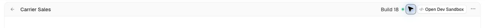
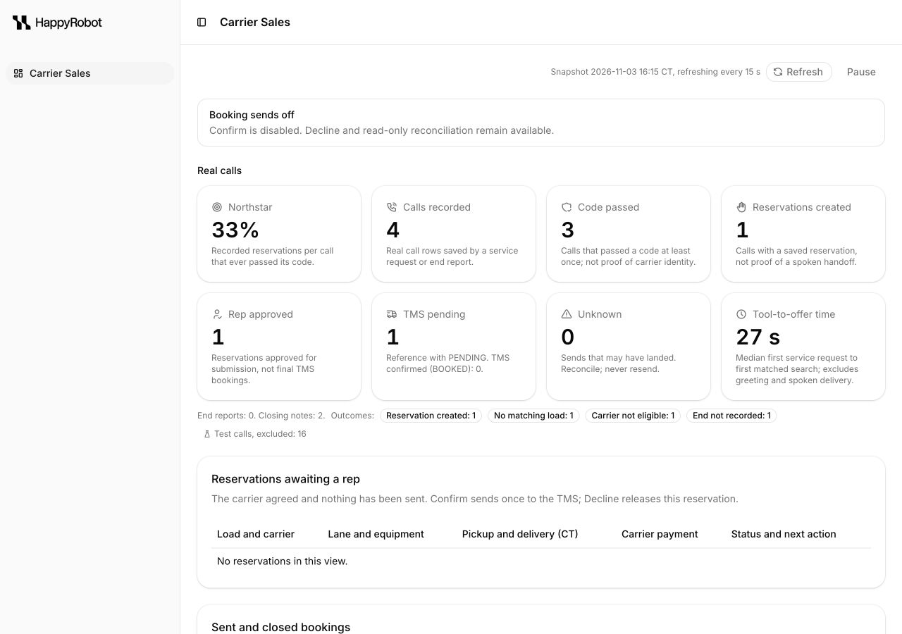
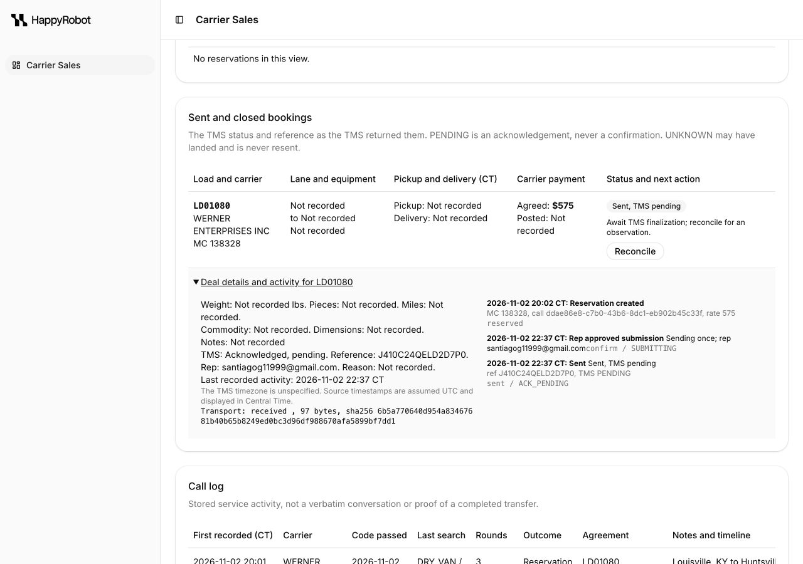
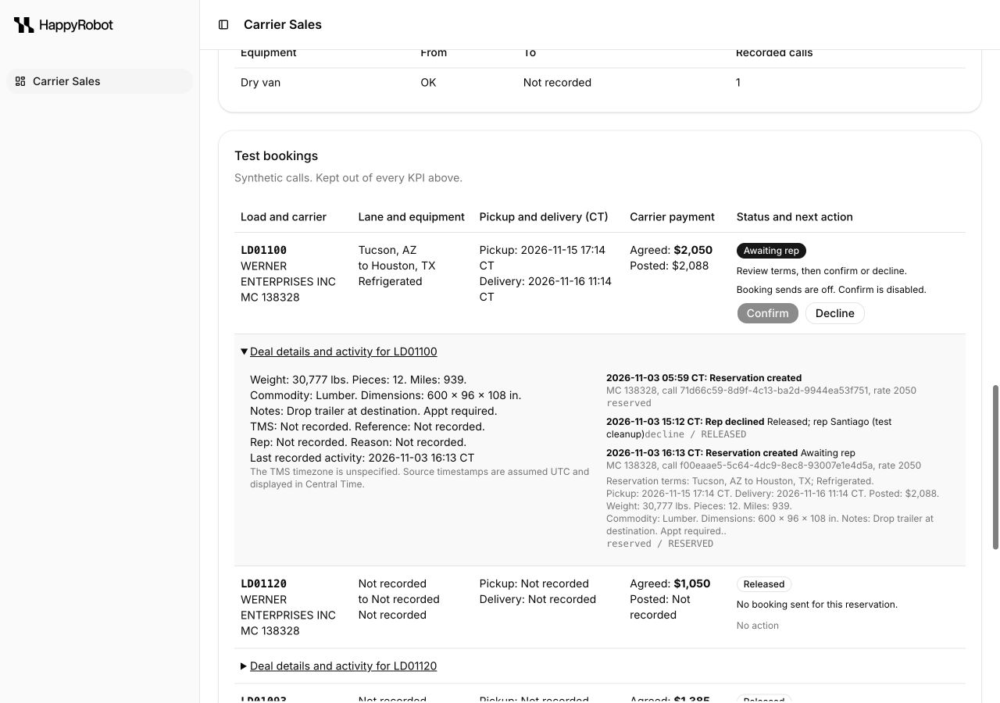
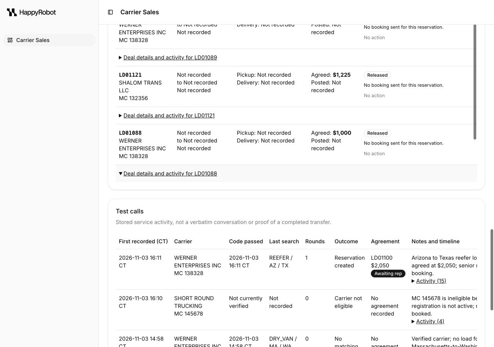

# Carrier Sales release, 2026-11-04 Sydney

Source: `8b0e4831fd69acf4072a82f232e2899624e1dcef`. Fly release 16 and workflow Version 5 were released by Claude after owner approval. Codex published the existing App as Carrier Sales, Build 18. [Open the App](https://carrier-sales-santiago.happyrobot.dev).

[Release facts and screenshot hashes](release.json) and [the 72-file source manifest](source-manifest.json) preserve provenance. The App import commit is `13f7dc1687188ee085c1a2cfa67ab20d9fe3ae35`; its native production publication is `e96e1c31e8c93c7ac471d1060d2c1e631e5568c4`. The full validation and limits are in [QA results](../../qa-results.md#owner-approved-release-and-published-app-check-2026-11-04).

The four product screenshots below use a verified 1280x900 CSS viewport. The administrative build-header screenshot is a direct crop of the platform's Build 18 control. No screenshot was edited. Booking sends stayed off; no booking action was clicked.

## Published build and name

## Overview and send mode

## Historical acknowledgement, not final confirmation

## Disabled Confirm and reservation reuse

LD01100 was declined in the earlier cleanup and then reserved again by a later synthetic call. Its prior decline remains visible; the new reservation is unchanged and Confirm is disabled. The five other cleaned rows remain Released.

## Released-row continuation

The test table uses contained vertical scrolling. Wider call logs also use internal horizontal scrolling at this viewport, so every column is not simultaneously visible. This is a remaining presentation limit, not missing stored evidence.

