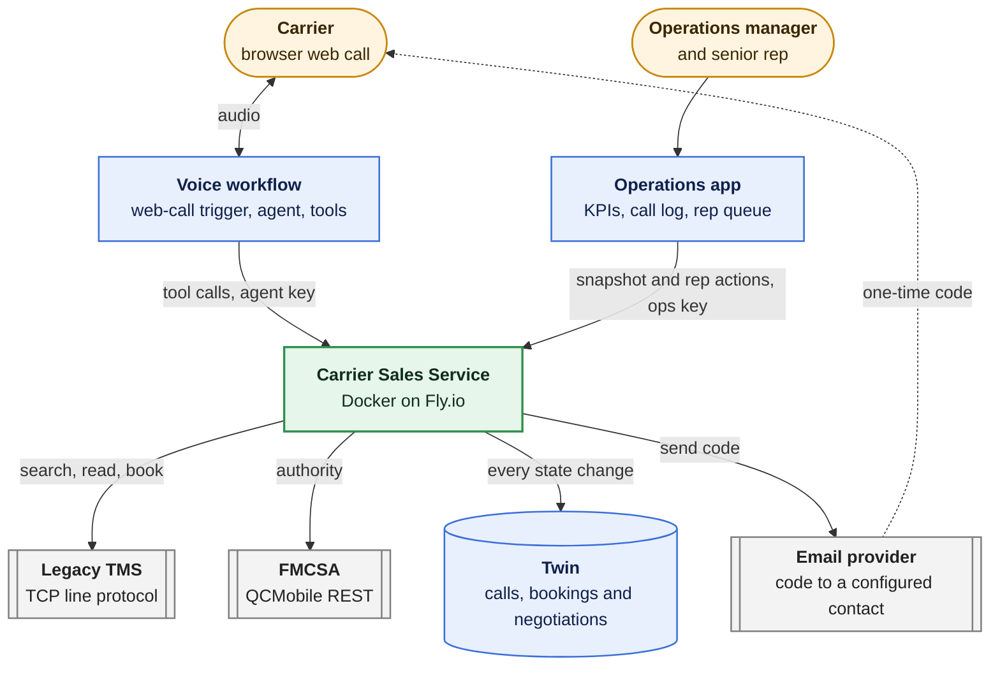
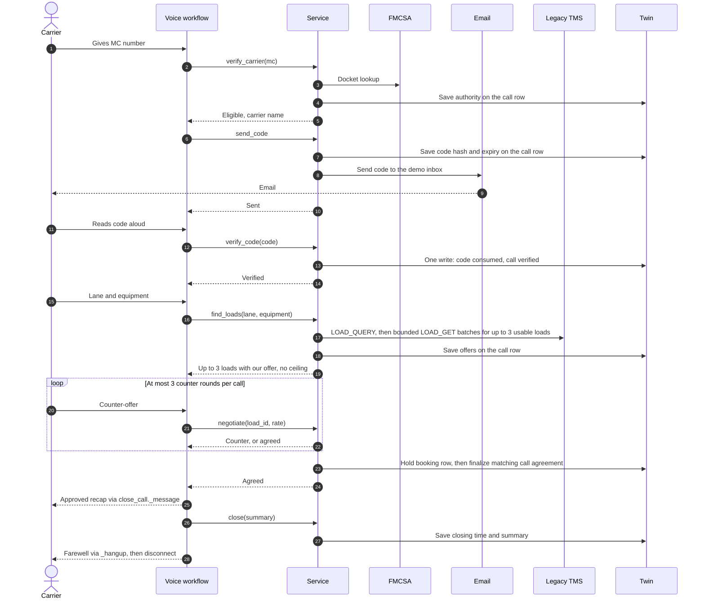
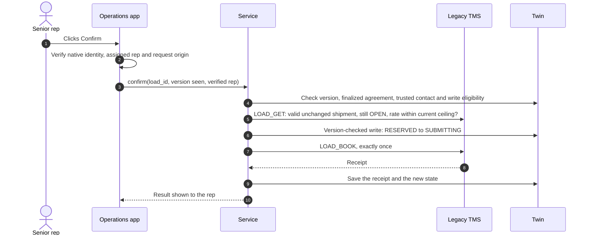
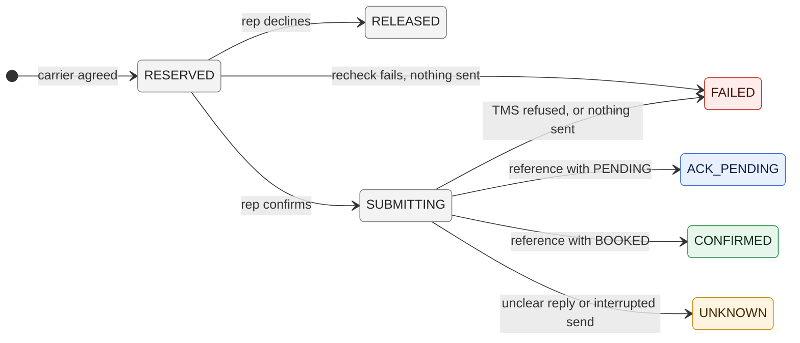

# Inbound Carrier Sales: Architecture

The complete architecture of the submission on `main`. The [one-page overview](../../ARCHITECTURE.md) is the place to start; the [release guide](release.md) pins deployment and reproduction commands.

| | |
|---|---|
| **Version** | 4.1, submission architecture reconciled 2026-11-07 |
| **Operating workspace** | Native App Build 11, submission service and populated Twin staging. Live carrier booking remains disabled; a separate expiring challenge-sandbox permission demonstrates Confirm. Readiness identifies the exact release and permission window. |
| **Evidence** | Current test results and voice evaluations are in [results](../results.md). Voice grades and audio results belong to their exact version. |
| **Historical rollback** | `oldmain` at 15ce2b6, voice Version 8, service release 17 and original App Build 24. The 49-call sample is dated historical evidence, not the current reporting boundary. |
| **Decisions** | Material choices, reasons and tradeoffs are in the [decision log](decision-log.md), including D-36 through D-46 for the submission. |
| **Requirements** | The [assignment PDF](../FDE_Technical_Challenge_-_Inbound_Carrier_Sales.pdf), summarized in [assignment.md](assignment.md). |

The four-part architecture uses HappyRobot for conversation, a deterministic Python service for authorization, Twin for state and Apps for operations. Twin contains three tables: calls, bookings and carrier/load negotiations. The third table adds durable shared concession memory within the existing datastore. Reservations opens all recorded agreements with an Awaiting rep filter; Overview derives stage progress and ended-call exceptions from the complete bounded snapshot.

---

## 1. The system on one page

A carrier opens a HappyRobot web call. A voice agent takes their MC number, the service checks it against FMCSA, and the carrier reads back a code sent by email. The agent then finds matching loads in the legacy TMS, negotiates within a private ceiling and reserves the load. A senior rep, whose transfer is mocked on the call, reviews the reservation in the operations app and clicks Confirm. Live carrier sends require independently enrolled contacts. The hosted demonstration instead uses the separate temporary challenge-sandbox permission described in section 10 and the release guide; live carrier booking remains off.

Two rules shape everything else:

> **1. The model talks; the service decides.** The model can only request actions. The service allows or refuses each one using its own records and the TMS, never the model's word. It never gives the model the rate ceiling or the expected code.
>
> **2. Only a rep can send a booking.** The TMS has no cancel, so the voice agent has no way to send `LOAD_BOOK`. A carrier's agreement only creates a reservation, so a mistake on the call reaches a person, not the TMS. An assigned, platform-verified rep confirms that exact reservation at its recorded rate, after the service checks finalized consent and trusted contact evidence. It is sent at most once: if the result is unclear, the load stays blocked and the booking is never resent.

Four parts, each with one job:

| Part | Runs on | Owns |
|---|---|---|
| **Voice workflow** | HappyRobot | The conversation: web-call trigger, inbound agent, prompt, tools. |
| **Carrier Sales Service** | Docker on Fly.io | Rules and integrations: verification, negotiation, reservations, TMS and FMCSA access. |
| **Twin** | HappyRobot | Saved service activity and booking decisions, with explicit capture gaps. |
| **Operations app** | HappyRobot Apps | What the operations manager sees and does: KPIs, call history, the rep queue. |

The TMS stays the source of truth for loads. Twin records what our solution did.

---

## 2. System overview



**Blue** is HappyRobot, **green** is the service we build and run, **grey** is outside systems.

**Trust boundaries.** Every arrow into the service is authenticated, and each caller has its own key. Tool requests carry the workflow's `run_id` in a hidden runtime field, so the model cannot choose or change the call. The service is the runtime writer to Twin and the integration path to the TMS, FMCSA and email provider. The workflow key must remain exclusive to that trusted integration: a hidden run ID is not independent platform attestation. Imported history is separately provisioned and immutable in runtime paths.

---

## 3. A call, end to end



Then, in the operations app:



`LOAD_BOOK` is reached only by winning that version-checked write, so a double click or two reps cannot send twice. The request carries the version the rep saw, so a rep can only confirm the reservation on their screen.

---

## 4. Rules that must always hold

Tests must prove these regardless of what the model does.

| ID | Invariant |
|---|---|
| **INV-1** | The service never returns or accepts a rate above `max_rate`. Confirm re-reads the ceiling before sending. |
| **INV-2** | `max_rate` never reaches anything the voice agent can see. Load fields reach the agent through an explicit allowlist, so a new field stays private by default. |
| **INV-3** | No load details until the service's own record shows FMCSA eligibility and a verified code for that call. |
| **INV-4** | At most 3 counter rounds per call, counted across every load discussed. |
| **INV-5** | The expected code never reaches the workflow. It goes only to the configured inbox, never to an address the caller gives. |
| **INV-6** | A load has at most one active reservation. A call has at most one agreement. |
| **INV-7** | `LOAD_BOOK` is sent only after a rep's Confirm of the reservation version they saw, at most once per reservation, and is never resent. A timeout is `UNKNOWN`, because a timeout does not say whether the request landed. |
| **INV-8** | Every endpoint requires authentication, including health. No public API docs. |
| **INV-9** | Every call and booking state change and its audit event commit in the same write. Neither can exist without the other. A shared negotiation quote lowered to a new cap is updated in place without a new event. |
| **INV-10** | Handled LOAD_BOOK outcomes retain the step, error type and every received byte/hash. This is not a durable crash journal; process death before persistence can lose a receipt. |

**What these cannot cover.** The service cannot control what the model says. A wrong number can be spoken, and a misheard rate inside the limits can reach a reservation. That is why a rep reviews every reservation before anything is sent. Conversation tests measure how often this happens.

---

## 5. Requirements traceability

| Requirement (PDF) | Where it is met | How it is verified |
|---|---|---|
| FMCSA authority check (p.2) | [§8](#8-verification-and-the-one-time-code) | Unit tests, live MC ledger |
| OTP after authority, before matching, no bypass (pp.4-5) | §8, INV-3, INV-5 | Unit tests, adversarial suite |
| Load match by lane and equipment (p.2) | [§9](#9-load-search-and-negotiation) | Conversation tests |
| Never exceed or disclose `max_rate` (p.4) | §9, INV-1, INV-2 | Property tests, adversarial probing, marked-value scan |
| At most 3 counters, then close without transfer (p.5) | §9, INV-4 | Unit and conversation tests |
| Tentative reservation, rep confirms, mocked handoff (pp.2-3) | [§10](#10-reservation-and-confirm) | End-to-end demo |
| Log MC, load, rate, outcome, notes (p.3) | [§7](#7-data-call-booking-and-negotiation-records), events on each row | Row checks after each test call |
| All call activity in Twin (p.4) | §7 | A call that drops midway still has a record |
| Operations UI in Apps (p.4) | [§11](#11-operations-app) | Demo |
| Graceful TMS timeouts and malformed responses (p.3) | [§6](#6-the-service), [§10](#10-reservation-and-confirm) | Fault-injection tests over real TCP |
| Authentication on all endpoints (p.5) | INV-8 | API tests: every route rejects a missing or wrong key |
| KPIs, scripted, edge and adversarial tests (p.4) | [§14](#14-quality) | [results](../results.md) |
| Docker, single-command cloud deploy (p.4) | [§16](#16-deployment) | `make deploy APP=... APP_URL=...` after explicit setup |
| Web call only, no phone number (p.5) | Voice workflow | Browser demo |

---

## 6. The service

One Python 3.12 FastAPI program. It keeps no database of its own and runs no background jobs. Its size is reported with every commit and kept small, but not capped ([D-28](decision-log.md)).

```text
service/
  main.py            Builds dependencies and the app
  config.py          Typed settings; the only runtime environment reader
  api.py             Routes, keys and request models
  calls.py           Verification and code flows
  call_state.py      Call-row transitions, claims and terminal recovery
  selling.py         Search, negotiation and closing orchestration
  sale_decisions.py  Atomic call-row negotiation decisions
  negotiation_memory.py  Shared carrier/load negotiation memory (D-44)
  bookings.py        One reservation row per load and consent checks
  rep_actions.py     Rep confirm, decline and reconcile; LOAD_BOOK
  dashboard.py       Bounded snapshot and legacy diagnostic fields
  core/              Pure rules; no network, files or clock
    models.py  money.py  pricing.py  negotiation.py  loads.py
    approved_freight.py  carrier_policy.py  codes.py  sandbox.py
  adapters/          External transport and provider contracts
    tms/              protocol.py  mapping.py  client.py
    twin.py  twin_reads.py  fmcsa.py  email.py
  policy/            Versioned pricing and blocked-load list
  tests/             Deterministic tests, fake integrations and profiles
tools/               Build gates, docs check and the review/deployment launcher
```

This map describes the current submission source. Build tooling is outside the runtime. Prototype migration history remains in [lessons from the prototype](../history/lessons-from-prototype.md#where-the-prototypes-files-went).

The dependency direction is one way: `api` calls `calls`, `selling`, `rep_actions` and `dashboard`, which call `core` and `adapters`. `selling` writes call rows through `calls`. `core` imports nothing from the others.

| Endpoint | Key | Does |
|---|---|---|
| `POST /carriers/verify` | Agent | Normalizes the MC, checks FMCSA, saves the result. |
| `POST /otp/send` | Agent | Issues a code once the carrier is eligible. At most 2 per call. |
| `POST /otp/verify` | Agent | Checks the spoken code. At most 3 failures, then the call is locked. |
| `POST /loads/search` | Agent | `LOAD_QUERY`, then bounded batches of `LOAD_GET` until up to 3 usable matches are found. Returns validated operating fields and the current quote. |
| `POST /negotiate` | Agent | Applies the negotiation policy. On agreement, reserves the load. |
| `POST /calls/close` | Agent | Records closing time and summary. Safe to repeat. |
| `POST /calls/ended` | Agent | Sent by the workflow after the voice agent finishes: who ended the call and how long it lasted. Creates the call's row if no tool ran. Safe to repeat. |
| `GET /ops/snapshot` | Ops | Calls, bookings with their versions, and KPIs for the app. Cached for 5 seconds after refresh completion. |
| `POST /bookings/{load_id}/confirm` | Ops | Sends `LOAD_BOOK` for the version the rep saw ([§10](#10-reservation-and-confirm)). |
| `POST /bookings/{load_id}/decline` | Ops | Releases the version the rep saw. Nothing was sent, so the load is free. |
| `POST /bookings/{load_id}/reconcile` | Ops | Read-only TMS check on a stuck or sent booking. Never sends. A `SUBMITTING` row older than 60 seconds becomes `UNKNOWN`. |
| `GET /health` | Either | Liveness and TMS reachability. |

**Send mode.** The authenticated operations snapshot includes the service live_booking setting. Confirm is disabled while it is false or unavailable; the service independently refuses sends while off.

**Rep actions** send `{version, rep}`: the booking version from the snapshot and the signed-in rep. Like voice requests they answer HTTP 200 with a `status`, such as `stale` when the row has moved on or `live_booking_off`.

**Voice responses** are always HTTP 200 with a `status` field, so the agent can say something sensible. HTTP errors are kept for authentication and malformed requests. Each voice request has a 12 second deadline covering everything it does.

**The TMS adapter** turns the line protocol into typed results. Reads retry within a 6 second budget. `LOAD_BOOK` never retries.

| What the TMS does | What the adapter does |
|---|---|
| Responds normally, padded, in any order | Parses by key, trims padding, ignores unknown fields. |
| Times out, closes slowly or sends a partial frame | Reads: up to 3 attempts (2 retries) with jitter inside the 6 second budget, then `tms_unavailable`. |
| Sends a malformed frame or an oversized line or reply | Treated as a failed read. Never crashes, never guesses. |
| Returns `ERR\|CODE:...` | Mapped to a typed error. |

**Field mapping.** The adapter owns the one mapping from TMS fields to the PDF's load fields. Known so far: `RATE` is `loadboard_rate`, and `MAX_BUY` is `max_rate` (D-10). `DIMS` converts from feet to inches. See [the TMS reference](../tms/README.md) and [contract evidence](../tms-contract.md).

---

## 7. Data: call, booking and negotiation records

This integration uses one SQL statement per request and does not use cross-table transactions. A row updates atomically with a version check. State and its own event therefore share one row. Agreement and load reservation still cross call/booking rows and use ID-bearing accepting claims, booking-row voids and retry recovery; they are not a transaction ([D-23](decision-log.md)).

All three tables use the same shape. The checked-in [bootstrap SQL](../../tools/twin-schema.sql) is run once in the selected Twin environment; see [setup and the read-only schema check](onboarding.md#reproduce-the-twin-tables). DDL support depends on the interface and permissions; the application adapter performs no schema changes.

| Column | Type | Meaning |
|---|---|---|
| `id` | text, primary key | `run_id` for `calls`, load ID for `bookings`, MC plus load ID for `negotiations` |
| `version` | bigint | Rises by one on every write |
| `data` | jsonb | The row's fields, shown below. Not `json`: the SQL casts values to `::jsonb`, as on the prototype |

**`calls`, one row per call.** The abbreviated example shows current state fields; imported rows also carry `read_only` and `imported_from`. Values are illustrative, not a recorded call.

```json
{
  "cohort": "real",
  "started_at": "...", "last_activity": "...", "closed_at": null,
  "mc": "138328", "carrier_name": "...", "eligible": true,
  "authority": { "reason": "active_carrier_authority_verified", "checked_at": "..." },
  "otp": { "hash": "...", "expires_at": "...", "sends": 1, "failed": 0, "consumed_at": null },
  "verified_at": "...",
  "search": { "equipment": "DRY_VAN", "origin_state": "CA", "dest_state": "KY" },
  "native_workflow": { "workspace": "...", "workflow_id": "..." },
  "offers": { "LD01234": 3600 },
  "shipments": { "LD01234": { "origin": { "city": "...", "state": "...", "zip": "..." } } },
  "lowest_asks": { "LD01234": 4200 },
  "rounds": 1,
  "counter_replies": { "LD01234": { "4200": { "load_id": "LD01234", "ask": 4200, "reply": { "status": "counter", "offer": 3600, "round": 1 } } } },
  "accepting": null,
  "agreement": null,
  "outcome": null,
  "summary": "...",
  "ended_at": "...", "ended_by": "user", "duration_seconds": 52,
  "policy_version": "pricing-v1",
  "events": [ { "seq": 1, "at": "...", "action": "verify_carrier", "mc": "138328", "status": "checking" } ]
}
```

**`bookings`, one row per load.** Creating this row is the reservation. The primary key means only one call can win a load.

```json
{
  "state": "RESERVED",
  "call_id": "...", "mc": "138328", "rate": 3625, "cohort": "real",
  "load": { "origin": { "city": "...", "state": "..." }, "pickup_datetime": "...", "loadboard_rate": 3800 },
  "rep": null, "reference": null, "tms_status": null, "raw_reply": null,
  "send": { "step": null, "error": null, "bytes": 0, "sha256": null },
  "reason": null,
  "events": [ { "seq": 1, "at": "...", "action": "reserved", "state": "RESERVED" } ]
}
```

**Every write works the same way.** Read the row and its version, compute the new row in memory with its new event, then write it back only if the version has not changed. If it has, read again and retry, up to 5 times. Reservation correctness does not depend on local locks. Dashboard refresh and Twin pacing do use local asyncio locks. Multi-step actions can require several statements. Fresh point reads share paced SQL slots, while writes remain independent and version checked; see section 13 for the actual budget and measured contention.

**The audit trail is the `events` list.** Because an event is written with the change it describes, an individual persisted row cannot lose its event through a separate failed audit write (INV-9). Call and booking rows can temporarily disagree during reservation recovery; claim IDs and booking history resolve that boundary. External TMS effects are a separate boundary. There is no separate audit table to keep in step, no outbox and no replay. Each call event records the call's MC after the step, except email completions retain the issuance MC and send number. Events keep what was asked and the result, never a code or the ceiling. A negotiation event keeps the carrier's ask as heard and as read, the load and our answer, so every round survives a later one. A search event keeps the loads pitched as the agent received them. A code event records the observed mailer result, not inbox delivery; a superseded completion cannot claim the current code was sent. Cancellation can leave delivery unknown. The workflow's end-of-call request records who ended the call and how long it lasted. Some results are internal, such as `checking` before an FMCSA lookup, so events record what the service decided, not every word spoken. A refused carrier change after an acceptance claim or agreement leaves no event or row write. Transcripts stay in HappyRobot, because they contain the spoken code.

**Outcome is computed, not stored twice.** A booking row is the only record of a booking. The dashboard derives each call's outcome when it reads:

| Condition | Outcome shown |
|---|---|
| A historical reservation belongs to the call, without an unfinished claim or follow-up flag | `agreed_pending_rep`, with its booking state beside it; incomplete holds remain review exceptions |
| `outcome` is set | That value: `negotiation_failed`, `no_match`, `carrier_ineligible`, `fmcsa_unavailable`, `code_failed`, `pricing_review_required`, `shipment_review_required`, `tms_unavailable` |
| `closed_at` is set | `ended_without_agreement` |
| `ended_at` is set, by the workflow after the call | `ended_without_close` |
| No activity for 30 minutes and no end recorded | `end_not_recorded` |

The legacy service demand diagnostic groups `no_match` outcomes by their latest `search` fields. The current App also inspects search history and requires end evidence before reporting a verified call as lost; [KPI definitions](kpis.md) separate the two populations.

**Repeated requests are answered from stored state** ([D-26](decision-log.md)). A repeated `verify_code` on a consumed code returns verified. A repeated `negotiate` with the same load and ask uses no additional round, including delayed retries after another ask or load. Up to three concession-producing request signatures are retained with the shipment. A replay preserves the safe current standing quote if later negotiation changed it; an explicit acceptance at that quote still takes priority. Replay metadata reports the current global round and final-offer status, including an old request arriving after the third round. A repeated close changes nothing. A repeated accept finds its own reservation.

---

**Capture coverage (deployed).** Each search event retains its normalized criteria and the public load details returned to the agent; each negotiation event retains the amount as heard, normalized ask, response and round. Code delivery records sent or failed without the expected code. These are service actions, not proof of words spoken or heard. The end webhook records end initiator and duration even if no tool ran, introduced with Version 4, retained in the baseline and current submission, and only when the workflow reaches the webhook and Twin accepts it. An abrupt close has no invented summary. Call counts cover persisted service requests and delivered end reports, not every platform call. No start-to-offer timing is inferred from the end webhook's receipt time.

**Historical imports and media provenance (D-40).** Imported call and booking rows carry `read_only` metadata. Call transitions, rep actions, reservation acquisition, voiding and source-consent checks refuse to mutate or submit them. Even a released imported booking blocks reuse; normal released rows remain reusable. Fresh call creation can stamp configured workflow provenance, from which the App constructs recording links for valid run IDs. Request fields cannot supply a URL. Historical native inventory enriches older rows; a UUID alone earns no media link.

## 8. Verification and the one-time code

1. **Authority.** FMCSA QCMobile docket lookup. Eligible only if `allowedToOperate` is `Y`, `commonAuthorityStatus` or `contractAuthorityStatus` is `A`, `statusCode` is `A`, `oosDate` is present and null, and any other out-of-service field says no. `allowedToOperate` alone is not enough, because inactive carriers still showed `Y`. Missing or unknown values fail closed, and an empty result means not found. FMCSA errors return `fmcsa_unavailable`, never inactive. The request works from Fly.io but returns HTTP 403 from the local machine. The ledger of checked carriers is in [docs/test-carriers.md](../test-carriers.md).
2. **Issue.** The service generates a 6-digit code, stores a keyed hash on the call row with a 5-minute expiry, then sends the email itself over Gmail SMTP. The service never returns the expected code to the workflow; the caller-spoken code and verification request do appear in restricted platform run records, and an uncertain send counts against the limit and is not silently retried.
3. **Check.** The carrier reads the code aloud, which is unavoidable. The service compares it against the hash in constant time. Consuming the code and marking the call verified are one write, so a crash cannot leave a used code and an unverified call.
4. **Destination (D-12, D-37).** The demo uses the approved shared demo inbox, which proves access to that inbox, not carrier identity. An enrolled roster routes each MC to an independently verified contact and is mandatory for `LIVE_BOOKING` startup. Per-reservation evidence must show that trusted route before a live carrier send. The temporary challenge-sandbox exception is described in section 10. Delivery admission allows four attempts per recipient and 100 total per process in ten minutes, in addition to per-call budgets; restart and scale-out limits remain explicit.
5. **Every call.** A fresh code is required on every call before matching (D-9).
6. **MC changes.** Before an acceptance claim or agreement, changing the MC clears authority, code and offers. It keeps the round, send and failure budgets, so a new MC cannot reset them. The new MC is saved before FMCSA is asked, so a failed or slow lookup cannot leave the earlier MC verified, and a late result for an MC the caller has since replaced is not applied. After a claim or agreement, a different MC returns `carrier_locked` without changing the row or looking up the carrier. Settlement and agreement replay still recheck verification and carrier ownership inside their writes. A refused settlement keeps the claim and held booking for recovery or rep decline; the voice path never releases that booking.

---

## 9. Load search and negotiation

**Search** normalizes lane and equipment, then requires explicit `OPEN`, a future pickup and no active reservation. `LOAD_QUERY` also returns `PENDING` loads, so returned matches are checked locally. Loads on the [blocked list](../../service/policy/blocked-loads-v1.json) are never offered. Results are ranked by pickup time, and at most three are offered, one at a time. Only validated locations, cargo, chronology and approved complete operating clauses reach the voice payload. Unrecognized text, contradictory requirements or incomplete shipment facts require review instead of a false claim of no freight. When nothing matches, the search is recorded on the call.

**Displayed times (D-34).** The public load view retains its original ISO timestamps and adds `pickup_time_display` and `delivery_time_display`. These are deterministic America/Chicago strings naming Central Time and CST or CDT, matching the App's display policy, including date changes and daylight saving. Startup resolves and injects the timezone; core formatting reads no files. The formatter leaves missing times null, but validation prevents such a load from being returned as found. Every found load carries both display strings. The voice prompt reads them instead of calculating a conversion. The TMS source timezone remains unconfirmed: the adapter still assumes UTC, so this display policy does not establish the source timezone. Display formatting was deployed in release 17 before Version 6 publication and is retained in the submission, which also validates shipment chronology and completeness before quoting.

**Rate assumption (D-10).** `MAX_BUY` from `LOAD_GET` is provisionally `max_rate`. The recruiter did not confirm this mapping or its currency. A load without a usable `MAX_BUY` goes to `pricing_review_required`: no offers, no reservation (D-11).

**Pricing policy (D-4).** A versioned file, [`pricing-v1`](../../service/policy/pricing-v1.json), turns each load's posted rate and ceiling into three numbers, all rounded down to 25:

- **Working cap:** the ceiling minus a load-specific gap of 2 to 6%. It is the highest number we say and the highest ask we accept.
- **Opening offer:** the posted rate minus 5% when that leaves room below the cap, otherwise a load-specific spread of 8 to 15% below the cap.
- **Legacy round targets:** the pricing-v1 schema retains its historical 35%, 65% and 100% values for reproducibility. The reciprocal policy does not use them to authorize concessions.

Both draws use an HMAC of the policy version, load ID and purpose under a server secret. The same load gives the same numbers on every call, so calling back does not redraw the price. The secret prevents exact recomputation, but the public policy band and observed offers still constrain possible ceilings. These percentages are demo choices the brokerage would own.

**Reciprocal policy (D-43).** `reciprocal-v2` considers asks no more than 25% above the opening, not the moving quote. After the first ask, the carrier must improve the lowest prior ask by at least $25. The next authorized offer is `min(cap, offer + max(25, floor((min(ask, cap) - offer) / 75) * 25))`: one third of the capped gap rounded down to $25, with a $25 floor or the remaining cap room if smaller. Reach, step share, minimum improvement and version are constants in `core/negotiation.py`. Distant, rising and token asks do not increase the offer. Acceptance at or below the standing or next offer uses the caller's exact amount, so the floor never overpays a small ask. A new above-offer ask consumes a round even when we hold; exact repeats do not. Three is a budget, not a requirement to reach the cap.

Each new call negotiation event and shared round-decision event records `negotiation_policy_version`. Pricing-v1 still owns opening and cap, and is not renamed or redrawn. Old events are neither relabeled nor backfilled, and existing shared quotes and budgets survive the policy change.

**Cross-call memory (D-44).** The `negotiations` Twin table uses the same id/version/data shape. Each row is keyed by normalized verified MC and load ID and contains the shipment fingerprint, standing quote, lowest ask, rounds and at most three concession-decision events. New calls must independently verify and search. They resume the quote and shared budget; changing voice version, restarting the service or waiting does not reset it. Material shipment changes allow a fresh shared budget, but never reset the call's global three-round limit. Posted-rate or ceiling changes alone do not reset the budget. Lower price limits durably retract the quote; later increases cannot resurrect it. No automatic time expiry is implemented, intentionally preventing wait-and-retry resets. Human repricing is a future explicit operation, not a caller capability.

**Write boundaries.** A fresh exact opening acceptance with no existing memory or spent rounds needs no memory write; it linearizes at the fresh absent-row read. A concurrent later decision is never overwritten. Concessions, lower prices and existing rows retain shared-memory CAS. That CAS spends the concession first, then call-row CAS rechecks verification, shipment consent and the global call budget before recording or reserving. A failed second write may consume a concession without the caller hearing it; retry or redial does not refund it. There is no multi-row transaction claim. Memory failure fails closed. Search and negotiation do fresh reads, not a process-local cache. Concurrent searches can return a conservative older quote; negotiation always uses shared memory and fresh price limits. Acceptance retains the existing reservation claim and recovery flow.

The implementation and scenario results are described in [the negotiation review](negotiation.md). The third table and original reciprocal service are deployed in Twin staging. This floor correction from `8ccbf0a` was deployed with owner approval on November 7; the owner's human call `6dc95ce1-f7e0-44a3-8394-8408b754527e` then exercised it on LD01114 ($1,100 opening, $1,250 ask countered at $1,150, agreed at $1,175). The [release guide](release.md) separates those release states. Existing historical calls remain immutable and are not retroactively treated as negotiations under the new policy.

**What this protects, and what it costs.** A fixed percentage could be inverted to find the ceiling; the keyed gap removes that formula. Some leakage is unavoidable, because the cap creates an accept/reject boundary that probing can narrow, so confidentiality is a tested property, not a guarantee. A carrier whose ask stays above the cap can be turned away even below the private ceiling. The App counts evidenced final-offer exhaustion, not an independently proven causal loss to the ceiling.

---

## 10. Reservation and Confirm

**On the call.** When a carrier accepts, `negotiate` re-reads the load, then inserts the booking row. If that insert loses, the load has gone and the agent says so. Nothing has been sent, so a dropped call, a misheard yes or a failed write leaves at worst a reservation for the rep to review. A reservation does not expire, so it holds the load until a rep acts.

**Shipment-bound consent (D-36).** Each quote stores its shipment facts, including dispatch ZIPs. Acceptance and rep submission compare the fresh TMS facts. Changed terms require a new pitch and acceptance. A stable shipment retains its spoken price through a repeated search or ask, unless the current cap requires a lower quote. A rising posted rate never silently raises a prior quote. A carrier must improve their best prior ask before another concession on those same terms; acceptance at their exact amount prevents offering more than they requested. A changed shipment clears those per-load facts and retains the call-wide round budget.

A booking row is a durable hold. Rep submission additionally requires the source call to have a matching finalized agreement and trusted-contact verification. A terminal webhook can recover a hold whose acceptance write was interrupted, but labels it as requiring carrier follow-up. That hold can be released, cannot be sent and is excluded from the conversion numerator. This is a safety repair, not evidence the caller heard a completed handoff.

**Reservation context.** The fresh detail read used to price an acceptance also supplies an explicit rep-view allowlist. Its lane, dates, equipment, cargo and posted rate are stored on the booking row and its reserved event; the ceiling is excluded. Reusing a released row preserves the previous snapshot in its event. Old rows have no reconstructed context. A carrier name is joined only while the call MC matches the reservation MC.

**In the app.** Confirm checks the row is still the version the rep saw, re-reads the load, wins a version-checked write to `SUBMITTING`, sends `LOAD_BOOK` once and saves the reply. Decline makes the same version check.



| State | Meaning | Load blocked | Rep can |
|---|---|---|---|
| `RESERVED` | Carrier agreed. Nothing sent. | Yes | Confirm, decline |
| `SUBMITTING` | Intent saved, `LOAD_BOOK` in flight. | Yes | Reconcile once older than 60 seconds |
| `ACK_PENDING` | Complete reply with matching load, reference, valid timestamp and `PENDING`. | Yes | Reconcile |
| `CONFIRMED` | Complete reply with matching load, reference, valid timestamp and `BOOKED`. Never observed live. | Yes | None |
| `UNKNOWN` | The write may have landed and we cannot tell. | Yes | Reconcile |
| `FAILED` | The TMS refused, or we can prove nothing was sent. | No | None |
| `RELEASED` | The rep declined. Nothing was sent. | No | None |
| `UNCLAIMED` | A retry voided a claim before it reserved, so that claim can never reserve. Nothing held or sent. | No | None |

A later reservation on a freed load carries the earlier attempt's events forward, so no evidence is lost.

**What can go wrong at Confirm:**

| Event | Result |
|---|---|
| The rep's screen is out of date | The row is no longer the version the rep saw. Nothing is sent or changed, and the rep is told to refresh. |
| TMS read fails before sending | Stays `RESERVED`. The rep is told to retry. |
| Load no longer `OPEN`, pickup passed or ceiling fell | `FAILED`, nothing sent. The rep calls the carrier back. |
| Two clicks or two reps | The version check lets one win. The other is told it is already handled. |
| `INVALID_RATE` or an unknown-load error | `FAILED`. Nothing was created. |
| The connection never opens, so no byte left the service | `FAILED`, with `send.step` recording why. The load is free. |
| Timeout after connecting, malformed reply, `ALREADY_BOOKED` or any other error | `UNKNOWN`, with bytes kept. Never resent. |
| Process dies after `SUBMITTING` | The row stays `SUBMITTING`. After 60 seconds the app offers Reconcile, which moves it to `UNKNOWN`. |
| Twin fails while saving the receipt | The save retries for about 10 seconds with the rep waiting. If it still fails, safe receipt identifiers, state and a digest are retained in the log and rep screen. Raw bytes stay off the browser and application log. A process crash can still lose unpersisted bytes. |

**`PENDING`.** The handbook shows `BOOKED`, but the ten complete receipts in the earlier TMS observations returned `PENDING`, including one sent deliberately above the ceiling and the first rep Confirm through this service, and no transition to BOOKED has been observed in the recorded checks. No documented action moves them on, and reads return no reference or owner ([evidence](../tms-contract.md)). So the app shows the actual TMS status, and `PENDING` is never called confirmed. The recruiter accepted proceeding with this handling for the challenge on November 5. He supplied no way to finalize the external booking. [Q8 and limits](questions.md)

**Live sends are off by default.** `LIVE_BOOKING` requires real-cohort calls and enrolled carrier contacts. A separate temporary challenge-sandbox permission permits a configured demo MC without pretending inbox access proves carrier identity. `service/core/sandbox.py` checks the source call and its current reservation event against an explicit UTC window. Startup rejects windows longer than 48 hours, a different TMS host/port, non-staging Twin, non-synthetic calls, a contact roster, or simultaneous live mode. Both source records must retain demo-inbox provenance. Imported rows, incomplete agreements and reservations outside the window remain unsendable. Expiry is checked after the fresh TMS read and again immediately before invoking the TMS booking adapter, including after the Twin claim; an already dispatched request still saves its receipt. Every sandbox send retains the same rep, version, shipment, rate and no-retry checks. There is no supported cancellation/reset; no permanent consumption or quota is established.

---

## 11. Operations app

Built from the HappyRobot Apps Next.js template and mirrored under `ops-app/`. It verifies the signed-in user, then calls the service from its server with the ops key. The Twin gateway for Apps has been failing (T-7), so the app reads through the service, which also keeps every rule in one place. The ops key never reaches the browser, and the rep's identity comes from the verified session.

- **Reservations.** The default route shows all recorded agreements, including historical released owners. Awaiting rep narrows the list to current reservations. Links carry load and run IDs, and native start time is used when available. Imported or superseded owners have no mutation controls. Latest per-load status cards are distinct from historical per-call agreement counts.
- **Overview.** UUID-shaped call IDs from the complete bounded Twin snapshot are deduplicated and counted once per stage, including active development calls. This admission rule is not platform attestation. The historical inventory adds duration and known-end evidence, rather than limiting new calls. Loss groups require a close, end callback or known historical completion. Commercial metrics pair the first offer and agreement for the same load and run. See [KPI definitions](kpis.md).
- **Bookings.** Submissions retain the actual TMS status and original receipt evidence. Reconciliation is a read. Confirm and decline go through existing state, version and identity checks.
- **Calls and demand.** Search operational records by MC, carrier, load, lane, outcome and Central date. Demand separates an explicitly empty search from a verified call that never initiated a search. Native recording links require platform sign-in. No signed media URLs are stored or served.

---

## 12. Security

- **Service authentication.** Separate agent and operations bearer keys, compared in constant time, open only their own endpoints. FastAPI's docs routes are off.
- **Rep authorization (D-37).** The App calls the platform identity endpoint and validates its `id` into a canonical subject, with consistent legacy `sub` compatibility. Missing or conflicting identity fails closed. Only exact `OPS_REP_SUBJECTS` assignments can mutate; a decoded cookie or request-supplied name cannot authorize.
- **Browser origin.** The App uses its configured canonical origin and explicit trusted deployment origins, not arbitrary forwarded headers. Unsafe cookie-bearing requests require an allowed Origin. The local reviewer uses an isolated identity fixture with the observed native response shape.
- **Least information to the model.** The agent never receives `max_rate`, the expected code, contact details or raw TMS frames. The Tool Call Result node exposes only listed fields as a second layer.
- **Secrets** live in Fly secrets and HappyRobot's credential store, never in the repository. `.env.example` lists names only.
- **Identity and delivery.** No path skips verification. The code destination comes from configuration, never the conversation. Real sends require an enrolled trusted contact roster and matching verification evidence on that reservation; the shared demo inbox is not carrier identity. Explicit re-verification suspends earlier eligibility. Email admission limits span call IDs within one process; shared throttling is required before scale-out.
- **Call isolation.** Identity comes from `run_id` in a hidden runtime field (D-16), so the model has no call ID to substitute.
- **SQL.** Twin's API takes SQL text, so every value goes through one quoting function and table names come from constants.
- **Logs.** Codes and the ceiling stay out of logs. Platform transcripts contain spoken codes, so they stay restricted to operators. Twin stores structured service events and closing notes when supplied, not a raw transcript.

---

## 13. Reliability and capacity

- **Timeouts.** A timeout does not tell us whether a request landed. For reads we retry. For `LOAD_BOOK` we record `UNKNOWN` and stop.
- **Voice deadline.** Every voice request stops at 12 seconds and returns `temporarily_unavailable`. That is safe because no voice request can send a booking. An interrupted code email counts against the send limit and is not retried.
- **Confirm runs to completion.** It has no voice deadline, and a dashboard disconnecting does not cancel it.
- **Twin rate limit.** All statements pass through one pacer at 4 per second, retrying only on HTTP 429. A timed-out write may still have landed, so the next fresh read decides. Conditional writes make that safe.
- **Fresh-read batching (D-38).** Point reads collect while waiting for their SQL slot, then detach before execution. Later reads and CAS retries get a new snapshot. Results are independent per waiter; cancellation of one does not cancel the others. Limits are 128 keys per query and 256 waiting requests. No write is coalesced and mutable call state is not cached.
- **Complete bounded snapshots (D-39).** Operations reads use ordered 100-row keyset pages, at most twenty pages per table, and reject truncation, duplicate IDs or incomplete replies. Twenty full pages, including exactly 2,000 rows, fail closed. The snapshot is not atomic across tables or concurrent writes. Cache expiry is five seconds after completion. The App allows twenty seconds and prevents overlapping refreshes; its prior screen and timestamp stay visible while refreshing.
- **One instance.** One service instance for simplicity. The version check protects against restarts and deployment overlap, without process-local reservation locks.
- **No background jobs.** Stale calls and stuck bookings are detected when read, and resolved by a rep. Saved row state survives restarts. An in-flight email or booking can have an uncertain outcome; a booking receipt not yet saved in Twin can be lost from process memory. Recovery depends on retained logs or the rep receipt, and no automatic resend is allowed.
- **Measured scope.** Both controlled twelve-call fixture patterns now finish with twelve agreements and no unfinished claims at the unchanged pacer and voice deadline. Three exact-version actual voice calls also overlapped and ended correctly. These are separate workloads, not a production capacity guarantee. [Before/after results and reproduction](release.md#concurrency-and-read-budget) preserve the failures, history/polling pressure, and remaining provider, retention and arrival-rate constraints.

---

## 14. Quality

**North Star: verified calls with a recorded reservation.** The current App divides deduplicated, UUID-shaped call rows with successful code verification and a recorded reservation by all such code-passed calls. Active calls and development records remain in the denominator; the UI says so. Incomplete consent holds do not enter the numerator. This is service-recorded conversion, not proof of a spoken handoff, carrier identity or financial impact. Rep approval, PENDING and BOOKED remain separate. [KPI definitions](kpis.md) specify every boundary and the dated 49-call sample.

**Cohorts (D-21, D-40).** Deployment tags remain on each record and enforce send eligibility. The App reports one unified population, with imported history and development calls identifiable. Legacy service `kpis` fields still count real-tagged rows; they are not the current Overview calculation.

| Customer problem (PDF p.1) | Implemented evidence | Additional pilot measurement |
|---|---|---|
| Missed calls and long holds | Recorded calls and available session durations | Incoming/offered calls, answer rate, queue/hold time and abandonment |
| Inconsistent negotiation | Opening-to-agreement movement, counter rounds, final-offer exhaustion; deterministic limit tests | Representative commercial results and customer-owned pricing policy |
| Manual verification | Authority and emailed-code milestones | Trusted contact onboarding and measured dispatcher time saved |
| No audit trail | Per-call events, shipment consent and separate submission receipts | Capture completeness against independent platform and TMS totals |
| Unmatched demand | Ended calls with no match, separated from no search | Staffing, inventory action and realized business impact |

**Guardrails:** service rates above ceiling, raw-ceiling field exposure, verification bypass, counters beyond three and duplicate booking sends must stay at zero in tests. These checks do not prove the model can never infer or speak a private number.

| Test layer | Covers | Where |
|---|---|---|
| Unit and property | Pricing bounds, money parsing, rounds, code expiry and limits, TMS parsing, booking transitions, FMCSA rule table | `service/tests/` |
| Integration | Fake TMS faults over real TCP, every route over HTTP, the real SQL running against a fake Twin, a crash at each write, a marked ceiling scanned through every response and row | `service/tests/` |
| Contract | Recorded TMS replies in [fixtures](../tms/fixtures/README.md) | `service/tests/` |
| Conversation | Standard, edge and adversarial suites | HappyRobot test suites, `happyrobot/` |

**Engineering gates, enforced in CI where possible:**

| Gate | Target |
|---|---|
| Size | Functions at most 50 lines, modules at most 300, enforced by `tools/check_service_shape.py` including nested helpers |
| Complexity | Radon rank B or better, with no exceptions |
| Lint and format | `ruff check` and `ruff format --check` clean |
| Types | `mypy --strict` clean |
| Coverage | At least 90% branch coverage on `core/`, `calls.py`, `call_state.py`, `selling.py`, `sale_decisions.py`, `negotiation_memory.py`, `bookings.py`, `rep_actions.py` and `dashboard.py` |
| Layering | `core/` imports only the standard library and `core/` |
| Environment | Only `config.py` reads it |
| Capacity | Keep the measured fixture and actual-voice workloads separate; agree representative arrival and latency targets before a supervised production pilot |
| Dependencies | `pip-audit` and `npm audit --omit=dev` show no high or critical issue |

---

## 15. Build plan

The following slices describe the completed November 2 to 4 baseline, not unfinished work. Each slice was a small set of commits on `main`, read by the owner. Each ends in something the owner can run or call. No booking is sent before slice 4.

| Slice | Delivers | Ends with |
|---|---|---|
| **0. Skeleton** | Docs, decisions, tooling, folders. No logic. | This commit |
| **1. Foundations** | Money, models, pricing, negotiation, loads; TMS protocol, mapping and read-only client. Rewritten in six small pieces, with the prototype's tests and recorded TMS replies as the check. | `make check` passes offline |
| **2. Verify** | Service, config, Twin adapter, FMCSA, email, Docker, deployment. Real workflow wired for verify, send and check. | A real call passes MC and code |
| **3. Sell** | Search, negotiation, reservation, close, mocked handoff. | A real call ends in a reservation |
| **4. Operate** | Dashboard, rep queue, `LOAD_BOOK` in the TMS client, Confirm with an authorized sending mode. | A rep click returns a reference with its actual TMS status |
| **5. Deliver** | QA suites, KPIs, build description, email, video. | Submission |

**Definition of done** is one real run showing: an active MC, an emailed code, at least one counter, a spoken mocked transfer, the agent ending the session, complete Twin rows, and a rep Confirm that returns a TMS reference.

**Current delivery state.** Main is the submission source. App Build 11 and workflow Version 20 are live on the submission stack. Reviewed service source `91ad2b7` preserves the negotiation rule and adds the bounded challenge-sandbox Confirm permission. The same Version 20 call was reserved, reviewed in the hosted App and acknowledged by the TMS as PENDING; a stale repeat was refused. The [results](../results.md) distinguish this from the earlier owner's Version 19 call and local fixture. The walkthrough video remains to be recorded using the [current script](../recording-script.md). Production pilot acceptance is separate. The original same-day target is historical. There is no fallback to `prototype/e2e` ([D-33](decision-log.md)); it stays as reference only.

---

## 16. Deployment

- **Image:** one Docker image, Python 3.12 slim, non-root, runtime packages only.
- **Cloud deploy:** after explicit resource and secret setup, `make deploy APP=<fly-app> APP_URL=<app-url>` deploys the service, checks authenticated health and TMS reachability, then opens the named App. There is no default target. It does not provision or publish native App/workflow resources.
- **Local review:** `make review` builds the local App, service, identity and TCP fixtures and opens a usable reservation; `make review-down` removes that disposable environment. No real business writes or customer secrets are used. See [reproduction and accepted checks](release.md#reproduce-the-application).
- **Hosting:** a machine that stays up during the demo. Fly's trial stopped machines after about 5 minutes.
- **Setup steps** are in [docs/reference/onboarding.md](onboarding.md).

---

## 17. Open questions

Unresolved checks are tracked in [the decision log](decision-log.md#open-checks). The recruiter accepted the PENDING handling in Q8. External finalization remains unspecified. Currency and bounds remain assumptions under Q3. A native post-call AI summary (T-8) is optional, not a dependency of the structured-activity design. See [results](../results.md) for capture and acceptance limits.
